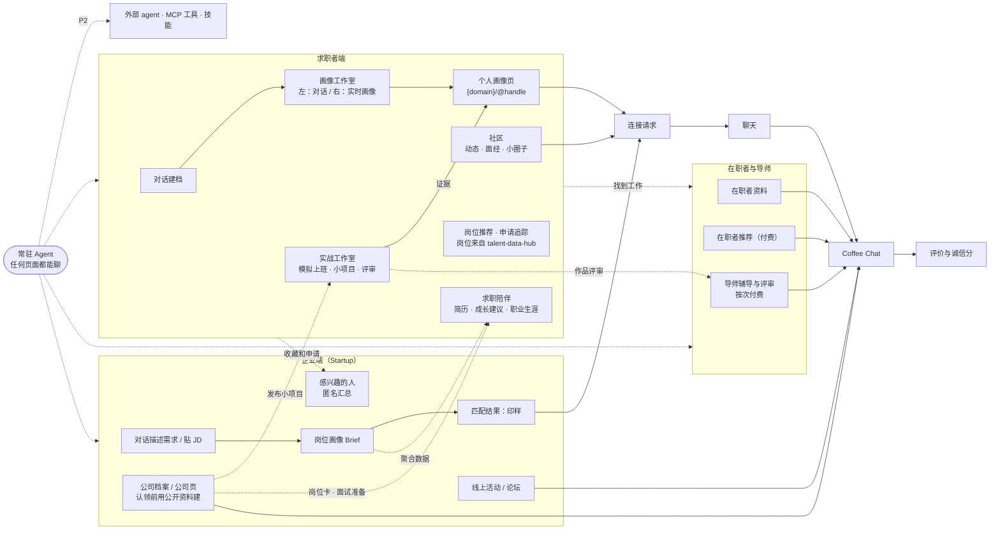

# Portrait（暂定代号）产品需求文档 PRD

| 项 | 内容 |
|---|---|
| 版本 | v0.5（草案，已纳入 2026-11-09 的人群、实战工作室、导师和社区决策，以及 2026-11-13 确认的企业端方向：公司档案引擎与认领） |
| 日期 | 2026-11-13 |
| 范围 | MVP 完整需求 + 面向规模化的演进方向 |
| 配套文档 | [Agent 设计](agent-design.md) · [前端设计简报（交给 Claude Design）](design-brief.md) · [技术架构与后端方案](architecture.md) |

> "Portrait" 只是文档里的代号，取"个人画像"之意；正式品牌名和域名待定。文中 `{domain}` 指我们的域名。

---

## 0. 一句话定义

一个会"采访"人的 AI：通过对话理解每一位求职者，把 TA 画成一张**独一无二、每句话都有出处**的个人画像页（`{domain}/@handle`）。Startup 用自然语言说出想要什么样的人，同一个 agent 帮他们找到、读懂并联系上这些人。

agent 随时都能聊，是求职者的长期伙伴：陪 TA 持续更新简历、找出该怎么提升。找到工作后，TA 可以解锁"在职者"身份，为后来的人提供 coffee chat 和内推。

---

## 1. 背景与机会

### 1.1 求职者的问题

- **简历是有损压缩。** 一页纸加模板，最能区分一个人的东西（做事方式、关键决策、动机、少见的能力组合）几乎都被挤掉了。
- **会写简历的和能做事的，不是同一批人。** 没有大厂实习、非名校、不擅长英文自我表达的学生（尤其是国际学生）在简历筛选里系统性吃亏。
- **个人主页门槛高。** 作品集网站要会设计、会写文案；LinkedIn 偏"出身标签"，大家的主页长得都差不多。

### 1.2 Startup 的问题

- 早期公司招第一批工程师或实习生时没有招聘团队，创始人亲自筛人，时间成本极高。
- 雇主品牌弱，拼不过大厂；职位板上的海投申请信号很低。
- 他们真正想看的是**有证据的能力**和**做事方式合不合得来**，而不是学校和公司 logo。

### 1.3 为什么是现在

- 大模型已经能做高质量的深度访谈、结构化抽取、带出处的推理，"聊天即建档"第一次真正可行。
- 生成式 UI 让"每人一页、各不相同、但都好看"在成本上可行。

---

## 2. 关键假设与已确认决策

2026-10-19 已确认首发市场、会员形式、默认可见性和学校筛选的方向；2026-11-09 确认两类核心人群并列、取消内推订阅；2026-11-13 确认企业端以"公司档案引擎 + 认领"为核心（见 [§16 决策记录](#16-决策记录)）。

| # | 项目 | 结论 | 状态 |
|---|---|---|---|
| A1 | 首发市场 | 北美（以美国为主）；首批人群见 A3 | 已确认 |
| A2 | 语言 | 界面英文为主，支持简体中文；agent 跟随用户的语言对话；画像页可生成英文、中文或双语版。对国际学生是关键卖点："用母语聊，拿到一页地道的英文主页" | 假设，待确认 |
| A3 | 求职者范围 | 产品面向所有求职者。两类核心人群并列、不分先后：① 在校大学生和应届毕业生（含中国留学生等国际学生）；② 被裁或想换方向的有经验白领。两类人共用一个核心（证据画像、先写上再补齐、真人引荐、结果透明），各有专属模块（见 4.1）。在职想换方向的人需要"对现雇主隐藏"（PRIV-07） | 已确认（2026-11-09） |
| A4 | 企业范围 | 公司档案覆盖所有公司（用公开岗位数据建，求职者用得上，见 CO-09）。"认领并招人"MVP 只开放早期 startup（Pre-seed 至 Series B，≤150 人），需通过验证；大公司进 waitlist，但可以对自己的公司档案报错或申请下线。具体人数和融资阶段的界线仍待定（§14 第 3 条） | 已确认（2026-11-13） |
| A5 | 会员 | 企业端、求职者端各自有付费会员；导师辅导按次付费，在职者推荐是付费订阅；内推本身永远免费，不卖内推（2026-11-09 取消内推订阅，见 7.10） | 已确认 |
| A6 | 默认可见性 | 新用户默认"匿名可发现"（见 7.4） | 已确认 |
| A7 | 学校筛选 | 不禁止企业按学校筛选；具体形式后续决定（见 MATCH-10） | 方向已定，细节待定 |
| A8 | 信息来源 | 个人信息只收录本人创建或授权的，不做爬取（见原则 1）。公司信息另算：公司档案只用公司自己公开发布的招聘信息和公共记录，经 talent-data-hub 取得，不收录员工的个人资料，不用员工评价网站（见原则 8、CO-09） | 产品原则 |

---

## 3. 目标与非目标

### 3.1 MVP 要验证的三件事

1. **供给**：求职者愿意通过对话建立画像，并把链接分享出去。
2. **需求**：startup 愿意用自然语言描述需求，并主动联系推荐给他们的人。
3. **连接**：双方真的聊起来，连接请求被接受，coffee chat 真的发生。

### 3.2 非目标（MVP 明确不做）

- 不做 ATS（面试安排、评估表、offer 管理）。我们负责"聊上"为止，之后可导出到 ATS。
- 不做海投式职位板，不提供"一键申请 100 个职位"。
- 不爬取、不收录未经本人授权的个人信息（例如批量抓取 LinkedIn）。愿景是"收录尽可能多求职者的画像"，实现路径是让每个人愿意自己来建档。
- 不做自动录用或淘汰决策。AI 只推荐、解释、起草，人做决定。
- 不自建直播和视频通话，MVP 用外部会议链接。
- 不做原生 App，先把移动端 Web 做好。
- 不经手、不出售内推。内推由在职者或导师在自己公司的系统里提交；平台不向任何人支付内推费用，也禁止求职者为内推向在职者或导师付钱或送礼。导师辅导可以收费，但辅导费不包含、也不承诺内推（见 7.15）。

---

## 4. 用户与场景

### 4.1 求职者（Talent）：两类核心人群

应届生和有经验的转换者并列为第一批核心人群，不分先后（2026-11-09 确认）。两类人共用一个核心：可信的证据画像、先写上再补齐、真人引荐、结果透明；各自再加专属模块。

| | 应届生（含国际学生） | 有经验的转换者（被裁、想换方向） |
|---|---|---|
| 最大的痛 | 没有相关经验；入门岗位里的练手活有一部分被 AI 接手；不懂职场的做事方式 | 简历漏掉很多真实成绩（Huntr 2026 年三季度调查里 88% 这么说）；不知道能转去哪；孤独 |
| 专属模块 | 实战工作室（7.18）、第一份工作的过渡（COACH-08）、导师评审（MENTOR-03） | 方向诊断（COACH-02）、经历翻译（把老行业的经历讲成新岗位能看懂的话）、在职者引荐（7.15）、裁员安置席位（7.10） |
| 谁付钱 | 招聘方（引荐、发布小项目）、导师辅导、以后加学校 | 前雇主（安置席位）、招聘方、可选 Pro |

**应届生**

| 代表用户 | 描述 | 核心诉求 |
|---|---|---|
| Lin，CS 大三，中国留学生 | 有两个不错的项目，没有大厂实习；英文自我表达不自信；关心 CPT/OPT | 真实能力被看见；拿到一页拿得出手的英文主页；找 startup 实习 |
| Maya，交互设计应届生 | 作品多，但案例写得少；想展示过程而不只是结果 | 好看的作品集页；匿名分享案例、收集反馈 |
| Alex，转专业或自学者 | Bootcamp 加 side projects，学历标签不占优 | 按作品和证据被评估，而不是按出身 |

**有经验的转换者**

| 代表用户 | 描述 | 核心诉求 |
|---|---|---|
| Chen，被裁的产品经理 | 8 年经验，在一轮裁员里被裁；简历只写了头衔和几个数字，带团队、救火这些经历都没写 | 把做过的事讲清楚、讲出证据；尽快被真人看到；不想一个人扛 |
| Wei，四大审计 3 年 | 在职，想转产品或数据分析；不想让现雇主知道 | 知道自己能转去哪、差什么；补上证据；对现雇主保密 |

### 4.2 Startup（Company，即"企业端"）

| 代表用户 | 描述 | 核心诉求 |
|---|---|---|
| 种子轮创始人 | 5–20 人，亲自招第一个工程师 | 10 分钟内看到靠谱的人和推荐理由；低成本开聊 |
| A 轮 Head of Talent | 20–100 人，需要持续的候选人来源和雇主品牌 | 批量但精准；办宣讲、AMA 吸引人 |
| 技术负责人（Hiring Manager） | 关心真实能力 | 看证据：代码、项目、做决策的过程 |

### 4.3 在职者与导师（Insider 找到工作后解锁；Mentor 来自导师库）

| 代表用户 | 描述 | 核心诉求 |
|---|---|---|
| Jordan，毕业一年的 SWE | 在一家科技公司工作；记得自己找工作时的艰难，愿意帮学弟学妹；公司有内推奖金 | 花很少的时间，认识背景属实、真正合适的求职者；拓展人脉 |
| 一年后的 Lin | 通过平台拿到工作，从求职者变成在职者 | 回馈后来的人；保留自己的画像和人脉 |
| Priya，大厂资深数据科学家（导师库） | 已经在我们的导师库里，愿意每月花几个小时带新人 | 按次收费的辅导和作品评审；把时间花在认真准备过的人身上；不被看成在卖内推 |

### 4.4 核心 Jobs-to-be-Done

- **求职者**："当我要找实习或工作时，我希望不用苦写简历，也能有一页真正代表我的东西，让对的人主动来找我。"
- **求职者（成长）**："当我还不够有竞争力时，我希望有人告诉我差在哪、先补什么，并陪我一步步做到。"
- **应届生**："当我没有相关经验时，我希望入职前先'上过班'，拿出雇主相信的作品。"
- **有经验的转换者**："当我被裁或想换方向时，我希望把多年做过的事讲清楚，知道自己能转去哪，并尽快被真人看到。"
- **在职的人**："当我在工作时，我希望顺手记下做成的事，下次晋升或求职时直接能用。"
- **想要内推的求职者**："当我想要内推时，我希望有人帮我把材料准备到位，并把我介绍给真正能帮上忙的在职者。"
- **在职者**："当我已经工作了，我愿意帮合适的人内推、拓展人脉，但不想把时间花在背景不实的人身上。"
- **Startup**："当我要招第一批人时，我希望说清楚我要什么样的人，马上看到有证据的候选人，并且低成本地聊上。"

---

## 5. 产品原则

1. **本人授权，本人拥有。** 画像只来自本人提供或授权的信息；本人随时可以编辑、隐藏、导出、删除。企业只能看到本人允许的部分。
2. **证据胜过形容词。** 画像里每一条事实性内容都能追溯到出处（对话原话、简历第几页、哪个链接）。agent 可以润色表达，但不夸大、不编造。
3. **随时能聊，对话即操作。** agent 是常驻的：任何时候、任何页面都能和它聊，它记得你是谁、聊过什么。所有操作都能"说"出来完成，直接点选、改字作为补充。
4. **先被看见，再被认识。** 求职者可以匿名被发现、匿名发动态；双方同意后才揭示身份。
5. **人做决定。** AI 推荐、解释、起草，不自动淘汰任何人；不收集、不推断、不使用年龄、性别、族裔等受保护特征。
6. **设计即差异化。** 前端追求杂志级的完成度，用 [Impeccable](https://impeccable.style) 做设计把关，拒绝"AI 味"模板。
7. **诚信可以被检验。** 内推和评价都建立在真实互动之上：只有真实发生过的 coffee chat 才能评价；被指出不属实的内容，要么补充证据，要么撤下；被评价的人始终有申辩的机会。
8. **公司也讲出处，推断和事实分开。** 公司档案只用公司自己公开发布的内容和公共记录，每条事实带出处和日期。推断（公司怎么说自己的文化、可能需要什么人）和事实分开放并标明，只当草稿；公司认领后可以确认、纠正或隐藏。

---

## 6. 产品全景

### 6.1 模块地图

### 6.2 双边飞轮

画像越多、越丰富 → 匹配越准 → startup 来得越多 → 活动和机会越多 → 更多求职者来建档并分享自己的链接。每一个被分享出去的画像页，本身就是一次拉新（页脚带"Draw yours"入口）。

第二个飞轮来自毕业生：求职者找到工作 → 解锁在职者 → 给后来的学弟学妹 coffee chat 和内推 → 平台对新一届学生更有吸引力。今天的求职者，就是明天的内推人。

第三个来源是整个职业生涯（见 7.14）：用户在职的几年里每月记下成绩，下次转折时画像和证据都还在，所以会第一个回到我们这里。美国员工在一家公司的中位任期是 4.1 年（BLS），一个人一生会经历好几轮求职；大多数求职产品在用户拿到 offer 那天就失去了他。

第四个飞轮把两端连起来，没有企业入驻时也能转（见 7.5）：公司档案在企业来之前就建好，先给求职者用 → 求职者收藏、申请 → 汇成"对这家公司感兴趣的人" → 公司有了来认领的理由 → 认领后确认和补充的信息让档案更准，求职者更愿意看。

### 6.3 信息架构

| 区域 | 路由（建议） | 说明 |
|---|---|---|
| 公共 | `/` | 双入口落地页，核心是一个对话框 |
| | `/@handle` | 个人画像页 |
| | `/c/[slug]` | 公司页：未认领时是由公开资料整理的公司档案（顶部标注"尚未经公司确认"和认领入口）；认领后是公司画像页 |
| | `/e/[id]` | 活动页 |
| | `/p/[id]` | 单条动态 |
| | `/pricing` | 会员与价格 |
| 求职者 | `/studio` | 画像工作室（对话 + 实时画像） |
| | `/feed` | 社区：动态、面经、小圈子 |
| | `/work` | 实战工作室：模拟任务、真实小项目、评审结果 |
| | `/mentors` | 导师：浏览、预约辅导和作品评审 |
| | `/events` | 活动 |
| | `/inbox` | 连接请求 / 消息 / Coffee chat |
| | `/settings/privacy` | 可见性与匿名设置 |
| | `/grow` | 求职陪伴：简历、成长建议与成长计划 |
| | `/referrals` | 内推：核验进度、内推包、向在职者发起的请求（免费） |
| 在职者 | `/insider` | 在职者资料、agent 推荐的求职者、coffee chat 时段、内推记录 |
| 导师 | `/mentor` | 导师资料、可约时段、待评审的作品、收入和结果数据 |
| 所有角色 | （全局） | 常驻 agent 对话入口，见 6.4 |
| 企业 | `/hire` | 招聘需求工作室（对话 + 岗位画像） |
| | `/hire/[briefId]` | 匹配结果（印样） |
| | `/hire/[briefId]/[candidateId]` | 候选人画像 + 匹配说明 |
| | `/company` | 公司工作室：认领、确认和补充公司档案、招聘假设（7.5） |
| | `/company/events` | 活动管理 |
| | `/company/projects` | 发布实战小项目、确认交付（7.18） |
| | `/company/settings` | 团队与账单 |
| 运营 | `/admin` | 审核、企业认证、用户管理 |

### 6.4 常驻 Agent

agent 是整个产品的核心界面，**任何时候、任何页面都能和它聊**：

- **始终在线**：求职者、在职者、企业成员登录后，每个页面都有固定的对话入口（桌面端是侧边面板，移动端是底部按钮）。在画像工作室、Brief 工作室、成长计划页，对话就是左侧主栏。
- **一条连续的对话**：用户看到的是一条不断延续的对话时间线，跨设备同步；agent 记得用户的画像（或企业的 Brief）、目标和之前聊过的事。
- **懂当前页面**：在候选人页问"这个人适合我们吗"，在活动页问"值得去吗"，agent 会带上当前页面的上下文来回答。
- **能代办**：起草消息、预约 coffee chat、报名活动、修改画像或 Brief。涉及对外发送、付费或公开的操作，必须用户确认后才执行。
- **能扩展**：将来可以接入外部工具和技能，并和别的 agent 对话协作（见 7.17）。

---

## 7. 功能需求

优先级：**P0** = MVP 必须；**P1** = MVP 后 1–3 个月；**P2** = 之后；**待定** = 方向已定，细节和优先级后续决定。

### 7.1 入口、账号与身份

落地页只有一个对话框，加一句可切换的话："I'm looking for **work** / **people**"。选 work 进入求职者对话，选 people 进入企业对话。**不注册就能开始聊**，在用户第一次看到价值的那一刻（画像草稿生成、匹配预览出现）再引导登录。

| ID | 需求 | 优先级 |
|---|---|---|
| ACC-01 | 双入口落地页：一个对话框 + work/people 切换；支持直接拖入简历、粘贴链接 | P0 |
| ACC-02 | 未登录可对话；匿名会话在登录后无损迁移到账号 | P0 |
| ACC-03 | 登录方式：Google、LinkedIn、GitHub、邮箱验证码 | P0 |
| ACC-04 | 认领链接：选择 handle（`{domain}/@handle`），保留字与敏感词过滤；30 天内只能改一次，旧链接自动跳转 | P0 |
| ACC-05 | 企业账号：工作邮箱域名验证 + 人工审核队列（核对官网、公司信息）；通过后显示"已验证"标识。公司页已经存在时走"认领"（CO-10）：邮箱域名和档案里的域名线索对得上，只用来排审核的先后，不能代替人工审核 | P0 |
| ACC-06 | 企业团队：邀请成员，按套餐限制席位，角色为 owner / admin / member | P0 |
| ACC-07 | 年龄门槛：仅限 18 岁以上 | P0 |
| ACC-08 | 学生邮箱（.edu）验证，显示"已验证学生" | P1 |
| ACC-09 | 同一账号同时拥有求职者和企业身份（如创始人也在找合伙人） | P2 |

**验收标准**

- 未登录用户可以完成至少 10 轮对话并看到画像草稿；登录后对话、草稿、上传的文件全部保留。
- 企业未通过验证前，只能看到匹配数量预览，看不到任何候选人详情，也看不到"感兴趣的人"的卡片（CO-12）。

### 7.2 求职者：对话建档与画像工作室（核心）

这是产品的心脏。流程：落地页对话框 → 全屏对话 → agent 生成第一版画像并给出链接（"诞生时刻"）→ 进入**画像工作室**：左边继续和 agent 聊，右边实时看到自己的画像被不断丰富。agent 如何理解一个人，详见 [agent-design.md](agent-design.md)。

| ID | 需求 | 优先级 |
|---|---|---|
| STU-01 | 全屏对话建档：agent 一次只问一个问题，跟随用户语言；支持快捷选项（chips） | P0 |
| STU-02 | 上传简历（PDF/DOCX，≤10MB）、粘贴链接（GitHub、个人网站、作品集、LinkedIn 导出的 PDF）；agent 读完后只追问它不知道的 | P0 |
| STU-03 | **首版画像速度**：上传简历后 60 秒内、或纯对话 5 分钟内，生成第一版画像和链接 | P0 |
| STU-04 | **诞生时刻**：对话栏滑到左侧，右侧画像逐段"排版"出来，顶部出现 `{domain}/@handle` 和认领按钮 | P0 |
| STU-05 | 分屏工作室：左对话、右画像；agent 的每次修改以流式补丁实时应用到右侧，并短暂高亮变化 | P0 |
| STU-06 | 点选即编辑：点击右侧任一区块，对话框出现上下文标签（如"正在编辑：项目 › Campus Eats"），说"写得更简洁"只改这一块 | P0 |
| STU-07 | 直接编辑：区块内可直接改字；改动同样记入版本历史 | P0 |
| STU-08 | 出处脚注：每条事实性内容带脚注标记，悬停显示来源（对话原话、简历页码、链接） | P0 |
| STU-09 | 待确认机制：agent 推断出的内容（技能等级、做事风格等）标记为"待确认"，发布前需逐条或批量确认 | P0 |
| STU-10 | 版本历史：至少保留最近 20 个版本，可一键撤销任一次 agent 修改 | P0 |
| STU-11 | 发布 / 取消发布；复制链接；自动生成分享卡片（OG 图） | P0 |
| STU-12 | 视角切换：公开版 / 匿名版 / startup 看到的版本 | P0 |
| STU-13 | 多语言：可用任意语言聊；画像页可选英文、中文或双语 | P0 |
| STU-14 | "下一步建议"：agent 提示最值得补充的内容（如"给 Campus Eats 加一个演示链接"） | P0 |
| STU-15 | 主题共创：3 套主题预设 × 强调色 × 疏密 × 区块顺序，agent 可一次提出 2–3 个方案 | P1 |
| STU-16 | 每周回访："这周做了什么？"一句话更新画像 | P1 |
| STU-17 | GitHub 深度解析（仓库、语言、贡献占比）作为"已展示"级证据 | P1 |
| STU-18 | 语音对话建档 | P2 |
| STU-19 | 模拟面试与表达辅导 | P2 |

**验收标准**

- 上传简历后 60 秒内，右侧至少出现：标题、经历、技能三个区块的草稿。
- 公开页上每一条事实性内容都能点开看到出处；没有出处的内容不能发布。
- 用户说"把 X 改得更简洁"时，只修改 X 区块，其他内容逐字不变；可一键撤销。
- 刷新页面、断网重连、换设备登录后，对话和画像状态不丢失。
- 用户说"跳过"或"不想说"，agent 不再追问同一话题。

### 7.3 个人画像页（公开页）

画像页是产品的门面，也是增长引擎。它由 agent 生成的**页面规格（Page Spec）**渲染：agent 只能在设计系统允许的组件、变体和配色范围内组合，所以每一页都不一样，但都好看、都无障碍。

| ID | 需求 | 优先级 |
|---|---|---|
| PAGE-01 | 地址 `{domain}/@handle`；区块包括：开场（名字、一句话、当前状态）、签名段、三个超能力、经历、作品、做事方式、在找什么、最近动态、"可以问我"；按 Page Spec 渲染 | P0 |
| PAGE-02 | 移动端优先：大多数分享链接会在手机上打开 | P0 |
| PAGE-03 | 行动按钮：约 coffee chat、发消息（需登录）、收藏 | P0 |
| PAGE-04 | 默认 `noindex`，本人可选择允许搜索引擎收录 | P0 |
| PAGE-05 | 页脚 "Drawn with {品牌} · Draw yours" | P0 |
| PAGE-06 | 企业从匹配结果进入时，右侧显示"匹配说明"面板（见 7.6） | P0 |
| PAGE-09 | 访问统计（哪些公司看过，按公司聚合） | P1 |
| PAGE-11 | 实名模式下可选上传头像照片和 15 秒语音或视频自我介绍；匿名模式不显示；企业的匹配列表默认不显示照片；照片永不进入匹配特征 | P0（照片）/ P1（语音、视频） |
| PAGE-10 | 自定义域名（Pro） | P2 |

**验收标准**

- 移动端（4G）LCP < 2.0s，CLS < 0.05。
- 分享到 LinkedIn、X、iMessage、微信时显示正确的分享卡片（名字 + 一句话标题，纯文字排版）。

### 7.4 隐私、可见性与匿名

新用户的默认可见性是**匿名可发现**。首次发布前会展示一次可见性设置，说明每种模式下谁能看到什么；用户可以直接确认，也可以改成其他模式。

| 模式 | 公开链接 | 出现在企业搜索中 | 企业看到什么 |
|---|---|---|---|
| 公开 | 任何人可访问（可选是否被搜索引擎收录） | 是 | 实名完整画像 |
| **匿名可发现（默认）** | 只有拿到链接的人可访问（`noindex`） | 是 | 匿名版画像：化名 + 语境标签，机构名泛化，隐藏链接和联系方式；接受连接后才揭示身份 |
| 仅链接 | 只有拿到链接的人可访问 | 否 | — |
| 隐藏 | 不可访问 | 否 | — |

| ID | 需求 | 优先级 |
|---|---|---|
| PRIV-01 | 四种可见性模式，新用户默认"匿名可发现"；任何时候可切换；切换前展示"谁能看到什么"的实时预览 | P0 |
| PRIV-02 | 字段级控制：签证需求、薪资期望、联系方式等敏感字段可设为"仅用于匹配，不展示" / "接受连接后展示" / "公开" | P0 |
| PRIV-03 | 匿名版画像由专门的匿名化流程生成：去名字和链接，机构名泛化（如"加州的一所公立研究型大学"），项目名改成描述，数字取整，文案重写以避免和公开版逐字相同 | P0 |
| PRIV-04 | 匿名化风险检查：agent 评估"能否通过搜索认出这个人"，高风险条目默认隐藏并提示本人 | P0 |
| PRIV-05 | 化名与实名之间没有可关联的字段：化名名称随机生成，**不能**由真实姓名或画像内容推导 | P0 |
| PRIV-06 | 数据导出（JSON + PDF）与账号删除；MVP 可走工单，30 天内完成 | P0 |
| PRIV-07 | 屏蔽指定公司（如现雇主），被屏蔽公司搜不到也看不到。本人填写的现雇主默认屏蔽，在"感兴趣的人"（CO-12）和匹配里都不出现本人；这一条默认屏蔽随 CO-12 一起做，是 P0 | P1 |
| PRIV-08 | 查看哪些公司看过我的画像（访问审计） | P1 |
| PRIV-09 | 导出和删除全自助 | P1 |

**验收标准**

- 匿名模式下，企业侧任何接口返回的数据都不包含姓名、handle、外链、联系方式（以接口测试验证，不只是前端隐藏）。
- 匿名版和公开版的文案在 8 字以上的连续片段上不重合（自动检测）。
- 用户被明确告知：匿名是"尽力而为"，如果自己把公开链接到处分享，别人仍可能对上号。

### 7.5 企业端：公司档案、认领与岗位画像（Brief）

企业端是求职者端的镜像：同样是"左边对话、右边一份活的文档"。不同的是，第一份文档在企业来之前就已经有了。**公司档案引擎**用公司自己公开发布的招聘信息和公共记录，先为每家公司建一份带出处的**公司档案**，先给求职者用：岗位推荐卡、面试准备、"你为什么适合这家"。企业来了之后**认领**它，逐条确认或纠正，档案就成了**公司画像**（给求职者看，帮 startup 建立雇主品牌）。第二份文档是**岗位画像 Brief**（给 agent 匹配用），由 agent 先提出**招聘假设**，企业选一条再补全。创始人第一次打开时看到的不是空表单，而是"这是我们从你们公开的 23 个岗位里读到的，哪里不对？"。

| ID | 需求 | 优先级 |
|---|---|---|
| CO-01 | 公司画像：在公司档案（CO-09）的基础上，创始人确认或修改使命、产品、阶段、团队规模、技术栈、文化、福利，确认后发布到 `/c/[slug]`；还没有档案的公司贴官网链接，由 agent 起草 | P0 |
| CO-02 | 岗位画像：用对话或粘贴 JD 生成结构化 Brief（必须项、加分项、看重的信号、硬性条件、团队背景），每条必须项附"为什么" | P0 |
| CO-03 | 追问澄清：把模糊要求变具体（"很强的工程师"→"之前独立上线过什么"）；指出相互冲突的条件 | P0 |
| CO-04 | 实时人才池预览："符合基本条件约 124 人，强匹配 18 人"；放宽某条件会怎样变化 | P0 |
| CO-05 | 公平护栏：拒绝按年龄、性别、族裔、宗教、婚育、残障等筛选；识别代理性表述（如 "native speaker"、"young and energetic"）并建议改为能力描述 | P0 |
| CO-06 | Brief 可设为私密（仅用于匹配）或公开（作为开放职位展示在公司页） | P0 |
| CO-07 | 多个 Brief、模板、团队协作编辑 | P1 |
| CO-08 | 保存的搜索 + 新匹配每日摘要 | P1 |
| CO-09 | 公司档案引擎：公司来之前就建档。事实来自这家公司的全部公开岗位（在招和已关闭的岗位、公布的薪资、地点、岗位描述原文）和公共记录（美国劳工部签证申报里的行业、人数、LCA 和 PERM 数量），每条带出处链接和日期。"公司怎么说自己"只引用公司自己的原话（先用岗位描述；官网内容等认领后或感兴趣的人数达标后再加），和事实分开放，标明"从公开资料推断"。未认领的公司页顶部标注"由公开资料整理，尚未经公司确认"，前期只在平台内显示（`noindex`，见 §14 第 21 条） | P0 |
| CO-10 | 认领与纠错：用工作邮箱提交认领，全部经过人工审核（ACC-05、ADM-01）。通过后可以逐条确认、修改或隐藏档案里的推断，上传资料（融资 deck、员工手册、面试流程、旧 JD）或接已有的连接器；每部分标明"公开给候选人"或"仅用于匹配"。任何人都可以对档案报错（ADM-07）；公司可以申请下线未认领页，下线后只保留公开岗位列表 | P0 |
| CO-11 | 招聘假设：agent 根据公开岗位的变化提出 2–3 条"你们可能需要"的铅笔草稿，每条写明依据（最近 90 天发了哪些岗、哪个岗开了多少天、哪些岗可能是重发）。企业点"对"、修改或不要；选中的一条再答 2–3 个追问就成为 Brief（CO-02、CO-03）。未经企业确认的假设不对任何人展示 | P0 |
| CO-12 | 感兴趣的人：把求职者对这家公司岗位的收藏和"已去申请"（求职者端岗位推荐里的操作）按公司汇总。通过验证的公司看到人数和匿名卡片（匿名版画像，PRIV-03），人数不到 k 人时不显示；身份只在本人同意连接后揭示；本人填写的现雇主永远看不到本人（PRIV-07）。求职者能看到自己被算进了哪些公司的"感兴趣的人"，可以随时退出 | P0 |
| CO-13 | 温池：对公司感兴趣但暂时没有合适岗位的人、上次聊到最后一轮的人，留在这家公司的温池里；他们的画像更新时提醒企业；本人随时可以退出 | P1 |
| CO-14 | 招聘审美记忆：企业的 agent 记住每次圈选和划掉的理由（MATCH-05、MATCH-06），跨 Brief 生效，企业可以查看和删除。理由里出现受保护特征或代理性表述时不进记忆，并提醒（CO-05） | P1 |
| CO-15 | 市场位置报告：企业自己的岗位在公开市场上的位置，包括同类岗位公布的薪资区间和开放天数。只用公开岗位的汇总，写明样本数，不估算，不暴露其他企业的私密 Brief。依赖 talent-data-hub 的职业分类和城市字段 | P1 |
| CO-16 | 双方 agent 预先问答：企业的 agent 在候选人允许的范围内向候选人的 agent 提问（可入职时间、是否接受混合办公），答案只来自本人确认过的画像，对话双方都能看到（ECO-05、ECO-06） | P2 |

**数据从哪来，边界在哪。** 岗位数据只通过 talent-data-hub 带版本的读取 API 取得，不读它的数据库，我们的应用也不自己抓取公司网站。它的数据里没有"公司"这个实体（截至 2026-11-12 的公开契约 1.0.0），所以雇主表建在我们这边：一家公司对应哪些招聘看板、哪些域名经过了人工审核，先按"招聘系统 + 账号"归并。广泛搜索岗位优先用 talent-data-hub 自己的搜索服务（计划用 OpenSearch 做）；企业端只保存已建档公司的岗位。talent-data-hub 移除一个岗位时，我们删掉它和所有引用它的档案事实、招聘假设和汇总数字，只隐藏不算。薪资只显示公司公布的原文。

**验收标准**

- 粘贴一段普通 JD 后 30 秒内生成可编辑的 Brief，且至少提出 2 个澄清问题。
- 输入"只要 25 岁以下"之类的要求时，agent 明确拒绝并给出替代建议，Brief 中不出现该条件。
- 在 30 家公司的评测集上，公司档案里的事实性条目都能点开出处，人工核对的准确率 ≥ 95%，编造为 0；推断类条目全部带"推断"标注。
- 未认领的公司页带 `noindex`，不出现在站点地图里。
- talent-data-hub 移除一个岗位后 24 小时内，引用它的档案事实、招聘假设和汇总数字被删除或重算（以测试验证）。
- 未通过验证的企业账号调用任何接口都拿不到"感兴趣的人"的卡片；人数不到 k 人时接口不返回人数；本人填写的现雇主调用企业侧任何接口都拿不到本人的匿名卡片（以接口测试验证）。

### 7.6 匹配与人才发现（印样 Contact Sheet）

匹配结果借用摄影里"印样"的隐喻：一张张候选人卡片排开，创始人用红笔圈出想聊的人。匹配逻辑详见 [agent-design.md §8](agent-design.md#8-匹配引擎)。

| ID | 需求 | 优先级 |
|---|---|---|
| MATCH-01 | 按 Brief 给出排序后的候选人列表；每张卡片包括：身份（按候选人可见性显示实名或化名）、一句话、**3 条带出处的推荐理由**、每个必须项的满足情况、对方可能感兴趣的程度、可入职时间 | P0 |
| MATCH-02 | 每个推荐必须有解释；解释里引用的证据必须真实存在（后端校验） | P0 |
| MATCH-03 | "潜在顾虑"和"建议在 coffee chat 中问的问题" | P0 |
| MATCH-04 | 筛选：岗位类型、可入职时间、地点/远程、工作许可兼容（仅当候选人允许用于匹配）、毕业年份；在可发现人群中关键词搜索 | P0 |
| MATCH-05 | 操作：圈选（加入候选名单）、划掉（附原因）、查看画像、发起连接 | P0 |
| MATCH-06 | 反馈学习：圈选和划掉的原因实时调整该 Brief 的排序 | P0 |
| MATCH-07 | 曝光保护：同一候选人每周收到的连接请求有上限；排序中加入适度的曝光均衡，避免所有公司都只看到同一批人 | P0 |
| MATCH-08 | 团队备注、候选人对比视图 | P1 |
| MATCH-09 | 基于真实结果（回复、coffee chat、录用）训练排序模型 | P2 |
| MATCH-10 | 按学校筛选：不禁止；作为筛选条件、是否参与排序、在印样上如何展示，后续决定 | 待定 |

**验收标准**

- 从 Brief 确认到看到第一屏匹配结果 ≤ 20 秒（首屏可先展示检索结果，再流式补充解释）。
- 设计伙伴 startup 对前 10 名的人工评分中，"愿意联系"的比例 ≥ 50%（MVP 质量门槛）。

### 7.7 连接：连接请求、聊天、Coffee Chat

| ID | 需求 | 优先级 |
|---|---|---|
| CONN-01 | 企业 → 求职者的连接请求：附言（agent 根据匹配理由起草，可修改）、关联的 Brief、类型（聊天 / coffee chat）；14 天未回复自动过期 | P0 |
| CONN-02 | 求职者可接受、婉拒（可选原因）、稍后再说；接受后揭示身份（匿名模式）并开启对话 | P0 |
| CONN-03 | 求职者 → 企业：在公司页、职位、活动页表达"感兴趣"；预约创始人的 **Office Hours**（startup 每周开放的 coffee chat 时段，每位求职者每周可约次数有上限） | P0 |
| CONN-04 | 1 对 1 消息：文字、链接、附件（PDF/图片 ≤10MB）、已读状态、举报、屏蔽；邮件通知合并发送 | P0 |
| CONN-05 | Coffee chat 预约：一方提出最多 3 个时间或从对方的空闲时段直接选；自动处理双方时区；确认后发送日历邀请（.ics）和会议链接（主持方提供或自动生成）；提前 24 小时和 1 小时提醒；改期、取消 | P0 |
| CONN-06 | Coffee chat 之后一键反馈："聊了吗？还想继续吗？"（用于匹配学习，不公开） | P0 |
| CONN-07 | 额度：每个连接请求消耗 1 个额度，按套餐每月发放 | P0 |
| CONN-08 | Coffee chat 前，agent 分别给双方准备简报（对方是谁、可以聊什么） | P1 |
| CONN-09 | 连接 Google 日历：读取空闲时间、自动生成 Meet 链接 | P1 |
| CONN-10 | 14 天未获回复的连接请求退还额度 | P1 |
| CONN-11 | 原生视频通话、群聊、熟人引荐 | P2 |

**反骚扰与反诈骗（P0）**：新企业账号每天最多 10 个连接请求；首条消息内容审核；识别"要求付费"、"站外转账"、可疑链接等诈骗特征并提醒求职者；举报入口始终可见。

**验收标准**

- 从企业发出请求到求职者接受、约定时间，全程不需要离开平台、不需要交换邮箱。
- 所有时间在双方界面上都以各自的本地时区显示，并注明对方时区。

### 7.8 社区：动态、面经与小圈子（可匿名发布）

目的：降低展示门槛，让大家愿意在这里分享自己做的东西；同时让 startup 能通过作品发现人，而不是通过出身。

我们不做第二个 Reddit。现有社区各有一个大问题：Reddit 以吐槽为主、建议真假难辨；一亩三分地的面经很多要积分才能看，而且只服务中文圈；LinkedIn 实名导致只能"表演"，没人敢说自己找得很难；Blind 戏气重、偏重大厂。我们的做法是**验证过的化名、和真实结果挂钩的内容、小圈子**。顺序上先做结构化面经和公司回复率榜（FEED-14、FEED-15），因为它们直接长在求职记录（COACH-07）上，不需要先有很多人；大广场式的动态放到最后。

| ID | 需求 | 优先级 |
|---|---|---|
| FEED-01 | 发布类型：文字、图片（≤4 张）、链接（自动预览）、项目展示（标题、图、链接、标签）、提问/讨论、"在找队友" | P0 |
| FEED-02 | 发布身份可选：实名 / 化名 / 公司（企业成员） | P0 |
| FEED-03 | 化名：每个用户一个稳定化名（随机生成的名字），可附加自选的非识别性语境标签（如"CS · 大三 · 湾区"）；化名可积累关注和互动；暂不使用头像图形 | P0 |
| FEED-04 | 匿名体检：以化名发布前，agent 检查内容是否会暴露身份（学校名、项目名、可搜索到的原文等）并提示 | P0 |
| FEED-05 | 互动：共鸣（点赞）、评论（可用化名）、关注（人、化名、公司）、分享、举报 | P0 |
| FEED-06 | 企业可对化名动态发起"邀请聊聊"；对方接受后才揭示身份 | P0 |
| FEED-07 | Tab：For you（MVP：时间 + 互动 + 话题匹配）、Following、Events | P0 |
| FEED-08 | 内容审核：发布前自动筛查（垃圾广告、骚扰、仇恨、色情、人肉/隐私泄露、泄露公司机密、诈骗），举报队列，频率限制，社区规范 | P0 |
| FEED-09 | 化名发帖不得点名攻击具体个人（社区规范 + 自动识别） | P0 |
| FEED-10 | 一键把"项目展示"动态加入画像的作品区 | P1 |
| FEED-11 | 每周话题和提示（"这周你做了什么？"）、话题频道 | P1 |
| FEED-12 | 个性化排序、创作者数据 | P2 |
| FEED-13 | 验证标签：化名可以附带"已验证学生"（学校邮箱）或"已验证在职"（公司邮箱，见 INS-01）标签；对外只显示类别，公司或学校按 PRIV-03 的规则泛化（如"已验证 · 在一家大型科技公司"），不显示能认出本人的信息 | P1 |
| FEED-14 | 结构化面经：面试结束后，从求职记录（COACH-07）一键生成面经，字段包括公司、岗位、轮次、题目类型和要点、多久回复、结果；发布前自动去掉能认出本人的信息并做匿名体检（FEED-04）；题目只写类型和要点，不鼓励逐字公开受保密约定的题目；基础内容全部免费，不设积分墙 | P1 |
| FEED-15 | 公司回复率榜：汇总用户自愿贡献的求职记录（投递到第一次回复的天数、面试后有没有回复、是否给了原因），按公司展示；每家公司至少有 k 位不同用户的数据才显示（k 默认 10，可调），只显示汇总数字；公司可以查看自己的数据并公开回应 | P1 |
| FEED-16 | 小圈子：6 到 10 个处境相同的人一组（如"2026 届数据分析""湾区被裁的产品经理"），用化名；每周一次 agent 主持的复盘（这周做了什么、卡在哪、下周做什么）；可以随时退出或换组。小圈子主要解决孤独和坚持，不承诺找到工作：密歇根大学 JOBS 项目的随机试验里，小组求职辅导明显减少了抑郁症状，但长期就业效果不显著 | P1 |
| FEED-17 | 求助变成行动：提问帖下，agent 把有用的回答整理成"下一步"，用户可以一键加进自己的成长计划（COACH-05） | P2 |
| FEED-18 | 导师和在职者答疑：导师定期开 office hours 和 AMA，回答可以用实名或"已验证"化名；回答被采纳和评价的情况进入导师的评分（RATE-09） | P2 |

**验收标准**

- 平台以外的人无法从化名推断出实名（化名、语境标签与实名画像之间没有可直接关联的字段）；平台内部保留关联以便审核。
- 违规内容（按测试集）发布前拦截率 ≥ 90%，误拦率 ≤ 3%。
- 公司回复率榜上任何一个数字都来自至少 k 位不同用户；从榜单和面经里无法反推出某一位用户的某一次投递。
- 小圈子的复盘内容只对圈内成员可见，不进入企业端的任何接口。

### 7.9 Startup 线上活动与论坛

让 startup 定期办线上宣讲、AMA、技术分享、圆桌论坛来吸引求职者；平台也定期办多家 startup 联合的 Showcase Night 作为增长活动。

| ID | 需求 | 优先级 |
|---|---|---|
| EVT-01 | 活动类型：公司介绍（宣讲）、AMA、技术分享、圆桌/论坛、联合 Showcase | P0 |
| EVT-02 | 创建：agent 根据公司画像起草（"下周四晚 6 点办一场关于创始工程师岗位的 AMA"），可修改；支持周期性系列（每周/双周/每月） | P0 |
| EVT-03 | 字段：标题、描述、议程、时间（时区）、时长、容量、目标人群标签、主持人、封面（可由品牌色生成）、外部会议链接（Zoom/Meet/YouTube 等） | P0 |
| EVT-04 | 发现：活动列表（按周）、筛选、根据画像推荐 | P0 |
| EVT-05 | 报名：一键报名；可选"把我的画像分享给主办方"（默认关闭）；加入日历；提前 24 小时和 1 小时提醒；开始前 10 分钟显示入会按钮 | P0 |
| EVT-06 | 论坛：活动页自带讨论区，会前收集问题、会后继续讨论；问题可投票（可用化名） | P0 |
| EVT-07 | 主办方后台：报名人数、愿意分享画像的报名者、问题列表；会后可给参与者发 1 条消息 | P0 |
| EVT-08 | 回放、精彩片段、会后人才池、联合主办、活动数据 | P1 |
| EVT-09 | 原生直播：实时问答、投票、"举手约 coffee chat" | P2 |

**验收标准**

- 主办方从说一句话到发布活动 ≤ 3 分钟。
- 主办方只能看到主动选择分享画像的报名者的画像。

### 7.10 会员与付费

价格均为假设，需通过设计伙伴访谈验证。原则：**求职者的核心功能永远免费**；任何付费曝光都必须对企业明确标注；不使用虚假稀缺等暗黑模式；**不卖内推**：任何付费项目都不包含、不承诺、也不能加速内推，内推永远免费，由在职者或导师自己决定（2026-11-09 取消内推订阅，原因见 7.15）。

| 套餐 | 面向 | 价格（假设） | 内容 |
|---|---|---|---|
| Free | 求职者 | $0 | 对话建档、画像页、动态、接收连接、活动、coffee chat |
| Pro | 求职者 | $8–12/月 | 高级主题与自定义域名、访问统计、PDF 简历导出、每周更多 Office Hours 预约、多语言版本 |
| Free | Startup | $0 | 认领公司页和公司档案、公司画像、1 个 Brief、"感兴趣的人"的人数和匿名卡片、查看前 10 个匹配（匿名）、每月 3 个连接请求、每月 1 场活动 |
| Startup | Startup | $99–199/月 | 3 个 Brief、完整匹配列表、每月 40 个连接额度、无限活动、Office Hours、3 个席位、保存的搜索 |
| Growth | Startup | $399+/月 | 10 个 Brief、150 个额度、10 个席位、活动推荐位、ATS 导出、数据看板 |
| 导师辅导 | 求职者（按次） | 价格由导师定，参考区间待定（ArgoLand 现有 60 分钟导师课 $299）；平台分成待定 | 1 小时辅导或一次作品评审；不包含、不承诺内推（见 7.15） |
| 在职者推荐 | 在职者 | $9–19/月 | agent 每周推荐已核验、值得约 coffee chat 的求职者，附理由、证据和诚信分；可直接发起 coffee chat（见 7.15） |
| 裁员安置席位 | 裁员的公司（HR） | 每位被裁员工 $199–499（假设）；传统再就业服务 RiseSmart 每人 $899–6,499，LHH 约 $2,400–10,000 | 被裁员工本人免费使用 3 到 6 个月，含全部求职功能和若干次导师辅导额度；公司只看到汇总的使用和结果数据 |

| ID | 需求 | 优先级 |
|---|---|---|
| BILL-01 | Startup 套餐订阅：Stripe Checkout 支付，Customer Portal 管理；发票 | P0 |
| BILL-02 | 套餐额度在后端强制执行（Brief 数、连接额度、席位、活动数） | P0 |
| BILL-03 | 额度账本：所有增减记录可追溯（只追加、不修改） | P0 |
| BILL-04 | 付款失败 7 天宽限期，之后降级为 Free | P0 |
| BILL-05 | 求职者 Pro、额度加购包、年付、Growth 套餐 | P1 |
| BILL-06 | 企业为活动参与者赠送 Pro、按成功录用收费 | P2 |
| BILL-07 | 导师辅导按次付费，并给导师分账（Stripe Connect）；在职者推荐订阅；权益和次数在后端强制执行；付款页、收据和条款写明"不包含、不承诺内推" | P1 |
| BILL-08 | 裁员安置席位：公司按人数购买，给每位员工发邀请码；员工用自己的账号激活，离开公司后照常使用；公司只能看到"激活了多少人、多少人拿到了面试和 offer"这类汇总数字（少于 5 人时不显示结果数字），看不到任何个人的画像、对话或求职记录 | P2 |

### 7.11 通知

| ID | 需求 | 优先级 |
|---|---|---|
| NOTI-01 | 站内通知 + 邮件：收到连接请求、请求被接受、新消息（合并发送）、coffee chat 确认与提醒、活动提醒、新匹配每日摘要 | P0 |
| NOTI-02 | 通知偏好设置与免打扰时段 | P0 |
| NOTI-03 | Web Push | P1 |

### 7.12 信任与安全

| ID | 需求 | 优先级 |
|---|---|---|
| TS-01 | 企业认证（见 ACC-05）与"已验证"标识 | P0 |
| TS-02 | 内容审核：自动筛查 + 举报 + 人工队列；社区规范页 | P0 |
| TS-03 | 诈骗识别与提醒（见 7.7） | P0 |
| TS-04 | 企业查看画像的访问日志（审计用，P1 对求职者可见） | P0 |
| TS-05 | AI 透明：告知用户正在与 AI 对话；AI 生成内容有标识；企业可查看"为什么推荐这个人" | P0 |
| TS-06 | 公平：不收集、不推断、不使用受保护特征；定期检查匹配结果的分布 | P0 |
| TS-07 | 上线前法务审查：美国部分州和城市（如纽约市 Local Law 144）对招聘中使用的自动化工具有审计和告知要求，欧盟 AI Act 把招聘类 AI 列为高风险。MVP 定位为"人主导的搜索与推荐工具"，不做自动决策，但仍需确认。内推网络上线前另需评估：诚信分如果提供给企业用于招聘决策，可能落入美国 FCRA（《公平信用报告法》）对"消费者报告"的规定；各公司也有自己的内推政策 | P0 |

### 7.13 运营后台

| ID | 需求 | 优先级 |
|---|---|---|
| ADM-01 | 企业认证审核队列 | P0 |
| ADM-02 | 内容审核队列（动态、评论、消息举报），处理动作：删除、警告、封禁 | P0 |
| ADM-03 | 用户与公司检索；封禁和解封 | P0 |
| ADM-04 | 功能开关、手动调整额度（留痕） | P0 |
| ADM-05 | 基础指标看板 | P0 |
| ADM-06 | 在职者验证、内推资质核验、评价申诉与"不属实"争议的审核队列 | P1 |
| ADM-07 | 公司档案的报错和下线申请队列（CO-10）：核对后改正、隐藏或下线，处理留痕 | P0 |

### 7.14 常驻 Agent、求职陪伴与职业生涯

agent 不只在建档时出现，而是一路陪着用户（见 [6.4](#64-常驻-agent)）：随时可以找它聊简历、聊方向、问"我该怎么提升"。平台上有大量企业的真实需求，所以 agent 能给出有数据支撑的建议；这些数据只以聚合、去标识化的形式使用。

粘性不靠求职期间的打卡，靠两次求职之间我们依然有用。职业生涯分七个阶段，每个阶段都要有回来的理由：

| 阶段 | 我们给什么 | 对应需求 |
|---|---|---|
| 探索方向 | 方向诊断（证据 + 在招岗位 + 真实结果）、实战任务 | COACH-02、7.18 |
| 求职中 | 证据画像、求职记录、真人引荐、每周复盘、小圈子 | 7.2、COACH-07、7.15、FEED-16 |
| 入职后的前 90 天 | 入职教练：30/60/90 天计划、第一次一对一、第一次绩效评估 | COACH-08 |
| 在职成长 | 每月成绩记录（变成画像证据）、晋升材料 | COACH-09 |
| 被动机会 | 画像保持最新，只让强匹配的招聘方和在职者匿名联系 | COACH-11 |
| COACH-12 | 简历编辑器（`/resume`）：传统一页简历，给还要用传统简历的人和场合。左边和 agent 对话（下一版），右边是一页真实的简历，跟着改，也能直接在纸面上改；多个版本（按目标岗位分）、默认版本；模板只做单栏（Standard、Compact）；字体用和 Arial、Calibri、Times、Georgia 等宽的开源字体（Arimo、Carlito、Tinos、Gelasio），PDF 里能嵌入；字号、对齐、Letter/A4；一页适配（自动缩小字号和间距，最低 9pt，还放不下就说还多几行）；区块显隐、排序、增删；联系方式可单独隐藏；撤销/重做；下载的 PDF 和纸面同一套排版。新版本从画像已确认的条目生成；用户手写的内容是本人陈述（同 COACH-01）。agent 只改写已有事实，新的数字、公司、日期要来自简历、画像已确认条目或用户在对话里说过的话，没有就先问；agent 的每处改动标出来，可以单条撤回 | P0 |
| 再次转折 | 一键切回求职模式，画像和证据都在；裁员安置席位 | COACH-10、BILL-08 |
| 回馈 | 成为在职者或导师：答疑、coffee chat、引荐 | 7.15 |

| ID | 需求 | 优先级 |
|---|---|---|
| AGENT-01 | 常驻对话入口：所有角色登录后，每个页面都能唤起 agent（桌面侧边面板、移动底部按钮、快捷键） | P0 |
| AGENT-02 | 连续对话：一条跨设备同步的对话时间线；agent 记得画像或 Brief、目标和历史 | P0 |
| AGENT-03 | 页面上下文：agent 知道用户正在看什么（某位候选人、某场活动、某条动态），回答时带上它 | P0 |
| AGENT-04 | 代办：起草消息、预约 coffee chat、报名活动。按风险分级：对外发送、付费、公开类操作必须用户确认；低风险动作可以由用户预先授权后自动执行，避免每一步都要点确认（修改画像和 Brief 已在 P0 中） | P1 |
| COACH-01 | 简历：从画像一键生成 ATS 友好的 PDF 简历，画像更新后简历同步更新（原 PAGE-08，提到 P0）。**先写上、再补齐**：用户是简历的作者，可以自己写上还没有证据的条目；这些条目在简历预览里标为"本人陈述 · 待补证据"，agent 推荐补证据的办法（WORK-08）；"正在学"的写成真实的说法（如"正在学 SQL，完成了 2 个练习项目"），不写成"熟练" | P0 |
| COACH-02 | 成长建议 v0：用户问"想做 X 岗位我该怎么提升"，agent 基于画像、目标岗位和公开信息（联网搜索）给出差距分析和建议 | P0 |
| COACH-03 | 针对不同岗位生成不同版本的简历 | P1 |
| COACH-04 | 基于平台数据的建议：聚合企业 Brief 中的必须项、加分项，以及哪些证据更容易被圈选和联系，例如"平台上约 60% 的前端实习把'有上线项目'列为必须项"；样本覆盖 ≥ 5 家公司才展示 | P1 |
| COACH-05 | 成长计划：把建议拆成可跟踪的计划项（学什么、做什么项目、补什么证据、参加哪场活动、约哪位在职者），每周回访；完成的计划项自动变成画像里的新条目和证据 | P1 |
| COACH-06 | 推荐平台内资源：相关活动、可以约的在职者和导师、能补证据的实战任务、值得关注的 startup | P1 |
| COACH-07 | 求职记录：记录每一次投递、回复、面试、offer 和拒绝（手动添加；P2 从邮件和日历导入）；agent 每周复盘进展、提醒跟进；第一次使用时问一次是否把去标识化的结果贡献给公司回复率榜（FEED-15）和面经（FEED-14），随时可以改 | P1 |
| COACH-08 | 入职后的前 90 天：用户告诉 agent 拿到 offer 后，agent 切换为入职教练：30/60/90 天计划、第一次一对一怎么准备、第一次绩效评估怎么准备；每两周一次检查 | P1 |
| COACH-09 | 每月成绩记录：在职期间每月一次，agent 花 5 分钟问"这个月做成了什么"；记录变成画像里的新条目（默认"本人陈述"，可以附证据），默认只有本人可见；提醒用户不要记下雇主的机密信息；年度考评和晋升材料可以直接用 | P1 |
| COACH-10 | 一键切回求职模式：被裁或想换工作时，画像、证据和求职记录都还在；agent 先把上次求职以来的成绩记录整理成新版画像和简历草稿，等用户确认 | P1 |
| COACH-11 | 被动机会："不主动找、但愿意听"：只有强匹配、并且符合用户设定条件（岗位、薪资下限、地点）的招聘方能发匿名连接请求；默认屏蔽现雇主（PRIV-07） | P2 |

**验收标准**

- 在任何页面都能在 1 秒内打开对话，看到完整的历史。
- 成长建议中的每条数据结论都标明来源（平台聚合数据、公开资料或通用经验），平台数据附样本规模。
- 任何建议都不会透露某一家公司的私密 Brief 内容。
- 简历由用户做主：agent 起草的内容只来自已确认或已验证的条目；用户自己写上、还没有证据的条目可以保留，但在预览里标出。
- AI 不在用户没说过的情况下加任何事实或数字。编造公司、职位、学历、日期、证书，以及隐藏文本，一律不做，用户要求也不做。
- 给招聘方看的画像（公开页、匿名版、匹配卡片、内推包）只放有证据或本人确认的条目，并标明是哪一种（证据等级，见 WORK-07）。
- 每月成绩记录的条目在用户主动发布之前，不出现在任何对外的页面和接口里。

### 7.15 在职者、导师与内推网络

求职者找到工作后，可以解锁"在职者"身份：和别人约 coffee chat、做 networking、给内推。在职者开通付费的"在职者推荐"后，会像企业端一样收到 agent 推荐的求职者。求职者想要内推，可以免费加入内推池，完成资质核验和内推包后，才会被推荐给在职者和导师。

导师来自我们已有的导师库：一批大厂的真人导师，可以做 1 小时辅导和作品评审，按次收费。导师库是我们最独特的资源之一。

**不卖内推。** Amazon 明确说员工收钱内推违反公司政策，Goldman Sachs 也说这类活动违反行为准则；也有招聘团队发现员工收钱内推后，直接忽略这个员工以后的所有内推。如果我们被看成在卖内推，导师和在职者的内推会失效，名声也会坏。所以用户付钱买的只能是导师的辅导和评审；导师看过用户的证据和作品、真心认可之后，才可能主动内推，内推本身免费，平台只记录结果。原来的"内推订阅"（付费买核验、包装和推荐）在用户眼里就是买内推，2026-11-09 取消，核验和内推包改为免费。

| ID | 需求 | 优先级 |
|---|---|---|
| INS-01 | 解锁在职者：用户标记"已找到工作"，用公司邮箱验证（不方便时上传 offer 或在职证明，人工审核）；通过后显示"已验证在职"标识 | P1 |
| INS-02 | 解锁后默认暂停"求职中"的可被发现状态（画像保留，可随时恢复），企业端不再推荐 | P1 |
| INS-03 | 在职者资料：已验证的公司和职位、团队方向、可以聊的话题、是否愿意内推、每月可接受的 coffee chat 数；姓名在 coffee chat 确认后显示（也可选择公开） | P1 |
| INS-04 | Networking：在职者之间、在职者与求职者之间可以互相约 coffee chat（免费，有频率限制） | P1 |
| INS-05 | 在职者推荐（付费）：agent 每周推荐若干位已核验、与在职者的公司和团队相关、值得约 coffee chat 的求职者，附推荐理由、证据和诚信分；在职者可以直接发起 coffee chat | P1 |
| INS-06 | 内推记录：在职者在自己公司的内推系统中提交后，在平台上标记"已内推"并跟踪结果；平台不经手内推本身 | P1 |
| INS-07 | 内推合规：在职者确认遵守所在公司的内推政策；平台禁止求职者为内推向在职者或导师付钱或送礼（平台上的导师辅导除外，且辅导不包含内推），消息中出现这类内容会被识别并提醒；提供举报入口 | P1 |
| REF-01 | 内推池（免费）：求职者自愿加入，进入"资质核验与包装"流程，进度可见（核验中 / 待补材料 / 已入池）；不能付费进入，也不能付费加速 | P1 |
| REF-02 | 资质核验：在校身份（学校邮箱）、过往实习与工作（公司邮箱或证明文件，人工审核）、关键技能的证据（GitHub、作品、项目）、工作许可状态（本人声明）；核验前取得本人明确授权 | P1 |
| REF-03 | 包装：agent 生成"内推包"，包括针对目标岗位的简历、一段可以直接贴进内推表单的推荐语、3 条最强证据；人工抽检；内容全部来自已确认或已验证的条目，只做专业呈现，不夸大 | P1 |
| REF-04 | 只有核验和包装都完成后，才进入内推池，被推荐给匹配的在职者和导师 | P1 |
| REF-05 | 明确告知：平台不出售内推；Pro 和导师辅导都不包含、不承诺、也不能加速内推；是否内推始终由在职者或导师决定 | P1 |
| REF-06 | 第三方身份核验（防止冒用身份） | P2 |
| MENTOR-01 | 导师库接入：先和导师库约定数据格式，按格式导入（CSV 或只读导出）；以后接只读接口（导师列表、导师详情、可约时段）和 webhook（新增、更新、下架、时段变化）。只导入需要的字段，不导入联系方式等用不到的个人信息；导师本人同意后才在平台上架 | P1 |
| MENTOR-02 | 导师资料：已验证的公司和职位、方向、可以辅导的话题、价格、每月可约时段；评分（RATE-09）和结果数据（MENTOR-05）一起展示 | P1 |
| MENTOR-03 | 作品评审：导师评审实战工作室的作品（7.18），按公开的评分标准给等级和逐条意见；评审结果进入证据阶梯（"导师评审"，显示评审人和日期） | P1 |
| MENTOR-04 | 1 小时辅导：按次预约和付款（BILL-07），用外部会议链接；预约后 agent 给导师准备简报（求职者的证据画像、作品和想聊的问题），也帮求职者准备要问的问题 | P1 |
| MENTOR-05 | 导师结果数据：每位导师辅导或评审过的人在 30 天和 90 天内拿到面试和 offer 的比例，和评分一起公开；样本少于 5 人时显示"数据较少"，不显示比例 | P1 |
| MENTOR-06 | 导师合规：导师确认遵守所在公司关于对外兼职和内推的政策，不透露雇主的机密信息；付费辅导里不得承诺或暗示内推，消息里出现"付钱换内推"这类内容会被识别并提醒（同 INS-07）；查实的取消导师资格 | P1 |
| MENTOR-07 | 导师主动推荐：导师认可某位求职者后，可以免费内推，或引荐给在职者和企业，不收任何费用；在平台上标记并跟踪结果 | P1 |

**验收标准**

- 没有完成核验和包装的求职者，不会出现在任何在职者的推荐里。
- 内推包里的每一句话都能追溯到已确认或已验证的条目。
- 除了平台上的导师辅导付款，求职者和在职者、导师之间没有任何付款通道；消息里的付款请求能被识别并提醒。
- 导师辅导的付款页、收据和条款都写明"不包含、不承诺内推"；任何付费权益都不影响内推池里的排序。

### 7.16 评价与诚信分

内推网络建立在诚信之上。Coffee chat 之后双方互相评价：在职者评价求职者，如果评价指出求职者填写了自己并不具备的资历，TA 的评分会下降；求职者也评价在职者（守时、是否尊重、是否索要费用），保护学生的安全。评分的展示参考 Google Maps：平均分、评价数、星级分布。

| ID | 需求 | 优先级 |
|---|---|---|
| RATE-01 | 只有真实发生过的 coffee chat 才能评价（双方都确认已发生） | P1 |
| RATE-02 | 在职者评价求职者：总分 1–5 星，加三个维度（画像属实度、准备程度、沟通与守时），可附文字 | P1 |
| RATE-03 | 选择"不属实"时必须指出具体条目；被指出的条目进入"争议中"，从内推包和匹配解释中暂时撤下；求职者 14 天内可以补充证据或修改，逾期视为不属实；确认失实会降低诚信分 | P1 |
| RATE-04 | 评分展示参考 Google Maps：平均分（保留一位小数）+ 评价数 + 星级分布；少于 3 条评价时显示"评价较少"；近期评价权重更高 | P1 |
| RATE-05 | 评分影响在内推池中的排序；多次或严重失实会被移出内推池，伪造材料的封禁账号 | P1 |
| RATE-06 | 防滥用：双盲提交（双方都提交、或 14 天后同时公开）；文字评价经过审核（不得涉及受保护特征或人身攻击）；被评价者可以申诉；识别报复性评价和刷分 | P1 |
| RATE-07 | 求职者评价在职者：总分 1–5 星，加三个维度（守时、尊重与专业、是否兑现承诺），以及是否被索要费用或礼物；在职者的评分对求职者可见，影响在职者被推荐的排序；查实索要费用的取消在职者身份 | P1 |
| RATE-08 | 评分的可见范围：先只对在职者可见；企业能否看到、是否用于企业端排序，等法务意见后再定 | 待定 |
| RATE-09 | 求职者评价导师：每次辅导或评审结束后可以评价（维度同 RATE-07，加"评审意见是否具体有用"）；导师的评分和结果数据（MENTOR-05）一起展示在导师资料上 | P1 |

**验收标准**

- 没有真实 coffee chat 记录的评价无法提交。
- 每一条"不属实"都对应具体条目；被评价者在评分生效前会收到通知，并有机会申辩。

### 7.17 开放生态：多 Agent 协作、MCP 与技能

目标形态是一个开放的 agent：像 Meta 的 Muse 这类通用 agent 一样，能通过 MCP 接入外部工具、按需使用技能，也能和别的 agent 对话协作。这一块排在 P2，但架构现在就预留扩展点（见 [architecture.md 8.4](architecture.md#84-开放生态的架构预留mcp技能agent-协作)）。

三个方向：

1. **接工具（MCP）**：用户授权后，agent 通过 MCP 连接外部服务。例如读日历的空闲时间来约 coffee chat，持续从 GitHub 同步项目证据，从 Notion 或 Google Drive 导入作品和笔记，把学习平台上完成的课程同步进成长计划。
2. **用技能**：把 agent 的专业能力做成按需加载的技能包，如简历改写、作品集点评、面试准备、薪资谈判、签证时间线说明（只提供信息，不做法律建议）。先做自有技能，再考虑经过审核的第三方技能。
3. **和别的 agent 协作**：
   - 用户自己的 AI 助手（如 Claude）通过我们的 MCP 服务读取和更新本人的画像，查看成长计划和收件箱；
   - startup 自己的招聘 agent 在套餐权限内搜索人才池、发起连接请求；
   - 代表双方的 agent 先"预聊"：在各自隐私设置允许的范围内交换信息、对齐时间，再把要不要约 coffee chat 交给人决定。

| ID | 需求 | 优先级 |
|---|---|---|
| ECO-01 | MCP 连接器：用户逐个授权连接外部服务（日历、GitHub、Notion、Google Drive 等），随时可以断开；agent 使用这些数据时注明来源 | P2 |
| ECO-02 | 技能：把简历改写、作品集点评、面试准备等能力做成按需加载的技能；先做自有技能 | P2 |
| ECO-03 | 第三方技能和连接器：经过安全审核后上架，用户自己选择是否启用 | P2 |
| ECO-04 | 对外 MCP 服务：用户授权自己的 AI 助手读写本人的画像、成长计划和收件箱；企业授权自己的招聘 agent 在套餐权限内搜索和发起请求 | P2 |
| ECO-05 | Agent 间协作：代表不同用户的 agent 可以对话协作（如对齐 coffee chat 时间、交换双方允许公开的信息），所有对话记录本人都能看到 | P2 |
| ECO-06 | 代表用户做出的承诺（发消息、约时间、分享画像）必须本人确认，或在本人预先设定的范围内才能自动执行 | P2 |
| ECO-07 | 外部 agent、MCP 工具和技能返回的内容一律当作不可信数据；按授权范围限制访问；全部操作写入审计日志 | P2 |

**验收标准**

- 任何外部 agent 都拿不到用户没有授权的数据（接口测试覆盖）。
- 用户可以在一个页面看到并撤销所有已连接的服务、已启用的技能和已授权的 agent。

### 7.18 实战工作室（主要面向应届生）

应届生最缺的不是课，是"做过真实工作"的证据。想换方向的有经验白领（如 4.1 里的 Wei）也可以用它补新方向的证据。NACE 2026 年春季调查里，雇主普遍希望候选人拿出技能的实例，而不是罗列技能；Burning Glass Institute 指出，AI 正在接手入门岗位里研究、起草、分析这些"练手活"，新人在岗位上学习的机会变少。所以学生需要一个"入职前先上过班"的地方。有效的做法都和真实工作挂钩（Forage 的工作模拟、Parker Dewey 的付费微实习）；只看视频、只做题的课程留不住人，也不能证明会做事。

实战工作室有三级，每一级都留下招聘方能相信的证据：

| 级别 | 是什么 | 谁来评 | 留下的证据 | 花多久 |
|---|---|---|---|---|
| 1 模拟上班 | AI 扮演经理、同事、客户，给你一个岗位的"第一周"：模糊的需求、一堆数据、截止时间，要你交作品、写邮件和周报 | AI 按评分标准评，抽样给导师复核 | "模拟完成"标签、作品、评审意见 | 每天 15 到 30 分钟，一周一个任务 |
| 2 真实小项目 | 企业端的 startup 发布 5 到 20 小时的小任务；也接开源和公益组织的任务 | 发布方确认交付并打分 | "雇主确认"标签、一句推荐 | 1 到 3 周 |
| 3 导师评审 | 导师库的导师看你的作品，可以再约 1 小时辅导 | 导师 | "导师评审"标签；导师认可后才可能引荐 | 按次 |

**证据阶梯**：本人陈述 → 模拟完成 → 导师评审 → 雇主确认 → 真实工作。每升一级，画像上那一条的标签就跟着变，招聘方一眼能看出哪些是真做过的。它和"先写上、再补齐"（COACH-01）接在一起：学生在简历里写了"会用 SQL 做分析"但没有证据，agent 就推荐一个两周的模拟任务；做完之后，这一条从"本人陈述"变成"模拟完成"。

第 1 级专门练"从学校到工作的转变"：怎么问清需求、怎么排优先级、怎么写进度更新、怎么接住批评、怎么和 AI 工具一起干活，这些正是雇主说新人最弱的地方。形式是**可玩的职场剧**，不拍真人视频：有剧情和角色，用户的选择会改变后面的发展，角色由 AI 实时扮演；配插画和配音就够了，内容还能按用户的目标岗位改写。真人拍摄贵、慢、难改，岗位要求每个季度都在变，拍完就过时。模拟游戏要让学员主动做决定、能反复练才有效（Sitzmann 对 65 项研究的元分析），被动观看效果差。

节奏学 Duolingo 的"每天一小步、马上有反馈、断了可以补救"，但不学它的目标：Duolingo 优化的是每天回来，我们优化的是拿到工作。求职本来就焦虑，所以用"每周的成果"代替"每天的打卡"，记录的是能放进画像的作品，不是积分。每个机制都要实测，不照搬。

第一条故事线是**"你的第一周：数据分析师"**（2026-11-09 确认）：岗位多、作品好评判。素材先用 ArgoLand Learning 里数据分析相关课程的场景、数据和 Excel（两个产品都是我们的，没有版权问题），按下面的形式重写：交付物改成真实工作的样子，评审改成按评分标准打等级，推荐对准目标岗位，从第一天就记录结果。

| ID | 需求 | 优先级 |
|---|---|---|
| WORK-01 | 第 1 级模拟上班：AI 扮演经理、同事、客户，给出一个岗位的"第一周"（模糊需求、数据、截止时间）；交付物是真实工作的样子（一页分析备忘录、一个看板、一封给经理的邮件、一份周报），不是填工作表 | P1 |
| WORK-02 | 第一条故事线"你的第一周：数据分析师"：素材以 ArgoLand Learning 的数据分析课程为种子重写；上线后和普通任务形式比完成率和作品质量，有效再扩到其他岗位 | P1 |
| WORK-03 | 可玩的职场剧：角色有性格和剧情，用户的选择改变后面的发展；AI 实时扮演角色；配插画和配音，不拍真人视频；按用户的目标岗位改写场景 | P1（语音对话 P2） |
| WORK-04 | 评审：按公开的评分标准给等级（不是只有通过或不通过），每条意见指向交付物里的具体位置；抽样给导师复核；评审结果用户不能改，只能重做后再评 | P1 |
| WORK-05 | 第 2 级真实小项目：企业端的 startup 发布 5 到 20 小时的小任务（可以付费），也接开源和公益组织的任务；发布方确认交付、打分并写一句推荐；上线前需要法务确认劳动法和国际学生工作许可的问题（见 §13） | P2 |
| WORK-06 | 第 3 级导师评审：用户可以把作品提交给导师评审，或约 1 小时辅导（MENTOR-03、MENTOR-04，按次付费） | P1 |
| WORK-07 | 证据等级：画像上每个条目显示证据等级（本人陈述、模拟完成、导师评审、雇主确认、真实工作），随新证据自动升级；招聘方看到等级、评审人和日期 | P1 |
| WORK-08 | 补证据推荐：条目还是"本人陈述"、并且对准用户的目标岗位时，agent 推荐一个能补上证据的任务；只推荐真实存在、马上能开始的任务 | P1 |
| WORK-09 | 节奏：一周一个任务、每天 15 到 30 分钟；用"每周成果"代替每日打卡，断了不惩罚 | P1 |
| WORK-10 | 结果追踪：完成任务后 30 天和 90 天内有没有拿到面试（来自求职记录 COACH-07），按任务和故事线统计，用来决定扩哪些故事线 | P1 |
| WORK-11 | 诚实标注：模拟项目在画像和简历里写在"项目"下，并标明"模拟"，不能写成真实的工作经历；任何导出都保留这个标注 | P1 |

**验收标准**

- 模拟任务的成果在画像、简历和内推包里都标明"模拟"，不会出现在"工作经历"下。
- 用一组人工标注过的交付物做评测，AI 评审的等级和导师给的等级相差不超过一级的比例 ≥ 80%；明显不合格的交付物不会拿到及格以上的等级。
- 第一条故事线上线后 4 周内，有完成率、作品质量和 30 天面试率三项数据，并和普通任务形式对比。

### 7.19 岗位推荐、申请追踪与申请助手（求职者）

v0.4 之前，匹配只有"企业找人"（7.6），求职者这边没有人帮他找岗位。没有企业入驻时，求职者每天打开没有新东西可看，这是粘性的根。Jack & Jill 的做法是先用公开岗位把求职者养起来（它自称每天搜索约 1,500 万条），合适的直接引荐给招聘经理；它的企业端候选人全部来自求职者端的用户。我们同样先让求职者每天有岗位可看，岗位来自自己的岗位数据平台 talent-data-hub：直接读雇主自己的招聘系统（Greenhouse、Lever、Workday 等），知道岗位是否还开着。

和同类产品的不同：每条推荐理由都指向画像里一条**确认过**的话和岗位描述里的原文，不编、不夸；这家公司有导师或在职者时，推荐卡上给出暖路径；企业入驻后它的岗位带"直达"标记，可以用画像直接连接。**不做不经确认的群投**：申请可以由插件或云端代填代交，但每一页都要本人确认后才往下走（2026-11-13 定，见 JOB-12）。

| ID | 需求 | 优先级 |
|---|---|---|
| JOB-01 | Jobs 页：按画像里确认过的条目和求职偏好（set_preferences：岗位、类型、地点、远程）给开放岗位排序；偏好里的类型、远程、地点是硬筛选；被筛掉多少条要说出来 | P0 |
| JOB-02 | 每条推荐最多 3 条理由：想要的岗位、确认过的一条话 + 岗位描述里包含匹配词的原句、符合的偏好；只引用确认过的条目，不引用草稿和被拒绝的；没有任何本人依据的岗位不推荐 | P0 |
| JOB-03 | 操作：去原网站申请（记为"已去申请"）、收藏、不感兴趣（原因：岗位不对、级别不对、地点、薪资、不要这家公司、其他）；不感兴趣的隐藏，"不要这家公司"隐藏整家公司 | P0 |
| JOB-04 | 已收藏列表：保留岗位当时的名称、公司和链接，岗位关闭或数据源切换后仍可读 | P0 |
| JOB-05 | 工作许可提醒：用户的工作许可需要担保时，岗位描述里写明不担保的，推荐卡上引用原句提醒（只用于匹配，不显示在画像上） | P0 |
| JOB-06 | 岗位来源：一个统一接口，talent-data-hub 读 API 上线前用它已抓取的样本（页面标明是样本、可能已关闭），上线后切到 API；关闭的岗位从推荐里下掉 | P0 |
| JOB-07 | 每日推荐：新岗位进来时重新排序，agent 在 studio 里说"今天有几个新岗位适合你"；邮件提醒等域名 | P1 |
| JOB-08 | 不感兴趣的原因调整排序；向量做语义匹配；用小模型把理由写得更自然，并检查引用的原文存在 | P1 |
| JOB-09 | 推荐卡显示这家公司的导师或在职者，可以请他看看或进免费内推池（7.15）；入驻企业的岗位标"直达"，可直接连接 | P1 |
| JOB-10 | 申请追踪看板：收藏 → 已投 → 面试 → offer / 结束；"去申请"自动进卡；岗位关闭时提醒；结果数据（自愿）喂给面经和公司回复率榜（7.8） | P1 |
| JOB-11 | 申请材料包。第一块已做：岗位要求覆盖检查（Jobs 卡片上"Check my fit"），逐条引用岗位原文，标明哪条确认过的条目能证明它，显示"必须项 8 条里 5 条有证据"，不给分数；表单会直接问的条件（年限、学历、地点、工作许可）单独标出。后续：针对岗位的简历（只用确认过的条目，带改动对比，COACH-01）、ATS 可读性检查（把生成的文件按机器的方式读回来给用户看）、招聘者视角的 AI 审查、按需生成的求职信、Word 导出、面试准备；公司调研和企业端共用。不做把文字改得"像人写的"来骗过 AI 检测，不做面试实时提词 | P1 |
| JOB-12 | 申请助手，插件和云端用同一套流程和同一个确认界面：① 岗位推荐给用户之前先读清它的申请表要填什么（几页、哪些题、哪些必填）；② 卡片上先告诉用户要填多少项、哪些已备好、哪些要补；③ 用户确认申请包（简历和每题答案，每条标明证据来源）；④ 开始代填，每填完一页先由系统回读核对（页面上的值和确认过的答案逐项比对），再把这一页的截图和字段清单给用户确认，确认后才进下一页，最后一页确认后才提交；⑤ 回执（提交内容、每页截图、时间）进追踪看板。云端浏览器用于不需登录的 ATS，用户不用守在电脑前，可以看实时画面并接管（验证码、登录由本人操作）；插件用于需要登录的 ATS，复用 ArgoLand 插件的填表内核和站点规则。底线：每天有上限；匹配度不过线的岗位不提供代投；不绕过验证码；不保存企业网站密码；自愿披露题默认"不愿回答"；不在 LinkedIn 上做自动化；不做不经确认的群投 | P1（云端试点）/ P2（插件） |
| JOB-13 | ChatGPT / Claude 里使用：对外 MCP 服务提供岗位推荐、画像和追踪看板（7.17） | P2 |
| JOB-14 | 手机端：先做可安装的网页应用（PWA）、推送通知和邮件里确认申请；每日推荐和代投有真实使用后再做 iOS / Android 原生 App | P2 |

---

## 8. 关键用户流程

### 流程 A：学生第一次建档（从落地页到分享链接）

1. 打开 `/`，对话框里写着 "Tell me about yourself — or drop your résumé."。
2. 拖入简历。agent 显示"正在读你的简历…"，随后列出发现：3 段经历、12 项技能。
3. agent 只追问最有价值的点："Campus Eats 有 2000 多人用，你具体负责哪部分？"
4. 5–8 轮之后，agent 说"你的画像初稿好了，要看看吗？"。点击后进入**诞生时刻**：对话栏滑到左侧，画像在右侧逐段排版出来，顶部出现 `{domain}/@lin`。
5. 点"认领这个链接"→ 用 Google 登录 → 确认可见性（默认"匿名可发现"，可更改）。
6. 继续在左边聊天，右边持续丰富；点选区块修改；确认"待确认"条目。
7. 点"发布"→ 复制链接，分享到 LinkedIn 或发给朋友。

### 流程 B：Startup 第一次找人

1. 创始人从自己公司页上的认领入口进来，或打开 `/` 切换到 "I'm looking for **people**"。公司档案已经在了，agent 说："这是我们从你们公开的岗位里读到的，哪里不对？"还没有档案的公司贴入官网和一段 JD，由 agent 起草。
2. 用工作邮箱登录 → 提交认领（MVP 人工审核，目标 24 小时内）。等待期间可以先纠正档案，看 agent 提出的 2–3 条招聘假设和人才池预览（只有数字，如"强匹配 18 人"）。
3. 认领通过后：逐条确认档案；选一条招聘假设或贴一段 JD，答 2–3 个澄清问题，生成岗位画像。
4. 先看"已经对你们感兴趣的人"的匿名卡片，再进入印样：浏览 18 张卡片，圈出 5 人，划掉 3 人并说明原因（排序随之调整）。
5. 打开一位候选人的画像，查看右侧匹配说明，用 agent 起草的附言发出 coffee chat 请求。

### 流程 C：匿名动态 → 被发现 → 揭示身份 → Coffee chat

1. Maya 用化名发布一个设计案例；发布前，匿名体检提示截图里有学校 logo，Maya 换了一张图。
2. 一位创始人看到这条动态，点"邀请聊聊"（消耗 1 个额度）。
3. Maya 收到请求，看到对方的公司画像，点击接受 → 双方身份揭示，进入对话。
4. 双方选定时间，收到日历邀请；coffee chat 之后双方各自做一键反馈。

### 流程 D：活动 → 报名 → 参加 → 会后联系

1. 求职者在 Events 看到推荐的 AMA，一键报名，并选择"分享我的画像给主办方"。
2. 会前在讨论区提问、投票。
3. 开始前 10 分钟收到提醒，点击入会（外部链接）。
4. 会后主办方给所有参与者发一条感谢消息，并对感兴趣的人发起 coffee chat。

### 流程 E：找到工作 → 成为在职者 → 推荐 → 内推

1. Lin 拿到 offer，在对话里告诉 agent"我找到工作了"。agent 祝贺 Lin，并引导用公司邮箱验证。
2. 验证通过后解锁在职者身份；"求职中"的可被发现状态自动暂停，画像保留。agent 切换为入职教练，帮 Lin 做 30/60/90 天计划（COACH-08）；之后每月问一次"这个月做成了什么"（COACH-09）。
3. Lin 填写在职者资料：团队方向、愿意聊的话题、每月可接受 4 次 coffee chat、愿意内推。
4. 开通"在职者推荐"后，agent 每周推荐 3–5 位已核验、适合 Lin 所在公司岗位的求职者，附理由、证据和诚信分。
5. Lin 约其中一位 coffee chat；聊完觉得合适，在公司的内推系统里提交内推，再到平台上标记"已内推"。
6. 双方在 14 天内各自评价，评价同时公开。

### 流程 F：模拟上班 → 导师评审 → 进入内推池 → 被推荐 → 评价

1. Alex 想做数据分析，画像里写了"会用 SQL 做分析"，但还是"本人陈述"。agent 推荐"你的第一周：数据分析师"（7.18）。
2. 这一周 Alex 每天花 20 分钟左右：经理（AI 扮演）给了一个模糊的需求和一份销售数据，Alex 先问清需求、中途写进度更新，最后交一页分析备忘录和一个看板。AI 按评分标准给出等级和逐条意见，这一条变成"模拟完成"。
3. Alex 把作品提交给导师库里的一位数据科学家评审（按次付费，付款页写明不包含内推）。导师给了等级和意见，Alex 改完之后，这一条变成"导师评审"。
4. Alex 免费加入内推池：验证学校邮箱、关联 GitHub；agent 生成内推包，Alex 逐条确认后入池。
5. 导师认可 Alex 的作品，主动把 Alex 引荐给自己公司的一位在职者；Alex 也被推荐给其他匹配的在职者。
6. Coffee chat 之后，在职者评价 Alex，Alex 也评价导师和在职者。如果有人指出某一条不属实，这一条进入"争议中"，从内推包里撤下；Alex 补充证据后恢复，确认失实则诚信分下降。

---

## 9. 非功能需求

| 类别 | 要求 |
|---|---|
| 性能 | 对话：点击发送后 1 秒内有可见反馈，P50 首字 < 3 秒；公开画像页移动端 LCP < 2.0s、CLS < 0.05、INP < 200ms |
| 可用性 | MVP 99.5%，规模化阶段 99.9% |
| 无障碍 | WCAG 2.2 AA；键盘可达；流式消息对读屏友好（`aria-live`）；尊重 `prefers-reduced-motion` |
| 国际化 | en + zh-CN 起步；所有时间带时区；中英混排排版规范（见 design-brief） |
| 安全 | 参照 OWASP ASVS L2；所有权限在服务端校验；敏感字段加密；审计日志 |
| 隐私 | 数据最小化；同意记录；导出和删除；聊天记录保留策略可配置 |
| 浏览器 | 主流浏览器最近两个版本；iOS Safari 16+ |
| 成本 | 一次完整建档的模型成本目标 < $1.5，通过评测持续优化（见 architecture.md §9） |

---

## 10. 指标体系

**北极星指标：每周双向确认的连接数**（被接受的连接请求 + 完成的 coffee chat）。

所有指标按两类核心人群（应届生、有经验的转换者）分开看。

| 层面 | 指标 | MVP 目标（假设） |
|---|---|---|
| 求职者激活 | 落地页 → 开始对话 | ≥ 35% |
| | 开始对话 → 生成首版画像 | ≥ 60% |
| | 首版画像生成时间（TTFP）中位数 | ≤ 5 分钟 |
| | 首版画像 → 发布 | ≥ 50% |
| | 发布后 7 天内分享链接被访问 | ≥ 40% |
| 求职者留存 | D30 回来更新画像或互动 | ≥ 25% |
| 公司档案 | 评测集上事实性条目的准确率 | ≥ 95%，编造为 0 |
| | 被报错并核实有误的档案条目占比 | < 2% |
| 企业认领 | 感兴趣的人数过门槛的公司 → 提交认领 | 记录基线 |
| 企业激活 | 注册 → 认证通过 → 创建 Brief | ≥ 60% |
| | 每个 Brief 发出的连接请求 | ≥ 5 |
| 连接 | 连接请求接受率 | ≥ 35% |
| | 接受 → coffee chat 完成 | ≥ 50% |
| 内容 | 每周活跃发帖者占比 | ≥ 10% |
| 活动 | 每场活动报名数、到场率 | ≥ 30 人、≥ 40% |
| 陪伴 | 每周在建档之外和 agent 聊天的求职者占比 | ≥ 30% |
| | 成长计划项的完成率 | ≥ 40% |
| 在职者 | 找到工作的用户 → 解锁在职者 | ≥ 40% |
| 求职结果 | 注册后 30 天内拿到至少一次面试 | 记录基线；和 ArgoLand 并行期间用同一口径对比 |
| | 注册到第一个 offer 的天数中位数 | 低于 Huntr 2026 年三季度报告的 102 天 |
| 实战工作室 | 开始模拟任务 → 完成 | ≥ 50% |
| | 完成任务后 30 天内拿到面试的比例 | 高于没做任务的相似用户 |
| 导师 | 导师辅导或评审后的用户评分 | ≥ 4.5 / 5 |
| | 辅导或评审过的人 90 天内拿到面试 | 记录基线 |
| 职业生涯 | 在职用户每月记录成绩的比例 | ≥ 30% |
| | 再次求职时回到我们这里的比例 | 记录基线 |
| 社区 | 有面试结果的用户里发布结构化面经的比例 | ≥ 20% |
| | 小圈子 4 周后仍在参加的比例 | ≥ 50% |
| 内推 | 加入内推池 → 完成核验并入池 | ≥ 70% |
| | 入池后 30 天内至少获得一次 coffee chat | ≥ 60% |
| | 内推相关的 coffee chat → 内推 | ≥ 30% |
| 诚信 | 被确认失实的评价占比 | < 3% |
| 商业 | 企业 Free → 付费转化 | ≥ 15%（设计伙伴阶段） |
| 质量 | 被用户纠正为"不对"的画像条目占比 | < 2% |
| | 匹配前 10 名"愿意联系"率 | ≥ 50% |
| 安全 | 匿名身份泄露事故 | 0 |

---

## 11. 冷启动与增长

- **先供给，后需求。** 画像页本身就有独立价值（比简历好看、比个人网站好做），即使还没有企业也值得分享。每次分享都带"Draw yours"入口和精美分享卡片。
- **第 0 天就有岗位和公司档案。** 没有企业入驻时，求职者看到的是公开岗位、公司档案和"你为什么适合这家"，申请跳到公司自己的网申页。两端不用互相等。
- **兴趣变成拉企业的理由。** 每家公司的"感兴趣的人"（CO-12）在认领前就在积累。人数过了门槛，我们才去联系这家公司，而且只说真实数字（"有 14 位有证据画像的人想加入你们，认领公司页就能看到"）。联系人不从 talent-data-hub 来（它不保存招聘人员的联系方式），先靠平台上的在职者、设计伙伴和公司页上的认领入口。
- **未认领的公司页本身就是认领理由。** 档案接近但有缺漏时，创始人会想来改。前期未认领页只在平台内显示，等准确率稳定了再决定是否让搜索引擎收录。
- **设计伙伴 startup。** 上线前手动邀请 20–30 家早期 startup（加速器、创始人社群），免费使用并提供反馈。首批从 ArgoLand 和 MentorX 已有的企业关系里找（2026-11-13 确认）。
- **固定节目。** 平台每两周办一次多家 startup 联合的 Showcase Night，吸引学生建档并报名。
- **校园渠道。** 校园大使、学生社团合作；中国留学生社群（小红书、微信群）突出"用中文聊，拿到英文主页"。
- **动态冷启动。** 种子用户发布"Build in public"类内容；每周话题引导发帖。
- **首批在职者。** 靠"找到工作"自然积累在职者需要时间。内推网络上线前，主动邀请校友、已经工作的校园大使、设计伙伴 startup 的员工成为首批在职者。
- **导师库。** 现有的大厂导师是首批导师，也是首批引荐人；先上线作品评审和 1 小时辅导。
- **被裁人群。** 等有了"用我们的人多久拿到面试和 offer"的数据，再去和中小公司的 HR 谈裁员安置席位；一次裁员就能带来几十到几百位真实用户。

---

## 12. 里程碑

| 阶段 | 时长（估计） | 内容 | 出口标准 |
|---|---|---|---|
| Phase 0：设计与验证 | 2 周 | Claude Design 出 P0 页面原型；agent 提示词原型 + 评测集；技术验证（流式 + 工具事件 + Page Spec 渲染器） | 原型通过 Impeccable critique；评测基线建立；5 位学生、3 家 startup 试用原型并给出反馈 |
| Phase 1：MVP 构建 | 6 周 | 第 7 节的全部 P0（含 7.14 的常驻 agent、简历和成长建议 v0） | 端到端流程 A–D 跑通；P0 验收标准全部通过 |
| Phase 2：内测 | 2–4 周 | 50 位学生 + 10 家设计伙伴 startup；开启付费 | 接受率、匹配质量达到第 10 节目标的 70% |
| Phase 3：公开上线 | — | 开放注册、校园渠道、Showcase Night | 北极星指标周环比增长 |
| Phase 4：导师、实战工作室与内推网络 | 6–8 周 | 7.14 的 P1、7.15（导师辅导与免费内推池）、7.16、7.18 的第 1 级和第一条故事线 | 首批 ≥ 100 位已验证在职者或导师；入池求职者 30 天内获得 coffee chat 的比例 ≥ 60%；数据分析师故事线完成率 ≥ 50% |
| Phase 5：开放生态 | 待定 | 7.17 | 至少 3 个官方连接器、3 个自有技能；对外 MCP 服务上线 |

**企业端分步交付（2026-11-13）。** 企业端的需求按下面六步做，和求职者端并行。E0 到 E2 不依赖求职者端的匹配；E3 起依赖 7.6。周数是估计。

| 步骤 | 时长（估计） | 内容 | 出口标准 |
|---|---|---|---|
| E0 | 1–2 周 | 本文档的企业端更新；雇主表和已建档公司的岗位存储，照 talent-data-hub 的公开契约做；30 家公司的评测集 | 评测集定稿；用契约自带的示例数据验收通过 |
| E1 | 2–3 周 | 公司档案 v0（CO-09），先用在求职者的岗位推荐卡和面试准备里。真实数据要等 talent-data-hub 的读取 API 上线 | 事实都有出处，准确率 ≥ 95% |
| E2 | 3 周 | 认领、公司工作室、招聘假设和第一份 Brief（ACC-05、ACC-06、ADM-01、ADM-07、TS-01、CO-01 至 CO-03、CO-05、CO-06、CO-10、CO-11） | 5 家设计伙伴认领并发布 Brief |
| E3 | 3 周 | 感兴趣的人、匹配印样、温池、招聘审美记忆（CO-04、CO-12 至 CO-14、MATCH-01 至 MATCH-07） | 前 10 名"愿意联系"的比例 ≥ 50% |
| E4 | 3–4 周 | 开聊与留下：连接、活动、实战小项目、公开回复率（7.7、7.9、WORK-05） | 连接接受率达到第 10 节的目标 |
| E5 | 待定 | 付费、ATS 导出、市场位置报告、双方 agent 预先问答（BILL-01、BILL-02、BILL-06、CO-15、CO-16） | 首批付费企业 |

---

## 13. 风险与对策

| 风险 | 影响 | 对策 |
|---|---|---|
| 双边冷启动 | 没人就没匹配 | 画像页的独立价值 + 设计伙伴 + 平台自办活动 |
| AI 画像不准或夸大 | 信任崩塌 | 证据模型 + 待确认机制 + 评测门槛 + 用户一键纠错 |
| 匿名身份泄露 | 严重伤害用户 | 匿名化流程 + 化名随机生成 + 接口层隔离 + 重识别攻击评测 |
| 虚假企业或诈骗 | 学生受害 | 企业认证 + 诈骗特征识别 + 举报 + 新账号限额 |
| 匿名动态带来的审核压力 | 社区变质 | 发布前筛查 + 社区规范 + 频率限制 + 人工队列 |
| AI 招聘相关法规 | 合规风险 | 人主导、不自动决策、可解释、不用受保护特征；上线前法务审查 |
| 模型成本 | 毛利 | 提示词缓存、按路由调整 effort、离线任务走 Batch API、以评测驱动的模型分配 |
| 设计野心拖慢 MVP | 延期 | 先定设计系统，MVP 只做 3 套主题预设；Impeccable 把关而非无限打磨 |
| 供应商锁定 | 后期迁移难 | 标准 Postgres + 可移植的抽象层（见 architecture.md §8） |
| 被看成在卖内推 | 很多公司禁止员工因内推收取候选人的钱物（Amazon、Goldman Sachs 都明确禁止）；一旦被看成卖内推，导师和在职者的内推会失效，名声也会坏 | 不卖内推，内推池免费；导师只按次收辅导和评审的钱，付款页和条款写明不包含内推；除此之外平台内没有付款通道，条款禁止私下付费；识别"付钱换内推"的消息；在职者和导师确认遵守公司政策 |
| 实战小项目的劳动法和工作许可 | 营利公司让学生无偿做真实工作，可能触及美国关于无薪实习的规定；国际学生做校外有偿工作一般需要 CPT 或 OPT 等授权，无偿项目算不算工作也要确认 | 第 2 级上线前法务确认；先做第 1 级（纯模拟，不产生雇佣关系）；小项目默认付费并写明报酬；国际学生接项目前提示工作许可的要求 |
| 公司回复率榜引发争议 | 数据不准会伤害公司、引来投诉 | 只用用户自愿贡献的记录；k 位以上不同用户才显示；只显示汇总；说明数据来源和口径；公司可以查看并公开回应 |
| 面经泄露受保密约定的题目 | 公司投诉，用户违反保密约定 | 题目只写类型和要点；社区规范；举报后下架 |
| 安置席位的隐私 | 前雇主看到员工的求职细节 | 公司只看汇总数字，少于 5 人不显示结果；员工用自己的账号，离职后照常使用 |
| 导师质量参差 | 用户花了钱没效果 | 公开导师的结果数据和评分；评审抽检；差评多的导师下架 |
| 评价被滥用（报复、刷分、歧视） | 伤害求职者 | 只评价真实发生的 coffee chat；双盲；文字审核；申诉；识别异常模式 |
| 诚信分的法律定性 | 如果提供给企业用于招聘决策，可能被视为美国 FCRA 下的"消费者报告" | 先只在内推场景中对在职者展示；企业是否可见等法务意见 |
| 在职者冷启动 | 内推网络没有供给 | 导师库的导师先上；校友、校园大使、startup 员工的定向邀请 |
| 在职者不愿付费 | 双边收费可能抑制在职者供给 | 上线后观察付费转化，再决定是否调整（如免费期） |
| 企业数据用于成长建议的保密问题 | 泄露企业的招聘计划 | 只用聚合、去标识化数据；样本 ≥ 5 家公司才展示；在服务条款中取得企业同意 |
| 公司档案写错 | 误导求职者；公司投诉我们失实 | 每条事实带出处和日期；推断和事实分开并标注；任何人都能报错（ADM-07）；认领后公司可以隐藏推断；30 家公司评测集的准确率门槛（7.5） |
| 公司反对未认领的公司页 | 投诉和法律风险 | 前期只在平台内显示，不让搜索引擎收录；提供下线申请，下线后只保留公开岗位列表；上线前法务审查（TS-07） |
| 求职者觉得自己被卖给了企业 | 信任崩塌（同类产品已有这类差评） | "感兴趣的人"默认匿名，不到 k 人不显示；推给企业的每个动作本人都看得到，可以退出；本人填写的现雇主看不到本人 |
| 依赖 talent-data-hub | 它的读取 API 还没上线（2026-11-12）；数据里没有公司实体、职业分类和城市字段 | 企业端照公开契约开发，上线前用契约示例验收；雇主表建在我们这边；依赖分类的市场位置报告排在最后（E5） |
| 岗位被来源方要求移除 | 我们如果还留着派生内容，就违反数据方的规则 | 每条档案事实和招聘假设都记录引用了哪些岗位；岗位移除时自动删除或重算（7.5 验收标准） |

---

## 14. 待决问题

1. 界面语言：英文为主 + 简体中文（假设 A2）是否成立？
2. 品牌名和域名。
3. Startup 的准入标准：人数、融资阶段、是否接受非美国公司？（假设 A4）
4. 定价与额度（需设计伙伴访谈）。
5. 求职者 Pro 是否在 MVP 就上线？（建议不上，先验证价值）
6. 会议链接方案：只用外部链接，还是 MVP 就接入自动生成房间？
7. 学校筛选的具体形式：作为筛选条件、是否参与排序、在印样上如何展示（假设 A7）。
8. 法务审查的时间与范围（含导师辅导、诚信分、实战小项目、公司回复率榜）。
9. 评分对谁可见：只给在职者，还是企业也能看？是否参与企业端排序？（RATE-08，需法务意见）
10. 资质核验做到多严：是否需要第三方身份核验？人工审核的成本怎么覆盖？
11. 导师辅导的价格区间和平台分成；在职者推荐的定价；首批在职者要不要给免费期。
12. 在职者只来自"在平台上找到工作的用户"，还是也直接邀请已经工作的人加入？
13. 开放生态先接哪些外部服务、先做哪些技能？（建议先接日历和 GitHub，技能先做简历改写和面试准备）
14. 导师库的数据格式和接入方式（MENTOR-01）：等导师库的基本情况（人数、公司和岗位、每月时间、现在的收费和分成）和脱敏样例。
15. 内推池的准入门槛：需要多少已验证或已评审的证据？
16. 公司回复率榜的 k 值；求职记录第一次问"是否贡献"时怎么说明。
17. 裁员安置席位的价格、时长和导师辅导额度。
18. 实战工作室第 2 级的小项目要不要强制付费，平台是否抽成。
19. talent-data-hub 读取 API 的上线时间，以及发给我们的密钥（预览环境和生产环境各一把）。2026-11-13 已确认可以上线，时间未定。
20. 读取 API 提供雇主信息之前，是否直接导入 talent-data-hub 仓库里的种子雇主名录（来自美国劳工部的公开签证申报，约 14.1 万家），固定到一个提交。
21. 未认领的公司页是否让搜索引擎收录。建议前期不收录：等评测集准确率达标、报错和下线流程跑通之后再开放。
22. 公司官网研究的做法：先用模型厂商的联网搜索、限定在公司自己的域名内、只对已认领或感兴趣人数达标的公司按需运行；还是在 talent-data-hub 里加"公司公开页面"这个来源。
23. "感兴趣的人"的 k 值，以及感兴趣人数到多少才去联系这家公司。
24. 企业端的免费范围和成功付费选项：认领、公司档案、第一份 Brief、感兴趣的人数和匿名卡片建议免费；是否加一个按成功录用收费的选项（BILL-06），需要设计伙伴访谈。

---

## 15. 术语表

| 术语 | 含义 |
|---|---|
| 画像（Portrait） | 一个人的结构化求职画像，加上由它渲染出的个人页 |
| 画像工作室（Studio） | 左对话、右实时画像的编辑界面 |
| 条目（Claim） | 画像里的一条内容（如"熟练使用 React"），带状态和证据 |
| 证据（Evidence） | 条目的出处：对话原话、简历页码、链接、验证记录 |
| 页面规格（Page Spec） | 描述画像页布局与主题的结构化数据，由 agent 编辑、由前端渲染 |
| 化名（Alias） | 匿名身份：随机生成的稳定名字 + 自选的语境标签 |
| 公司档案 | 企业来之前，用公司公开发布的岗位和公共记录建的一份带出处的资料；认领并确认后成为公司画像（CO-09） |
| 认领 | 公司的人用工作邮箱申请接管自己的公司页，人工审核通过后可以确认、纠正和补充（CO-10） |
| 招聘假设 | agent 根据公开岗位的变化提出的"你们可能需要什么人"的草稿，企业确认后才成为 Brief（CO-11） |
| 感兴趣的人 | 求职者对一家公司岗位的收藏和申请，按公司匿名汇总后给通过验证的公司看（CO-12） |
| 温池 | 对一家公司感兴趣但暂时没有合适岗位的人（CO-13） |
| 招聘审美记忆 | 企业的 agent 记住的圈选和划掉理由，跨 Brief 生效（CO-14） |
| talent-data-hub | 我们自己的岗位数据平台，直接读雇主的招聘系统；本产品通过它带版本的读取 API 取岗位数据 |
| 岗位画像（Brief） | 企业对岗位需求的结构化描述 |
| 印样（Contact Sheet） | 企业端的匹配结果视图 |
| 连接请求（Connection Request） | 企业向求职者发出的聊天或 coffee chat 邀请 |
| Office Hours | Startup 每周开放给求职者直接预约的 coffee chat 时段 |
| 常驻 Agent | 任何页面都能唤起、记得用户的那个 agent |
| 成长计划 | agent 根据差距分析生成、可跟踪的提升计划 |
| 在职者（Insider） | 已验证在职的用户，可以约 coffee chat、做 networking、给内推 |
| 导师（Mentor） | 导师库里的大厂真人导师，按次提供 1 小时辅导和作品评审；认可某位求职者后可以自主免费内推 |
| 内推池 | 免费加入、完成核验和包装、可以被推荐给在职者和导师的求职者 |
| 内推包 | 为内推准备的材料：针对岗位的简历、推荐语、最强证据 |
| 诚信分 | 根据 coffee chat 评价计算的评分，展示方式参考 Google Maps |
| 实战工作室 | 应届生的专属模块：模拟上班、真实小项目、导师评审三级任务（7.18） |
| 证据等级（证据阶梯） | 条目的可信程度：本人陈述、模拟完成、导师评审、雇主确认、真实工作 |
| 求职记录 | 用户自己的投递、回复、面试、offer 记录（COACH-07），是面经和公司回复率榜的数据来源 |
| 每月成绩记录 | 在职期间每月一次的"这个月做成了什么"，变成画像里的新条目（COACH-09） |
| 小圈子 | 6 到 10 个处境相同的人一组，每周一次 agent 主持的复盘（FEED-16） |
| 公司回复率榜 | 由用户自愿贡献的求职记录汇总出的各公司回复速度和回复率（FEED-15） |
| 裁员安置席位 | 裁员的公司按人数购买，被裁员工免费使用我们的求职 agent（BILL-08） |
| MCP | Model Context Protocol，让 agent 连接外部工具和数据的开放协议 |
| 技能（Skill） | 按需加载的专业能力包（说明 + 资源），如简历改写、面试准备 |
| Agent 协作 | 代表不同用户或公司的 agent 之间对话协作，如 A2A 这类开放协议 |

---

## 16. 决策记录

| 日期 | 决策 | 影响 |
|---|---|---|
| 2026-10-19 | 首发市场确定为北美大学生 | 不再保留中国大陆部署方案；合规以美国为主 |
| 2026-10-19 | 企业端和求职者端各自有付费会员 | 见 7.10 |
| 2026-10-19 | 新用户默认"匿名可发现" | 见 7.4；首次发布前展示可见性设置，可确认或更改 |
| 2026-10-19 | 不禁止企业按学校筛选，具体形式后续决定 | 见 MATCH-10、[agent-design.md §7.4](agent-design.md#74-公平护栏) |
| 2026-10-19 | 取消画像指纹 | 删除 PAGE-07；化名和分享卡片暂时只用文字；画像页开场改为"名字 1–9 栏 · 状态 10–12 栏" |
| 2026-10-19 | agent 必须随时能聊：任何页面都能唤起，记得用户 | 新增 6.4 与 AGENT-01 至 AGENT-04 |
| 2026-10-19 | 新增求职陪伴：持续更新简历、成长建议（使用企业数据的聚合结果） | 新增 7.14；PAGE-08 并入 COACH-01 并提到 P0 |
| 2026-10-19 | 新增在职者与内推网络：找到工作后解锁在职者；在职者付费获得推荐；求职者订阅内推，须先通过核验和包装 | 新增 7.15、7.10 的两个套餐 |
| 2026-10-19 | 新增评价与诚信分，展示方式参考 Google Maps | 新增 7.16 |
| 2026-10-19 | agent 将来要像 Meta 的 Muse 一样开放：接别的 agent 协作、接 MCP、用技能 | 新增 7.17（P2）；架构现在预留扩展点（architecture.md 8.4） |
| 2026-10-19 | 双向评价：求职者也可以评价在职者 | RATE-07 确认为 P1 |
| 2026-10-19 | 允许实名用户上传头像照片和简短自我介绍（可选） | 新增 PAGE-11；匿名模式和企业匹配列表默认不显示照片 |
| 2026-10-19 | 交互感与人味：信息分层收起、靠交互展开，全站统一"从来源处生长"的动效 | design-brief 5A、12.6 |
| 2026-10-19 | 在仓库中安装 Impeccable v4.7.0（技能 + 子代理） | 见 design-brief §13.1；设计钩子等前端代码开始后再启用 |
| 2026-10-19 | Impeccable 指出原视觉方向和推荐字体属于 AI 常见外观 | 字体清单已更新（design-brief §3.1）；决定按 design-brief §12.5 重新探索视觉方向 |
| 2026-10-19 | 对话采用常规的左右布局：agent 消息靠左，用户消息靠右 | 设计简报 S1、S1b、组件清单和 Claude Design 提示词已更新 |
| 2026-11-09 | 产品面向所有求职者；应届生和有经验的转换者（被裁、想换方向）并列为第一批核心人群，不分先后 | A1、A3、4.1；指标按两类人群分开看 |
| 2026-11-09 | "先写上、再补齐"：用户是简历的作者，可以写还没有证据的条目，会被标出；AI 不替用户编事实；给招聘方看的画像只放有证据或本人确认的条目，并标明是哪一种 | COACH-01 及其验收标准 |
| 2026-11-09 | 取消内推订阅，不卖内推；内推池、核验和内推包改为免费；导师按次收辅导和作品评审的钱，导师的结果数据公开 | 7.10、7.15（新增 MENTOR-01 至 MENTOR-07）、RATE-09、流程 F |
| 2026-11-09 | 新增实战工作室：模拟上班、真实小项目、导师评审三级，加证据阶梯；第一条故事线是"你的第一周：数据分析师"；ArgoLand Learning 的素材可以直接用（两个产品都是我们的） | 新增 7.18 |
| 2026-11-09 | 新增求职者岗位推荐、申请追踪和申请助手：岗位来自 talent-data-hub，理由必须指向确认过的条目和岗位原文；不做自动投递 | 新增 7.19 |
| 2026-11-13 | 申请助手从"提交永远由本人点"改为"每一页由本人确认，插件或云端代填代交"；提前读申请表；用户可以看到代投的页面；新增申请材料包的岗位要求覆盖检查和手机端；仍然不做不经确认的群投 | 7.19 JOB-11、JOB-12、JOB-14 |
| 2026-11-09 | 社区不做第二个 Reddit：验证过的化名、结构化面经、公司回复率榜、小圈子 | 7.8 新增 FEED-13 至 FEED-18 |
| 2026-11-09 | 陪伴整个职业生涯：入职后的前 90 天、每月成绩记录、被动机会、一键切回求职模式 | 7.14 新增 COACH-07 至 COACH-11 |
| 2026-11-09 | 新增裁员安置席位：公司按人数购买，员工免费用，公司只看汇总数字 | 7.10、BILL-08 |
| 2026-11-13 | 企业端以"公司档案引擎 + 认领"为核心：企业来之前先用公开岗位和公共记录建档，先给求职者用；企业认领后确认和补充；agent 推断的"需要什么人"只当招聘假设的草稿；企业文化只写"公司怎么说自己"，标明是推断 | A8、原则 8、6.1 至 6.3、7.5（新增 CO-09 至 CO-16）、ADM-07、流程 B、第 10 至 15 节 |
| 2026-11-13 | 公司档案覆盖所有公司；"认领并招人"MVP 先只对早期 startup 开放 | A4 |
| 2026-11-13 | 企业端和求职者端并行开工，企业端按 E0 至 E5 分步交付 | 第 12 节 |
| 2026-11-13 | 首批企业设计伙伴从 ArgoLand 和 MentorX 已有的企业关系里找 | 第 11 节 |
| 2026-11-13 | 岗位数据只通过 talent-data-hub 的读取 API 取得（可以上线，时间未定）；talent-data-hub 自己会做一个基于 OpenSearch 的搜索服务，广泛搜索岗位优先用它 | 7.5、§14 第 19 条 |
