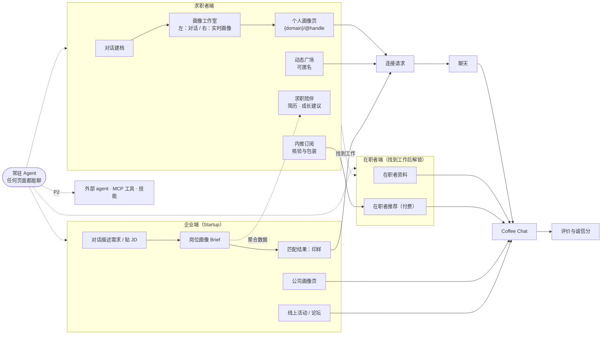

# Portrait（暂定代号）产品需求文档 PRD

| 项 | 内容 |
|---|---|
| 版本 | v0.3（草案，已纳入 2026-10-19 的确认结果与新功能） |
| 日期 | 2026-10-19 |
| 范围 | MVP 完整需求 + 面向规模化的演进方向 |
| 配套文档 | [Agent 设计](agent-design.md) · [前端设计简报（交给 Claude Design）](design-brief.md) · [技术架构与后端方案](architecture.md) |

> "Portrait" 只是文档里的代号，取"个人画像"之意；正式品牌名和域名待定。文中 `{domain}` 指我们的域名。

---

## 0. 一句话定义

一个会"采访"人的 AI：通过对话理解每一位求职者，把 TA 画成一张**独一无二、每句话都有出处**的个人画像页（`{domain}/@handle`）。Startup 用自然语言说出想要什么样的人，同一个 agent 帮他们找到、读懂并联系上这些人。

agent 随时都能聊，是求职者的长期伙伴：陪 TA 持续更新简历、找出该怎么提升。找到工作后，TA 可以解锁"在职者"身份，为后来的人提供 coffee chat 和内推。

---

## 1. 背景与机会

### 1.1 求职者的问题

- **简历是有损压缩。** 一页纸加模板，最能区分一个人的东西（做事方式、关键决策、动机、少见的能力组合）几乎都被挤掉了。
- **会写简历的和能做事的，不是同一批人。** 没有大厂实习、非名校、不擅长英文自我表达的学生（尤其是国际学生）在简历筛选里系统性吃亏。
- **个人主页门槛高。** 作品集网站要会设计、会写文案；LinkedIn 偏"出身标签"，大家的主页长得都差不多。

### 1.2 Startup 的问题

- 早期公司招第一批工程师或实习生时没有招聘团队，创始人亲自筛人，时间成本极高。
- 雇主品牌弱，拼不过大厂；职位板上的海投申请信号很低。
- 他们真正想看的是**有证据的能力**和**做事方式合不合得来**，而不是学校和公司 logo。

### 1.3 为什么是现在

- 大模型已经能做高质量的深度访谈、结构化抽取、带出处的推理，"聊天即建档"第一次真正可行。
- 生成式 UI 让"每人一页、各不相同、但都好看"在成本上可行。

---

## 2. 关键假设与已确认决策

2026-10-19 已确认首发市场、会员形式、默认可见性和学校筛选的方向（见 [§16 决策记录](#16-决策记录)）。

| # | 项目 | 结论 | 状态 |
|---|---|---|---|
| A1 | 首发市场 | 北美大学生（以美国为主），包含中国留学生等国际学生 | 已确认 |
| A2 | 语言 | 界面英文为主，支持简体中文；agent 跟随用户的语言对话；画像页可生成英文、中文或双语版。对国际学生是关键卖点："用母语聊，拿到一页地道的英文主页" | 假设，待确认 |
| A3 | 求职者范围 | MVP：北美在校大学生（本科、研究生）和应届毕业生。以后扩展到社招时，需要"对现雇主隐藏"等更强的隐私能力（P1 已预留） | 随 A1 确定 |
| A4 | 企业范围 | MVP 只开放早期 startup（Pre-seed 至 Series B，≤150 人），需通过验证；大公司进 waitlist | 假设，待确认 |
| A5 | 会员 | 企业端、求职者端各自有付费会员；求职者的内推订阅、在职者推荐也是付费功能（见 7.10） | 已确认 |
| A6 | 默认可见性 | 新用户默认"匿名可发现"（见 7.4） | 已确认 |
| A7 | 学校筛选 | 不禁止企业按学校筛选；具体形式后续决定（见 MATCH-10） | 方向已定，细节待定 |
| A8 | 信息来源 | 只收录本人创建或授权的信息，不做爬取（见原则 1） | 产品原则 |

---

## 3. 目标与非目标

### 3.1 MVP 要验证的三件事

1. **供给**：求职者愿意通过对话建立画像，并把链接分享出去。
2. **需求**：startup 愿意用自然语言描述需求，并主动联系推荐给他们的人。
3. **连接**：双方真的聊起来，连接请求被接受，coffee chat 真的发生。

### 3.2 非目标（MVP 明确不做）

- 不做 ATS（面试安排、评估表、offer 管理）。我们负责"聊上"为止，之后可导出到 ATS。
- 不做海投式职位板，不提供"一键申请 100 个职位"。
- 不爬取、不收录未经本人授权的个人信息（例如批量抓取 LinkedIn）。愿景是"收录尽可能多求职者的画像"，实现路径是让每个人愿意自己来建档。
- 不做自动录用或淘汰决策。AI 只推荐、解释、起草，人做决定。
- 不自建直播和视频通话，MVP 用外部会议链接。
- 不做原生 App，先把移动端 Web 做好。
- 不经手内推本身。内推由在职者在自己公司的系统里提交；平台不向在职者支付内推费用，也禁止求职者向在职者付钱或送礼。

---

## 4. 用户与场景

### 4.1 求职者（Talent，即"学生端"）

| 代表用户 | 描述 | 核心诉求 |
|---|---|---|
| Lin，CS 大三，中国留学生 | 有两个不错的项目，没有大厂实习；英文自我表达不自信；关心 CPT/OPT | 真实能力被看见；拿到一页拿得出手的英文主页；找 startup 实习 |
| Maya，交互设计应届生 | 作品多，但案例写得少；想展示过程而不只是结果 | 好看的作品集页；匿名分享案例、收集反馈 |
| Alex，转专业或自学者 | Bootcamp 加 side projects，学历标签不占优 | 按作品和证据被评估，而不是按出身 |

### 4.2 Startup（Company，即"企业端"）

| 代表用户 | 描述 | 核心诉求 |
|---|---|---|
| 种子轮创始人 | 5–20 人，亲自招第一个工程师 | 10 分钟内看到靠谱的人和推荐理由；低成本开聊 |
| A 轮 Head of Talent | 20–100 人，需要持续的候选人来源和雇主品牌 | 批量但精准；办宣讲、AMA 吸引人 |
| 技术负责人（Hiring Manager） | 关心真实能力 | 看证据：代码、项目、做决策的过程 |

### 4.3 在职者（Insider，找到工作后解锁）

| 代表用户 | 描述 | 核心诉求 |
|---|---|---|
| Jordan，毕业一年的 SWE | 在一家科技公司工作；记得自己找工作时的艰难，愿意帮学弟学妹；公司有内推奖金 | 花很少的时间，认识背景属实、真正合适的求职者；拓展人脉 |
| 一年后的 Lin | 通过平台拿到工作，从求职者变成在职者 | 回馈后来的人；保留自己的画像和人脉 |

### 4.4 核心 Jobs-to-be-Done

- **求职者**："当我要找实习或工作时，我希望不用苦写简历，也能有一页真正代表我的东西，让对的人主动来找我。"
- **求职者（成长）**："当我还不够有竞争力时，我希望有人告诉我差在哪、先补什么，并陪我一步步做到。"
- **想要内推的求职者**："当我想要内推时，我希望有人帮我把材料准备到位，并把我介绍给真正能帮上忙的在职者。"
- **在职者**："当我已经工作了，我愿意帮合适的人内推、拓展人脉，但不想把时间花在背景不实的人身上。"
- **Startup**："当我要招第一批人时，我希望说清楚我要什么样的人，马上看到有证据的候选人，并且低成本地聊上。"

---

## 5. 产品原则

1. **本人授权，本人拥有。** 画像只来自本人提供或授权的信息；本人随时可以编辑、隐藏、导出、删除。企业只能看到本人允许的部分。
2. **证据胜过形容词。** 画像里每一条事实性内容都能追溯到出处（对话原话、简历第几页、哪个链接）。agent 可以润色表达，但不夸大、不编造。
3. **随时能聊，对话即操作。** agent 是常驻的：任何时候、任何页面都能和它聊，它记得你是谁、聊过什么。所有操作都能"说"出来完成，直接点选、改字作为补充。
4. **先被看见，再被认识。** 求职者可以匿名被发现、匿名发动态；双方同意后才揭示身份。
5. **人做决定。** AI 推荐、解释、起草，不自动淘汰任何人；不收集、不推断、不使用年龄、性别、族裔等受保护特征。
6. **设计即差异化。** 前端追求杂志级的完成度，用 [Impeccable](https://impeccable.style) 做设计把关，拒绝"AI 味"模板。
7. **诚信可以被检验。** 内推和评价都建立在真实互动之上：只有真实发生过的 coffee chat 才能评价；被指出不属实的内容，要么补充证据，要么撤下；被评价的人始终有申辩的机会。

---

## 6. 产品全景

### 6.1 模块地图

### 6.2 双边飞轮

画像越多、越丰富 → 匹配越准 → startup 来得越多 → 活动和机会越多 → 更多求职者来建档并分享自己的链接。每一个被分享出去的画像页，本身就是一次拉新（页脚带"Draw yours"入口）。

第二个飞轮来自毕业生：求职者找到工作 → 解锁在职者 → 给后来的学弟学妹 coffee chat 和内推 → 平台对新一届学生更有吸引力。今天的求职者，就是明天的内推人。

### 6.3 信息架构

| 区域 | 路由（建议） | 说明 |
|---|---|---|
| 公共 | `/` | 双入口落地页，核心是一个对话框 |
| | `/@handle` | 个人画像页 |
| | `/c/[slug]` | 公司画像页 |
| | `/e/[id]` | 活动页 |
| | `/p/[id]` | 单条动态 |
| | `/pricing` | 会员与价格 |
| 求职者 | `/studio` | 画像工作室（对话 + 实时画像） |
| | `/feed` | 动态广场 |
| | `/events` | 活动 |
| | `/inbox` | 连接请求 / 消息 / Coffee chat |
| | `/settings/privacy` | 可见性与匿名设置 |
| | `/grow` | 求职陪伴：简历、成长建议与成长计划 |
| | `/referrals` | 内推订阅：核验进度、内推包、向在职者发起的请求 |
| 在职者 | `/insider` | 在职者资料、agent 推荐的求职者、coffee chat 时段、内推记录 |
| 所有角色 | （全局） | 常驻 agent 对话入口，见 6.4 |
| 企业 | `/hire` | 招聘需求工作室（对话 + 岗位画像） |
| | `/hire/[briefId]` | 匹配结果（印样） |
| | `/hire/[briefId]/[candidateId]` | 候选人画像 + 匹配说明 |
| | `/company` | 公司画像工作室 |
| | `/company/events` | 活动管理 |
| | `/company/settings` | 团队与账单 |
| 运营 | `/admin` | 审核、企业认证、用户管理 |

### 6.4 常驻 Agent

agent 是整个产品的核心界面，**任何时候、任何页面都能和它聊**：

- **始终在线**：求职者、在职者、企业成员登录后，每个页面都有固定的对话入口（桌面端是侧边面板，移动端是底部按钮）。在画像工作室、Brief 工作室、成长计划页，对话就是左侧主栏。
- **一条连续的对话**：用户看到的是一条不断延续的对话时间线，跨设备同步；agent 记得用户的画像（或企业的 Brief）、目标和之前聊过的事。
- **懂当前页面**：在候选人页问"这个人适合我们吗"，在活动页问"值得去吗"，agent 会带上当前页面的上下文来回答。
- **能代办**：起草消息、预约 coffee chat、报名活动、修改画像或 Brief。涉及对外发送、付费或公开的操作，必须用户确认后才执行。
- **能扩展**：将来可以接入外部工具和技能，并和别的 agent 对话协作（见 7.17）。

---

## 7. 功能需求

优先级：**P0** = MVP 必须；**P1** = MVP 后 1–3 个月；**P2** = 之后；**待定** = 方向已定，细节和优先级后续决定。

### 7.1 入口、账号与身份

落地页只有一个对话框，加一句可切换的话："I'm looking for **work** / **people**"。选 work 进入求职者对话，选 people 进入企业对话。**不注册就能开始聊**，在用户第一次看到价值的那一刻（画像草稿生成、匹配预览出现）再引导登录。

| ID | 需求 | 优先级 |
|---|---|---|
| ACC-01 | 双入口落地页：一个对话框 + work/people 切换；支持直接拖入简历、粘贴链接 | P0 |
| ACC-02 | 未登录可对话；匿名会话在登录后无损迁移到账号 | P0 |
| ACC-03 | 登录方式：Google、LinkedIn、GitHub、邮箱验证码 | P0 |
| ACC-04 | 认领链接：选择 handle（`{domain}/@handle`），保留字与敏感词过滤；30 天内只能改一次，旧链接自动跳转 | P0 |
| ACC-05 | 企业账号：工作邮箱域名验证 + 人工审核队列（核对官网、公司信息）；通过后显示"已验证"标识 | P0 |
| ACC-06 | 企业团队：邀请成员，按套餐限制席位，角色为 owner / admin / member | P0 |
| ACC-07 | 年龄门槛：仅限 18 岁以上 | P0 |
| ACC-08 | 学生邮箱（.edu）验证，显示"已验证学生" | P1 |
| ACC-09 | 同一账号同时拥有求职者和企业身份（如创始人也在找合伙人） | P2 |

**验收标准**

- 未登录用户可以完成至少 10 轮对话并看到画像草稿；登录后对话、草稿、上传的文件全部保留。
- 企业未通过验证前，只能看到匹配数量预览，看不到任何候选人详情。

### 7.2 求职者：对话建档与画像工作室（核心）

这是产品的心脏。流程：落地页对话框 → 全屏对话 → agent 生成第一版画像并给出链接（"诞生时刻"）→ 进入**画像工作室**：左边继续和 agent 聊，右边实时看到自己的画像被不断丰富。agent 如何理解一个人，详见 [agent-design.md](agent-design.md)。

| ID | 需求 | 优先级 |
|---|---|---|
| STU-01 | 全屏对话建档：agent 一次只问一个问题，跟随用户语言；支持快捷选项（chips） | P0 |
| STU-02 | 上传简历（PDF/DOCX，≤10MB）、粘贴链接（GitHub、个人网站、作品集、LinkedIn 导出的 PDF）；agent 读完后只追问它不知道的 | P0 |
| STU-03 | **首版画像速度**：上传简历后 60 秒内、或纯对话 5 分钟内，生成第一版画像和链接 | P0 |
| STU-04 | **诞生时刻**：对话栏滑到左侧，右侧画像逐段"排版"出来，顶部出现 `{domain}/@handle` 和认领按钮 | P0 |
| STU-05 | 分屏工作室：左对话、右画像；agent 的每次修改以流式补丁实时应用到右侧，并短暂高亮变化 | P0 |
| STU-06 | 点选即编辑：点击右侧任一区块，对话框出现上下文标签（如"正在编辑：项目 › Campus Eats"），说"写得更简洁"只改这一块 | P0 |
| STU-07 | 直接编辑：区块内可直接改字；改动同样记入版本历史 | P0 |
| STU-08 | 出处脚注：每条事实性内容带脚注标记，悬停显示来源（对话原话、简历页码、链接） | P0 |
| STU-09 | 待确认机制：agent 推断出的内容（技能等级、做事风格等）标记为"待确认"，发布前需逐条或批量确认 | P0 |
| STU-10 | 版本历史：至少保留最近 20 个版本，可一键撤销任一次 agent 修改 | P0 |
| STU-11 | 发布 / 取消发布；复制链接；自动生成分享卡片（OG 图） | P0 |
| STU-12 | 视角切换：公开版 / 匿名版 / startup 看到的版本 | P0 |
| STU-13 | 多语言：可用任意语言聊；画像页可选英文、中文或双语 | P0 |
| STU-14 | "下一步建议"：agent 提示最值得补充的内容（如"给 Campus Eats 加一个演示链接"） | P0 |
| STU-15 | 主题共创：3 套主题预设 × 强调色 × 疏密 × 区块顺序，agent 可一次提出 2–3 个方案 | P1 |
| STU-16 | 每周回访："这周做了什么？"一句话更新画像 | P1 |
| STU-17 | GitHub 深度解析（仓库、语言、贡献占比）作为"已展示"级证据 | P1 |
| STU-18 | 语音对话建档 | P2 |
| STU-19 | 模拟面试与表达辅导 | P2 |

**验收标准**

- 上传简历后 60 秒内，右侧至少出现：标题、经历、技能三个区块的草稿。
- 公开页上每一条事实性内容都能点开看到出处；没有出处的内容不能发布。
- 用户说"把 X 改得更简洁"时，只修改 X 区块，其他内容逐字不变；可一键撤销。
- 刷新页面、断网重连、换设备登录后，对话和画像状态不丢失。
- 用户说"跳过"或"不想说"，agent 不再追问同一话题。

### 7.3 个人画像页（公开页）

画像页是产品的门面，也是增长引擎。它由 agent 生成的**页面规格（Page Spec）**渲染：agent 只能在设计系统允许的组件、变体和配色范围内组合，所以每一页都不一样，但都好看、都无障碍。

| ID | 需求 | 优先级 |
|---|---|---|
| PAGE-01 | 地址 `{domain}/@handle`；区块包括：开场（名字、一句话、当前状态）、签名段、三个超能力、经历、作品、做事方式、在找什么、最近动态、"可以问我"；按 Page Spec 渲染 | P0 |
| PAGE-02 | 移动端优先：大多数分享链接会在手机上打开 | P0 |
| PAGE-03 | 行动按钮：约 coffee chat、发消息（需登录）、收藏 | P0 |
| PAGE-04 | 默认 `noindex`，本人可选择允许搜索引擎收录 | P0 |
| PAGE-05 | 页脚 "Drawn with {品牌} · Draw yours" | P0 |
| PAGE-06 | 企业从匹配结果进入时，右侧显示"匹配说明"面板（见 7.6） | P0 |
| PAGE-09 | 访问统计（哪些公司看过，按公司聚合） | P1 |
| PAGE-10 | 自定义域名（Pro） | P2 |

**验收标准**

- 移动端（4G）LCP < 2.0s，CLS < 0.05。
- 分享到 LinkedIn、X、iMessage、微信时显示正确的分享卡片（名字 + 一句话标题，纯文字排版）。

### 7.4 隐私、可见性与匿名

新用户的默认可见性是**匿名可发现**。首次发布前会展示一次可见性设置，说明每种模式下谁能看到什么；用户可以直接确认，也可以改成其他模式。

| 模式 | 公开链接 | 出现在企业搜索中 | 企业看到什么 |
|---|---|---|---|
| 公开 | 任何人可访问（可选是否被搜索引擎收录） | 是 | 实名完整画像 |
| **匿名可发现（默认）** | 只有拿到链接的人可访问（`noindex`） | 是 | 匿名版画像：化名 + 语境标签，机构名泛化，隐藏链接和联系方式；接受连接后才揭示身份 |
| 仅链接 | 只有拿到链接的人可访问 | 否 | — |
| 隐藏 | 不可访问 | 否 | — |

| ID | 需求 | 优先级 |
|---|---|---|
| PRIV-01 | 四种可见性模式，新用户默认"匿名可发现"；任何时候可切换；切换前展示"谁能看到什么"的实时预览 | P0 |
| PRIV-02 | 字段级控制：签证需求、薪资期望、联系方式等敏感字段可设为"仅用于匹配，不展示" / "接受连接后展示" / "公开" | P0 |
| PRIV-03 | 匿名版画像由专门的匿名化流程生成：去名字和链接，机构名泛化（如"加州的一所公立研究型大学"），项目名改成描述，数字取整，文案重写以避免和公开版逐字相同 | P0 |
| PRIV-04 | 匿名化风险检查：agent 评估"能否通过搜索认出这个人"，高风险条目默认隐藏并提示本人 | P0 |
| PRIV-05 | 化名与实名之间没有可关联的字段：化名名称随机生成，**不能**由真实姓名或画像内容推导 | P0 |
| PRIV-06 | 数据导出（JSON + PDF）与账号删除；MVP 可走工单，30 天内完成 | P0 |
| PRIV-07 | 屏蔽指定公司（如现雇主），被屏蔽公司搜不到也看不到 | P1 |
| PRIV-08 | 查看哪些公司看过我的画像（访问审计） | P1 |
| PRIV-09 | 导出和删除全自助 | P1 |

**验收标准**

- 匿名模式下，企业侧任何接口返回的数据都不包含姓名、handle、外链、联系方式（以接口测试验证，不只是前端隐藏）。
- 匿名版和公开版的文案在 8 字以上的连续片段上不重合（自动检测）。
- 用户被明确告知：匿名是"尽力而为"，如果自己把公开链接到处分享，别人仍可能对上号。

### 7.5 企业端：公司画像与岗位画像（Brief）

企业端是求职者端的镜像：同样是"左边对话、右边一份活的文档"。第一份文档是**公司画像**（给求职者看，帮 startup 建立雇主品牌）；第二份是**岗位画像 Brief**（给 agent 匹配用）。

| ID | 需求 | 优先级 |
|---|---|---|
| CO-01 | 公司画像：贴官网链接，agent 起草使命、产品、阶段、团队规模、技术栈、文化、福利，创始人确认后发布到 `/c/[slug]` | P0 |
| CO-02 | 岗位画像：用对话或粘贴 JD 生成结构化 Brief（必须项、加分项、看重的信号、硬性条件、团队背景），每条必须项附"为什么" | P0 |
| CO-03 | 追问澄清：把模糊要求变具体（"很强的工程师"→"之前独立上线过什么"）；指出相互冲突的条件 | P0 |
| CO-04 | 实时人才池预览："符合基本条件约 124 人，强匹配 18 人"；放宽某条件会怎样变化 | P0 |
| CO-05 | 公平护栏：拒绝按年龄、性别、族裔、宗教、婚育、残障等筛选；识别代理性表述（如 "native speaker"、"young and energetic"）并建议改为能力描述 | P0 |
| CO-06 | Brief 可设为私密（仅用于匹配）或公开（作为开放职位展示在公司页） | P0 |
| CO-07 | 多个 Brief、模板、团队协作编辑 | P1 |
| CO-08 | 保存的搜索 + 新匹配每日摘要 | P1 |

**验收标准**

- 粘贴一段普通 JD 后 30 秒内生成可编辑的 Brief，且至少提出 2 个澄清问题。
- 输入"只要 25 岁以下"之类的要求时，agent 明确拒绝并给出替代建议，Brief 中不出现该条件。

### 7.6 匹配与人才发现（印样 Contact Sheet）

匹配结果借用摄影里"印样"的隐喻：一张张候选人卡片排开，创始人用红笔圈出想聊的人。匹配逻辑详见 [agent-design.md §8](agent-design.md#8-匹配引擎)。

| ID | 需求 | 优先级 |
|---|---|---|
| MATCH-01 | 按 Brief 给出排序后的候选人列表；每张卡片包括：身份（按候选人可见性显示实名或化名）、一句话、**3 条带出处的推荐理由**、每个必须项的满足情况、对方可能感兴趣的程度、可入职时间 | P0 |
| MATCH-02 | 每个推荐必须有解释；解释里引用的证据必须真实存在（后端校验） | P0 |
| MATCH-03 | "潜在顾虑"和"建议在 coffee chat 中问的问题" | P0 |
| MATCH-04 | 筛选：岗位类型、可入职时间、地点/远程、工作许可兼容（仅当候选人允许用于匹配）、毕业年份；在可发现人群中关键词搜索 | P0 |
| MATCH-05 | 操作：圈选（加入候选名单）、划掉（附原因）、查看画像、发起连接 | P0 |
| MATCH-06 | 反馈学习：圈选和划掉的原因实时调整该 Brief 的排序 | P0 |
| MATCH-07 | 曝光保护：同一候选人每周收到的连接请求有上限；排序中加入适度的曝光均衡，避免所有公司都只看到同一批人 | P0 |
| MATCH-08 | 团队备注、候选人对比视图 | P1 |
| MATCH-09 | 基于真实结果（回复、coffee chat、录用）训练排序模型 | P2 |
| MATCH-10 | 按学校筛选：不禁止；作为筛选条件、是否参与排序、在印样上如何展示，后续决定 | 待定 |

**验收标准**

- 从 Brief 确认到看到第一屏匹配结果 ≤ 20 秒（首屏可先展示检索结果，再流式补充解释）。
- 设计伙伴 startup 对前 10 名的人工评分中，"愿意联系"的比例 ≥ 50%（MVP 质量门槛）。

### 7.7 连接：连接请求、聊天、Coffee Chat

| ID | 需求 | 优先级 |
|---|---|---|
| CONN-01 | 企业 → 求职者的连接请求：附言（agent 根据匹配理由起草，可修改）、关联的 Brief、类型（聊天 / coffee chat）；14 天未回复自动过期 | P0 |
| CONN-02 | 求职者可接受、婉拒（可选原因）、稍后再说；接受后揭示身份（匿名模式）并开启对话 | P0 |
| CONN-03 | 求职者 → 企业：在公司页、职位、活动页表达"感兴趣"；预约创始人的 **Office Hours**（startup 每周开放的 coffee chat 时段，每位求职者每周可约次数有上限） | P0 |
| CONN-04 | 1 对 1 消息：文字、链接、附件（PDF/图片 ≤10MB）、已读状态、举报、屏蔽；邮件通知合并发送 | P0 |
| CONN-05 | Coffee chat 预约：一方提出最多 3 个时间或从对方的空闲时段直接选；自动处理双方时区；确认后发送日历邀请（.ics）和会议链接（主持方提供或自动生成）；提前 24 小时和 1 小时提醒；改期、取消 | P0 |
| CONN-06 | Coffee chat 之后一键反馈："聊了吗？还想继续吗？"（用于匹配学习，不公开） | P0 |
| CONN-07 | 额度：每个连接请求消耗 1 个额度，按套餐每月发放 | P0 |
| CONN-08 | Coffee chat 前，agent 分别给双方准备简报（对方是谁、可以聊什么） | P1 |
| CONN-09 | 连接 Google 日历：读取空闲时间、自动生成 Meet 链接 | P1 |
| CONN-10 | 14 天未获回复的连接请求退还额度 | P1 |
| CONN-11 | 原生视频通话、群聊、熟人引荐 | P2 |

**反骚扰与反诈骗（P0）**：新企业账号每天最多 10 个连接请求；首条消息内容审核；识别"要求付费"、"站外转账"、可疑链接等诈骗特征并提醒求职者；举报入口始终可见。

**验收标准**

- 从企业发出请求到求职者接受、约定时间，全程不需要离开平台、不需要交换邮箱。
- 所有时间在双方界面上都以各自的本地时区显示，并注明对方时区。

### 7.8 动态广场（可匿名发布）

目的：降低展示门槛，让大家愿意在这里分享自己做的东西；同时让 startup 能通过作品发现人，而不是通过出身。

| ID | 需求 | 优先级 |
|---|---|---|
| FEED-01 | 发布类型：文字、图片（≤4 张）、链接（自动预览）、项目展示（标题、图、链接、标签）、提问/讨论、"在找队友" | P0 |
| FEED-02 | 发布身份可选：实名 / 化名 / 公司（企业成员） | P0 |
| FEED-03 | 化名：每个用户一个稳定化名（随机生成的名字），可附加自选的非识别性语境标签（如"CS · 大三 · 湾区"）；化名可积累关注和互动；暂不使用头像图形 | P0 |
| FEED-04 | 匿名体检：以化名发布前，agent 检查内容是否会暴露身份（学校名、项目名、可搜索到的原文等）并提示 | P0 |
| FEED-05 | 互动：共鸣（点赞）、评论（可用化名）、关注（人、化名、公司）、分享、举报 | P0 |
| FEED-06 | 企业可对化名动态发起"邀请聊聊"；对方接受后才揭示身份 | P0 |
| FEED-07 | Tab：For you（MVP：时间 + 互动 + 话题匹配）、Following、Events | P0 |
| FEED-08 | 内容审核：发布前自动筛查（垃圾广告、骚扰、仇恨、色情、人肉/隐私泄露、泄露公司机密、诈骗），举报队列，频率限制，社区规范 | P0 |
| FEED-09 | 化名发帖不得点名攻击具体个人（社区规范 + 自动识别） | P0 |
| FEED-10 | 一键把"项目展示"动态加入画像的作品区 | P1 |
| FEED-11 | 每周话题和提示（"这周你做了什么？"）、话题频道 | P1 |
| FEED-12 | 个性化排序、创作者数据 | P2 |

**验收标准**

- 平台以外的人无法从化名推断出实名（化名、语境标签与实名画像之间没有可直接关联的字段）；平台内部保留关联以便审核。
- 违规内容（按测试集）发布前拦截率 ≥ 90%，误拦率 ≤ 3%。

### 7.9 Startup 线上活动与论坛

让 startup 定期办线上宣讲、AMA、技术分享、圆桌论坛来吸引求职者；平台也定期办多家 startup 联合的 Showcase Night 作为增长活动。

| ID | 需求 | 优先级 |
|---|---|---|
| EVT-01 | 活动类型：公司介绍（宣讲）、AMA、技术分享、圆桌/论坛、联合 Showcase | P0 |
| EVT-02 | 创建：agent 根据公司画像起草（"下周四晚 6 点办一场关于创始工程师岗位的 AMA"），可修改；支持周期性系列（每周/双周/每月） | P0 |
| EVT-03 | 字段：标题、描述、议程、时间（时区）、时长、容量、目标人群标签、主持人、封面（可由品牌色生成）、外部会议链接（Zoom/Meet/YouTube 等） | P0 |
| EVT-04 | 发现：活动列表（按周）、筛选、根据画像推荐 | P0 |
| EVT-05 | 报名：一键报名；可选"把我的画像分享给主办方"（默认关闭）；加入日历；提前 24 小时和 1 小时提醒；开始前 10 分钟显示入会按钮 | P0 |
| EVT-06 | 论坛：活动页自带讨论区，会前收集问题、会后继续讨论；问题可投票（可用化名） | P0 |
| EVT-07 | 主办方后台：报名人数、愿意分享画像的报名者、问题列表；会后可给参与者发 1 条消息 | P0 |
| EVT-08 | 回放、精彩片段、会后人才池、联合主办、活动数据 | P1 |
| EVT-09 | 原生直播：实时问答、投票、"举手约 coffee chat" | P2 |

**验收标准**

- 主办方从说一句话到发布活动 ≤ 3 分钟。
- 主办方只能看到主动选择分享画像的报名者的画像。

### 7.10 会员与付费

价格均为假设，需通过设计伙伴访谈验证。原则：**求职者的核心功能永远免费**；任何付费曝光都必须对企业明确标注；不使用虚假稀缺等暗黑模式；**内推订阅购买的是核验、包装和推荐服务，不是内推本身**。

| 套餐 | 面向 | 价格（假设） | 内容 |
|---|---|---|---|
| Free | 求职者 | $0 | 对话建档、画像页、动态、接收连接、活动、coffee chat |
| Pro | 求职者 | $8–12/月 | 高级主题与自定义域名、访问统计、PDF 简历导出、每周更多 Office Hours 预约、多语言版本 |
| Free | Startup | $0 | 公司画像、1 个 Brief、查看前 10 个匹配（匿名）、每月 3 个连接请求、每月 1 场活动 |
| Startup | Startup | $99–199/月 | 3 个 Brief、完整匹配列表、每月 40 个连接额度、无限活动、Office Hours、3 个席位、保存的搜索 |
| Growth | Startup | $399+/月 | 10 个 Brief、150 个额度、10 个席位、活动推荐位、ATS 导出、数据看板 |
| 内推订阅 | 求职者（附加订阅） | $29–49/月 | 资质核验与包装、进入内推池、被推荐给匹配的在职者、每月若干次向在职者发起 coffee chat 请求（见 7.15） |
| 在职者推荐 | 在职者 | $9–19/月 | agent 每周推荐已核验、值得约 coffee chat 的求职者，附理由、证据和诚信分；可直接发起 coffee chat（见 7.15） |

| ID | 需求 | 优先级 |
|---|---|---|
| BILL-01 | Startup 套餐订阅：Stripe Checkout 支付，Customer Portal 管理；发票 | P0 |
| BILL-02 | 套餐额度在后端强制执行（Brief 数、连接额度、席位、活动数） | P0 |
| BILL-03 | 额度账本：所有增减记录可追溯（只追加、不修改） | P0 |
| BILL-04 | 付款失败 7 天宽限期，之后降级为 Free | P0 |
| BILL-05 | 求职者 Pro、额度加购包、年付、Growth 套餐 | P1 |
| BILL-06 | 企业为活动参与者赠送 Pro、按成功录用收费 | P2 |
| BILL-07 | 内推订阅、在职者推荐两种订阅（Stripe）；权益和次数在后端强制执行 | P1 |

### 7.11 通知

| ID | 需求 | 优先级 |
|---|---|---|
| NOTI-01 | 站内通知 + 邮件：收到连接请求、请求被接受、新消息（合并发送）、coffee chat 确认与提醒、活动提醒、新匹配每日摘要 | P0 |
| NOTI-02 | 通知偏好设置与免打扰时段 | P0 |
| NOTI-03 | Web Push | P1 |

### 7.12 信任与安全

| ID | 需求 | 优先级 |
|---|---|---|
| TS-01 | 企业认证（见 ACC-05）与"已验证"标识 | P0 |
| TS-02 | 内容审核：自动筛查 + 举报 + 人工队列；社区规范页 | P0 |
| TS-03 | 诈骗识别与提醒（见 7.7） | P0 |
| TS-04 | 企业查看画像的访问日志（审计用，P1 对求职者可见） | P0 |
| TS-05 | AI 透明：告知用户正在与 AI 对话；AI 生成内容有标识；企业可查看"为什么推荐这个人" | P0 |
| TS-06 | 公平：不收集、不推断、不使用受保护特征；定期检查匹配结果的分布 | P0 |
| TS-07 | 上线前法务审查：美国部分州和城市（如纽约市 Local Law 144）对招聘中使用的自动化工具有审计和告知要求，欧盟 AI Act 把招聘类 AI 列为高风险。MVP 定位为"人主导的搜索与推荐工具"，不做自动决策，但仍需确认。内推网络上线前另需评估：诚信分如果提供给企业用于招聘决策，可能落入美国 FCRA（《公平信用报告法》）对"消费者报告"的规定；各公司也有自己的内推政策 | P0 |

### 7.13 运营后台

| ID | 需求 | 优先级 |
|---|---|---|
| ADM-01 | 企业认证审核队列 | P0 |
| ADM-02 | 内容审核队列（动态、评论、消息举报），处理动作：删除、警告、封禁 | P0 |
| ADM-03 | 用户与公司检索；封禁和解封 | P0 |
| ADM-04 | 功能开关、手动调整额度（留痕） | P0 |
| ADM-05 | 基础指标看板 | P0 |
| ADM-06 | 在职者验证、内推资质核验、评价申诉与"不属实"争议的审核队列 | P1 |

### 7.14 常驻 Agent 与求职陪伴

agent 不只在建档时出现，而是一路陪着用户（见 [6.4](#64-常驻-agent)）：随时可以找它聊简历、聊方向、问"我该怎么提升"。平台上有大量企业的真实需求，所以 agent 能给出有数据支撑的建议；这些数据只以聚合、去标识化的形式使用。

| ID | 需求 | 优先级 |
|---|---|---|
| AGENT-01 | 常驻对话入口：所有角色登录后，每个页面都能唤起 agent（桌面侧边面板、移动底部按钮、快捷键） | P0 |
| AGENT-02 | 连续对话：一条跨设备同步的对话时间线；agent 记得画像或 Brief、目标和历史 | P0 |
| AGENT-03 | 页面上下文：agent 知道用户正在看什么（某位候选人、某场活动、某条动态），回答时带上它 | P0 |
| AGENT-04 | 代办：起草消息、预约 coffee chat、报名活动。按风险分级：对外发送、付费、公开类操作必须用户确认；低风险动作可以由用户预先授权后自动执行，避免每一步都要点确认（修改画像和 Brief 已在 P0 中） | P1 |
| COACH-01 | 简历：从画像一键生成 ATS 友好的 PDF 简历，画像更新后简历同步更新（原 PAGE-08，提到 P0） | P0 |
| COACH-02 | 成长建议 v0：用户问"想做 X 岗位我该怎么提升"，agent 基于画像、目标岗位和公开信息（联网搜索）给出差距分析和建议 | P0 |
| COACH-03 | 针对不同岗位生成不同版本的简历 | P1 |
| COACH-04 | 基于平台数据的建议：聚合企业 Brief 中的必须项、加分项，以及哪些证据更容易被圈选和联系，例如"平台上约 60% 的前端实习把'有上线项目'列为必须项"；样本覆盖 ≥ 5 家公司才展示 | P1 |
| COACH-05 | 成长计划：把建议拆成可跟踪的计划项（学什么、做什么项目、补什么证据、参加哪场活动、约哪位在职者），每周回访；完成的计划项自动变成画像里的新条目和证据 | P1 |
| COACH-06 | 推荐平台内资源：相关活动、可以约的在职者、值得关注的 startup | P1 |

**验收标准**

- 在任何页面都能在 1 秒内打开对话，看到完整的历史。
- 成长建议中的每条数据结论都标明来源（平台聚合数据、公开资料或通用经验），平台数据附样本规模。
- 任何建议都不会透露某一家公司的私密 Brief 内容。
- 简历中只出现已确认或已验证的条目。

### 7.15 在职者与内推网络

求职者找到工作后，可以解锁"在职者"身份：和别人约 coffee chat、做 networking、给内推。在职者开通付费的"在职者推荐"后，会像企业端一样收到 agent 推荐的求职者。求职者想要内推，可以开通"内推订阅"，经过严格的资质核验和包装后，才会被推荐给在职者。

| ID | 需求 | 优先级 |
|---|---|---|
| INS-01 | 解锁在职者：用户标记"已找到工作"，用公司邮箱验证（不方便时上传 offer 或在职证明，人工审核）；通过后显示"已验证在职"标识 | P1 |
| INS-02 | 解锁后默认暂停"求职中"的可被发现状态（画像保留，可随时恢复），企业端不再推荐 | P1 |
| INS-03 | 在职者资料：已验证的公司和职位、团队方向、可以聊的话题、是否愿意内推、每月可接受的 coffee chat 数；姓名在 coffee chat 确认后显示（也可选择公开） | P1 |
| INS-04 | Networking：在职者之间、在职者与求职者之间可以互相约 coffee chat（免费，有频率限制） | P1 |
| INS-05 | 在职者推荐（付费）：agent 每周推荐若干位已核验、与在职者的公司和团队相关、值得约 coffee chat 的求职者，附推荐理由、证据和诚信分；在职者可以直接发起 coffee chat | P1 |
| INS-06 | 内推记录：在职者在自己公司的内推系统中提交后，在平台上标记"已内推"并跟踪结果；平台不经手内推本身 | P1 |
| INS-07 | 内推合规：在职者确认遵守所在公司的内推政策；平台禁止求职者向在职者付钱或送礼，消息中出现这类内容会被识别并提醒；提供举报入口 | P1 |
| REF-01 | 内推订阅（求职者付费的附加订阅）：开通后进入"资质核验与包装"流程，进度可见（核验中 / 待补材料 / 已入池） | P1 |
| REF-02 | 资质核验：在校身份（学校邮箱）、过往实习与工作（公司邮箱或证明文件，人工审核）、关键技能的证据（GitHub、作品、项目）、工作许可状态（本人声明）；核验前取得本人明确授权 | P1 |
| REF-03 | 包装：agent 生成"内推包"，包括针对目标岗位的简历、一段可以直接贴进内推表单的推荐语、3 条最强证据；人工抽检；内容全部来自已确认或已验证的条目，只做专业呈现，不夸大 | P1 |
| REF-04 | 只有核验和包装都完成后，才进入内推池，被推荐给匹配的在职者 | P1 |
| REF-05 | 订阅者每月可以主动向在职者发起若干次 coffee chat 请求（次数按订阅档位） | P1 |
| REF-06 | 明确告知：订阅购买的是核验、包装和推荐服务，不承诺获得内推；是否内推始终由在职者决定 | P1 |
| REF-07 | 第三方身份核验（防止冒用身份） | P2 |

**验收标准**

- 没有完成核验和包装的求职者，不会出现在任何在职者的推荐里。
- 内推包里的每一句话都能追溯到已确认或已验证的条目。
- 求职者和在职者之间没有任何付款通道；消息里的付款请求能被识别并提醒。

### 7.16 评价与诚信分

内推网络建立在诚信之上。Coffee chat 之后双方互相评价：在职者评价求职者，如果评价指出求职者填写了自己并不具备的资历，TA 的评分会下降；求职者也评价在职者（守时、是否尊重、是否索要费用），保护学生的安全。评分的展示参考 Google Maps：平均分、评价数、星级分布。

| ID | 需求 | 优先级 |
|---|---|---|
| RATE-01 | 只有真实发生过的 coffee chat 才能评价（双方都确认已发生） | P1 |
| RATE-02 | 在职者评价求职者：总分 1–5 星，加三个维度（画像属实度、准备程度、沟通与守时），可附文字 | P1 |
| RATE-03 | 选择"不属实"时必须指出具体条目；被指出的条目进入"争议中"，从内推包和匹配解释中暂时撤下；求职者 14 天内可以补充证据或修改，逾期视为不属实；确认失实会降低诚信分 | P1 |
| RATE-04 | 评分展示参考 Google Maps：平均分（保留一位小数）+ 评价数 + 星级分布；少于 3 条评价时显示"评价较少"；近期评价权重更高 | P1 |
| RATE-05 | 评分影响在内推池中的排序；多次或严重失实会被移出内推池，伪造材料的封禁账号 | P1 |
| RATE-06 | 防滥用：双盲提交（双方都提交、或 14 天后同时公开）；文字评价经过审核（不得涉及受保护特征或人身攻击）；被评价者可以申诉；识别报复性评价和刷分 | P1 |
| RATE-07 | 求职者评价在职者：总分 1–5 星，加三个维度（守时、尊重与专业、是否兑现承诺），以及是否被索要费用或礼物；在职者的评分对求职者可见，影响在职者被推荐的排序；查实索要费用的取消在职者身份 | P1 |
| RATE-08 | 评分的可见范围：先只对在职者可见；企业能否看到、是否用于企业端排序，等法务意见后再定 | 待定 |

**验收标准**

- 没有真实 coffee chat 记录的评价无法提交。
- 每一条"不属实"都对应具体条目；被评价者在评分生效前会收到通知，并有机会申辩。

### 7.17 开放生态：多 Agent 协作、MCP 与技能

目标形态是一个开放的 agent：像 Meta 的 Muse 这类通用 agent 一样，能通过 MCP 接入外部工具、按需使用技能，也能和别的 agent 对话协作。这一块排在 P2，但架构现在就预留扩展点（见 [architecture.md 8.4](architecture.md#84-开放生态的架构预留mcp技能agent-协作)）。

三个方向：

1. **接工具（MCP）**：用户授权后，agent 通过 MCP 连接外部服务。例如读日历的空闲时间来约 coffee chat，持续从 GitHub 同步项目证据，从 Notion 或 Google Drive 导入作品和笔记，把学习平台上完成的课程同步进成长计划。
2. **用技能**：把 agent 的专业能力做成按需加载的技能包，如简历改写、作品集点评、面试准备、薪资谈判、签证时间线说明（只提供信息，不做法律建议）。先做自有技能，再考虑经过审核的第三方技能。
3. **和别的 agent 协作**：
   - 用户自己的 AI 助手（如 Claude）通过我们的 MCP 服务读取和更新本人的画像，查看成长计划和收件箱；
   - startup 自己的招聘 agent 在套餐权限内搜索人才池、发起连接请求；
   - 代表双方的 agent 先"预聊"：在各自隐私设置允许的范围内交换信息、对齐时间，再把要不要约 coffee chat 交给人决定。

| ID | 需求 | 优先级 |
|---|---|---|
| ECO-01 | MCP 连接器：用户逐个授权连接外部服务（日历、GitHub、Notion、Google Drive 等），随时可以断开；agent 使用这些数据时注明来源 | P2 |
| ECO-02 | 技能：把简历改写、作品集点评、面试准备等能力做成按需加载的技能；先做自有技能 | P2 |
| ECO-03 | 第三方技能和连接器：经过安全审核后上架，用户自己选择是否启用 | P2 |
| ECO-04 | 对外 MCP 服务：用户授权自己的 AI 助手读写本人的画像、成长计划和收件箱；企业授权自己的招聘 agent 在套餐权限内搜索和发起请求 | P2 |
| ECO-05 | Agent 间协作：代表不同用户的 agent 可以对话协作（如对齐 coffee chat 时间、交换双方允许公开的信息），所有对话记录本人都能看到 | P2 |
| ECO-06 | 代表用户做出的承诺（发消息、约时间、分享画像）必须本人确认，或在本人预先设定的范围内才能自动执行 | P2 |
| ECO-07 | 外部 agent、MCP 工具和技能返回的内容一律当作不可信数据；按授权范围限制访问；全部操作写入审计日志 | P2 |

**验收标准**

- 任何外部 agent 都拿不到用户没有授权的数据（接口测试覆盖）。
- 用户可以在一个页面看到并撤销所有已连接的服务、已启用的技能和已授权的 agent。

---

## 8. 关键用户流程

### 流程 A：学生第一次建档（从落地页到分享链接）

1. 打开 `/`，对话框里写着 "Tell me about yourself — or drop your résumé."。
2. 拖入简历。agent 显示"正在读你的简历…"，随后列出发现：3 段经历、12 项技能。
3. agent 只追问最有价值的点："Campus Eats 有 2000 多人用，你具体负责哪部分？"
4. 5–8 轮之后，agent 说"你的画像初稿好了，要看看吗？"。点击后进入**诞生时刻**：对话栏滑到左侧，画像在右侧逐段排版出来，顶部出现 `{domain}/@lin`。
5. 点"认领这个链接"→ 用 Google 登录 → 确认可见性（默认"匿名可发现"，可更改）。
6. 继续在左边聊天，右边持续丰富；点选区块修改；确认"待确认"条目。
7. 点"发布"→ 复制链接，分享到 LinkedIn 或发给朋友。

### 流程 B：Startup 第一次找人

1. 打开 `/`，切换到 "I'm looking for **people**"，贴入官网和一段 JD。
2. agent 起草公司画像和岗位画像，提出 2–3 个澄清问题，并显示人才池预览（"强匹配 18 人"）。
3. 用工作邮箱登录 → 提交认证（MVP 人工审核，目标 24 小时内）。
4. 认证通过后进入印样：浏览 18 张卡片，圈出 5 人，划掉 3 人并说明原因（排序随之调整）。
5. 打开一位候选人的画像，查看右侧匹配说明，用 agent 起草的附言发出 coffee chat 请求。

### 流程 C：匿名动态 → 被发现 → 揭示身份 → Coffee chat

1. Maya 用化名发布一个设计案例；发布前，匿名体检提示截图里有学校 logo，Maya 换了一张图。
2. 一位创始人看到这条动态，点"邀请聊聊"（消耗 1 个额度）。
3. Maya 收到请求，看到对方的公司画像，点击接受 → 双方身份揭示，进入对话。
4. 双方选定时间，收到日历邀请；coffee chat 之后双方各自做一键反馈。

### 流程 D：活动 → 报名 → 参加 → 会后联系

1. 求职者在 Events 看到推荐的 AMA，一键报名，并选择"分享我的画像给主办方"。
2. 会前在讨论区提问、投票。
3. 开始前 10 分钟收到提醒，点击入会（外部链接）。
4. 会后主办方给所有参与者发一条感谢消息，并对感兴趣的人发起 coffee chat。

### 流程 E：找到工作 → 成为在职者 → 推荐 → 内推

1. Lin 拿到 offer，在对话里告诉 agent"我找到工作了"。agent 祝贺 Lin，并引导用公司邮箱验证。
2. 验证通过后解锁在职者身份；"求职中"的可被发现状态自动暂停，画像保留。
3. Lin 填写在职者资料：团队方向、愿意聊的话题、每月可接受 4 次 coffee chat、愿意内推。
4. 开通"在职者推荐"后，agent 每周推荐 3–5 位已核验、适合 Lin 所在公司岗位的求职者，附理由、证据和诚信分。
5. Lin 约其中一位 coffee chat；聊完觉得合适，在公司的内推系统里提交内推，再到平台上标记"已内推"。
6. 双方在 14 天内各自评价，评价同时公开。

### 流程 F：订阅内推 → 核验与包装 → 被推荐 → 评价

1. Alex 开通内推订阅，agent 说明需要准备的材料，以及"订阅不等于内推"。
2. Alex 验证学校邮箱、关联 GitHub、上传过往实习的证明；agent 和人工审核员完成核验。
3. agent 生成内推包（针对岗位的简历、推荐语、3 条最强证据），Alex 逐条确认后进入内推池。
4. Alex 被推荐给匹配的在职者；也可以每月主动向在职者发起几次 coffee chat 请求。
5. Coffee chat 之后，在职者评价 Alex。如果有人指出"带领 5 人团队"不属实，这一条进入"争议中"，从内推包里撤下；Alex 补充证据后恢复，确认失实则诚信分下降。

---

## 9. 非功能需求

| 类别 | 要求 |
|---|---|
| 性能 | 对话：点击发送后 1 秒内有可见反馈，P50 首字 < 3 秒；公开画像页移动端 LCP < 2.0s、CLS < 0.05、INP < 200ms |
| 可用性 | MVP 99.5%，规模化阶段 99.9% |
| 无障碍 | WCAG 2.2 AA；键盘可达；流式消息对读屏友好（`aria-live`）；尊重 `prefers-reduced-motion` |
| 国际化 | en + zh-CN 起步；所有时间带时区；中英混排排版规范（见 design-brief） |
| 安全 | 参照 OWASP ASVS L2；所有权限在服务端校验；敏感字段加密；审计日志 |
| 隐私 | 数据最小化；同意记录；导出和删除；聊天记录保留策略可配置 |
| 浏览器 | 主流浏览器最近两个版本；iOS Safari 16+ |
| 成本 | 一次完整建档的模型成本目标 < $1.5，通过评测持续优化（见 architecture.md §9） |

---

## 10. 指标体系

**北极星指标：每周双向确认的连接数**（被接受的连接请求 + 完成的 coffee chat）。

| 层面 | 指标 | MVP 目标（假设） |
|---|---|---|
| 求职者激活 | 落地页 → 开始对话 | ≥ 35% |
| | 开始对话 → 生成首版画像 | ≥ 60% |
| | 首版画像生成时间（TTFP）中位数 | ≤ 5 分钟 |
| | 首版画像 → 发布 | ≥ 50% |
| | 发布后 7 天内分享链接被访问 | ≥ 40% |
| 求职者留存 | D30 回来更新画像或互动 | ≥ 25% |
| 企业激活 | 注册 → 认证通过 → 创建 Brief | ≥ 60% |
| | 每个 Brief 发出的连接请求 | ≥ 5 |
| 连接 | 连接请求接受率 | ≥ 35% |
| | 接受 → coffee chat 完成 | ≥ 50% |
| 内容 | 每周活跃发帖者占比 | ≥ 10% |
| 活动 | 每场活动报名数、到场率 | ≥ 30 人、≥ 40% |
| 陪伴 | 每周在建档之外和 agent 聊天的求职者占比 | ≥ 30% |
| | 成长计划项的完成率 | ≥ 40% |
| 在职者 | 找到工作的用户 → 解锁在职者 | ≥ 40% |
| 内推 | 内推订阅 → 完成核验并入池 | ≥ 70% |
| | 入池后 30 天内至少获得一次 coffee chat | ≥ 60% |
| | 内推相关的 coffee chat → 内推 | ≥ 30% |
| 诚信 | 被确认失实的评价占比 | < 3% |
| 商业 | 企业 Free → 付费转化 | ≥ 15%（设计伙伴阶段） |
| 质量 | 被用户纠正为"不对"的画像条目占比 | < 2% |
| | 匹配前 10 名"愿意联系"率 | ≥ 50% |
| 安全 | 匿名身份泄露事故 | 0 |

---

## 11. 冷启动与增长

- **先供给，后需求。** 画像页本身就有独立价值（比简历好看、比个人网站好做），即使还没有企业也值得分享。每次分享都带"Draw yours"入口和精美分享卡片。
- **设计伙伴 startup。** 上线前手动邀请 20–30 家早期 startup（加速器、创始人社群），免费使用并提供反馈。
- **固定节目。** 平台每两周办一次多家 startup 联合的 Showcase Night，吸引学生建档并报名。
- **校园渠道。** 校园大使、学生社团合作；中国留学生社群（小红书、微信群）突出"用中文聊，拿到英文主页"。
- **动态冷启动。** 种子用户发布"Build in public"类内容；每周话题引导发帖。
- **首批在职者。** 首发用户都是学生，靠"找到工作"自然积累在职者需要时间。内推网络上线前，主动邀请校友、已经工作的校园大使、设计伙伴 startup 的员工成为首批在职者。

---

## 12. 里程碑

| 阶段 | 时长（估计） | 内容 | 出口标准 |
|---|---|---|---|
| Phase 0：设计与验证 | 2 周 | Claude Design 出 P0 页面原型；agent 提示词原型 + 评测集；技术验证（流式 + 工具事件 + Page Spec 渲染器） | 原型通过 Impeccable critique；评测基线建立；5 位学生、3 家 startup 试用原型并给出反馈 |
| Phase 1：MVP 构建 | 6 周 | 第 7 节的全部 P0（含 7.14 的常驻 agent、简历和成长建议 v0） | 端到端流程 A–D 跑通；P0 验收标准全部通过 |
| Phase 2：内测 | 2–4 周 | 50 位学生 + 10 家设计伙伴 startup；开启付费 | 接受率、匹配质量达到第 10 节目标的 70% |
| Phase 3：公开上线 | — | 开放注册、校园渠道、Showcase Night | 北极星指标周环比增长 |
| Phase 4：内推网络 | 6–8 周 | 7.14 的 P1、7.15、7.16 | 首批 ≥ 100 位已验证在职者；入池求职者 30 天内获得 coffee chat 的比例 ≥ 60% |
| Phase 5：开放生态 | 待定 | 7.17 | 至少 3 个官方连接器、3 个自有技能；对外 MCP 服务上线 |

---

## 13. 风险与对策

| 风险 | 影响 | 对策 |
|---|---|---|
| 双边冷启动 | 没人就没匹配 | 画像页的独立价值 + 设计伙伴 + 平台自办活动 |
| AI 画像不准或夸大 | 信任崩塌 | 证据模型 + 待确认机制 + 评测门槛 + 用户一键纠错 |
| 匿名身份泄露 | 严重伤害用户 | 匿名化流程 + 化名随机生成 + 接口层隔离 + 重识别攻击评测 |
| 虚假企业或诈骗 | 学生受害 | 企业认证 + 诈骗特征识别 + 举报 + 新账号限额 |
| 匿名动态带来的审核压力 | 社区变质 | 发布前筛查 + 社区规范 + 频率限制 + 人工队列 |
| AI 招聘相关法规 | 合规风险 | 人主导、不自动决策、可解释、不用受保护特征；上线前法务审查 |
| 模型成本 | 毛利 | 提示词缓存、按路由调整 effort、离线任务走 Batch API、以评测驱动的模型分配 |
| 设计野心拖慢 MVP | 延期 | 先定设计系统，MVP 只做 3 套主题预设；Impeccable 把关而非无限打磨 |
| 供应商锁定 | 后期迁移难 | 标准 Postgres + 可移植的抽象层（见 architecture.md §8） |
| 付费内推的合规风险 | 很多公司禁止员工因内推收取候选人的钱物，处理不当会连累在职者 | 订阅购买的是核验、包装和推荐服务；平台内没有求职者与在职者之间的付款通道，条款禁止私下付费；在职者确认遵守公司政策；不承诺内推结果 |
| 评价被滥用（报复、刷分、歧视） | 伤害求职者 | 只评价真实发生的 coffee chat；双盲；文字审核；申诉；识别异常模式 |
| 诚信分的法律定性 | 如果提供给企业用于招聘决策，可能被视为美国 FCRA 下的"消费者报告" | 先只在内推场景中对在职者展示；企业是否可见等法务意见 |
| 在职者冷启动 | 内推网络没有供给 | 校友、校园大使、startup 员工的定向邀请 |
| 在职者不愿付费 | 双边收费可能抑制在职者供给 | 上线后观察付费转化，再决定是否调整（如免费期） |
| 企业数据用于成长建议的保密问题 | 泄露企业的招聘计划 | 只用聚合、去标识化数据；样本 ≥ 5 家公司才展示；在服务条款中取得企业同意 |

---

## 14. 待决问题

1. 界面语言：英文为主 + 简体中文（假设 A2）是否成立？
2. 品牌名和域名。
3. Startup 的准入标准：人数、融资阶段、是否接受非美国公司？（假设 A4）
4. 定价与额度（需设计伙伴访谈）。
5. 求职者 Pro 是否在 MVP 就上线？（建议不上，先验证价值）
6. 会议链接方案：只用外部链接，还是 MVP 就接入自动生成房间？
7. 学校筛选的具体形式：作为筛选条件、是否参与排序、在印样上如何展示（假设 A7）。
8. 法务审查的时间与范围（含内推订阅和诚信分）。
9. 评分对谁可见：只给在职者，还是企业也能看？是否参与企业端排序？（RATE-08，需法务意见）
10. 资质核验做到多严：是否需要第三方身份核验？人工审核的成本怎么覆盖？
11. 内推订阅和在职者推荐的定价；首批在职者要不要给免费期。
12. 在职者只来自"在平台上找到工作的用户"，还是也直接邀请已经工作的人加入？
13. 开放生态先接哪些外部服务、先做哪些技能？（建议先接日历和 GitHub，技能先做简历改写和面试准备）
14. 视觉方向：保留"活体杂志 + 红笔"，还是按 Impeccable 的校准重新探索？（建议重新探索，见 design-brief §12.5）

---

## 15. 术语表

| 术语 | 含义 |
|---|---|
| 画像（Portrait） | 一个人的结构化求职画像，加上由它渲染出的个人页 |
| 画像工作室（Studio） | 左对话、右实时画像的编辑界面 |
| 条目（Claim） | 画像里的一条内容（如"熟练使用 React"），带状态和证据 |
| 证据（Evidence） | 条目的出处：对话原话、简历页码、链接、验证记录 |
| 页面规格（Page Spec） | 描述画像页布局与主题的结构化数据，由 agent 编辑、由前端渲染 |
| 化名（Alias） | 匿名身份：随机生成的稳定名字 + 自选的语境标签 |
| 岗位画像（Brief） | 企业对岗位需求的结构化描述 |
| 印样（Contact Sheet） | 企业端的匹配结果视图 |
| 连接请求（Connection Request） | 企业向求职者发出的聊天或 coffee chat 邀请 |
| Office Hours | Startup 每周开放给求职者直接预约的 coffee chat 时段 |
| 常驻 Agent | 任何页面都能唤起、记得用户的那个 agent |
| 成长计划 | agent 根据差距分析生成、可跟踪的提升计划 |
| 在职者（Insider） | 已验证在职的用户，可以约 coffee chat、做 networking、给内推 |
| 内推订阅 | 求职者付费的附加订阅：资质核验、包装、进入内推池 |
| 内推池 | 完成核验和包装、可以被推荐给在职者的求职者 |
| 内推包 | 为内推准备的材料：针对岗位的简历、推荐语、最强证据 |
| 诚信分 | 根据 coffee chat 评价计算的评分，展示方式参考 Google Maps |
| MCP | Model Context Protocol，让 agent 连接外部工具和数据的开放协议 |
| 技能（Skill） | 按需加载的专业能力包（说明 + 资源），如简历改写、面试准备 |
| Agent 协作 | 代表不同用户或公司的 agent 之间对话协作，如 A2A 这类开放协议 |

---

## 16. 决策记录

| 日期 | 决策 | 影响 |
|---|---|---|
| 2026-10-19 | 首发市场确定为北美大学生 | 不再保留中国大陆部署方案；合规以美国为主 |
| 2026-10-19 | 企业端和求职者端各自有付费会员 | 见 7.10 |
| 2026-10-19 | 新用户默认"匿名可发现" | 见 7.4；首次发布前展示可见性设置，可确认或更改 |
| 2026-10-19 | 不禁止企业按学校筛选，具体形式后续决定 | 见 MATCH-10、[agent-design.md §7.4](agent-design.md#74-公平护栏) |
| 2026-10-19 | 取消画像指纹 | 删除 PAGE-07；化名和分享卡片暂时只用文字；画像页开场改为"名字 1–9 栏 · 状态 10–12 栏" |
| 2026-10-19 | agent 必须随时能聊：任何页面都能唤起，记得用户 | 新增 6.4 与 AGENT-01 至 AGENT-04 |
| 2026-10-19 | 新增求职陪伴：持续更新简历、成长建议（使用企业数据的聚合结果） | 新增 7.14；PAGE-08 并入 COACH-01 并提到 P0 |
| 2026-10-19 | 新增在职者与内推网络：找到工作后解锁在职者；在职者付费获得推荐；求职者订阅内推，须先通过核验和包装 | 新增 7.15、7.10 的两个套餐 |
| 2026-10-19 | 新增评价与诚信分，展示方式参考 Google Maps | 新增 7.16 |
| 2026-10-19 | agent 将来要像 Meta 的 Muse 一样开放：接别的 agent 协作、接 MCP、用技能 | 新增 7.17（P2）；架构现在预留扩展点（architecture.md 8.4） |
| 2026-10-19 | 双向评价：求职者也可以评价在职者 | RATE-07 确认为 P1 |
| 2026-10-19 | 在仓库中安装 Impeccable v4.7.0（技能 + 子代理） | 见 design-brief §13.1；设计钩子等前端代码开始后再启用 |
| 2026-10-19 | Impeccable 指出原视觉方向和推荐字体属于 AI 常见外观 | 字体清单已更新（design-brief §3.1）；视觉方向是否重新探索待定（§14 第 14 条） |
| 2026-10-19 | 对话采用常规的左右布局：agent 消息靠左，用户消息靠右 | 设计简报 S1、S1b、组件清单和 Claude Design 提示词已更新 |
