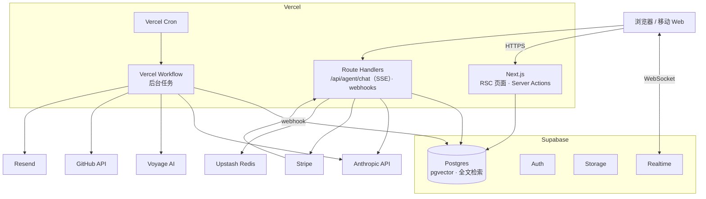
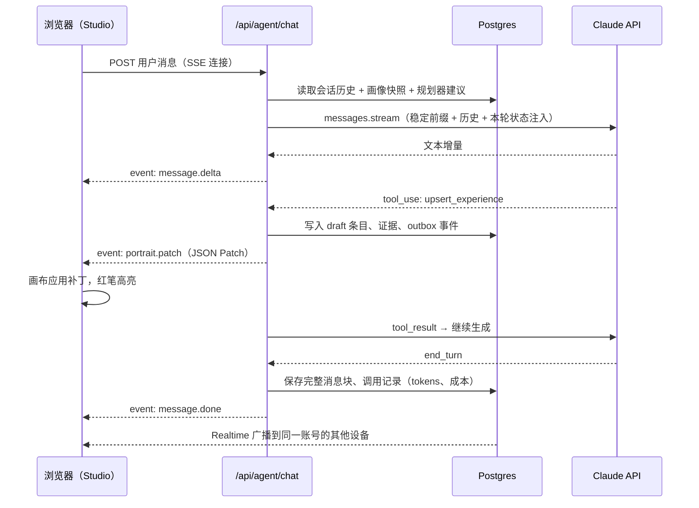
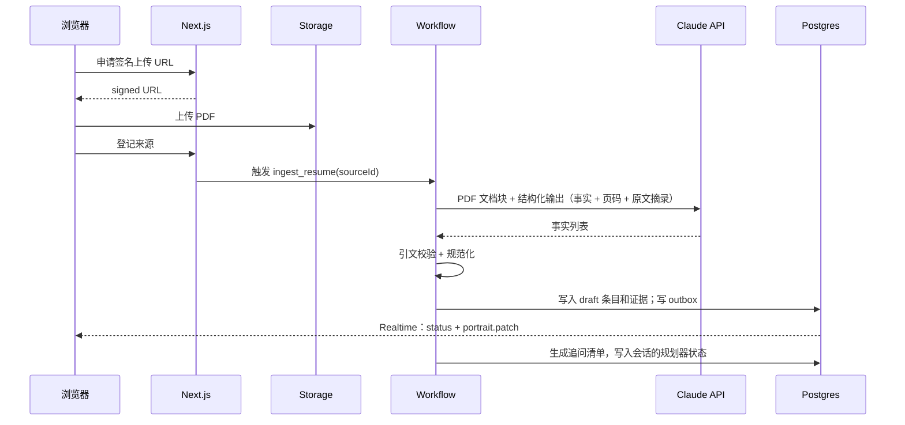
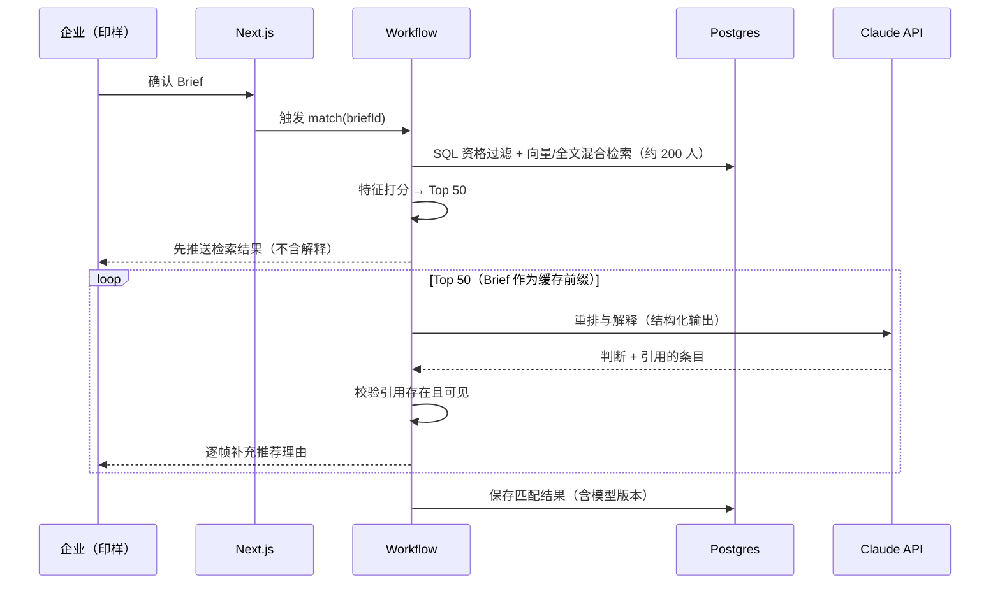
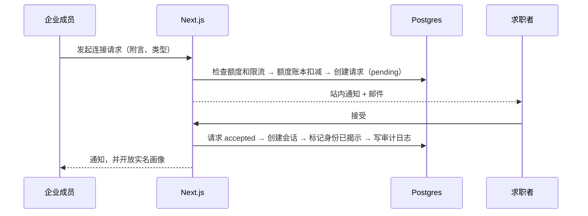
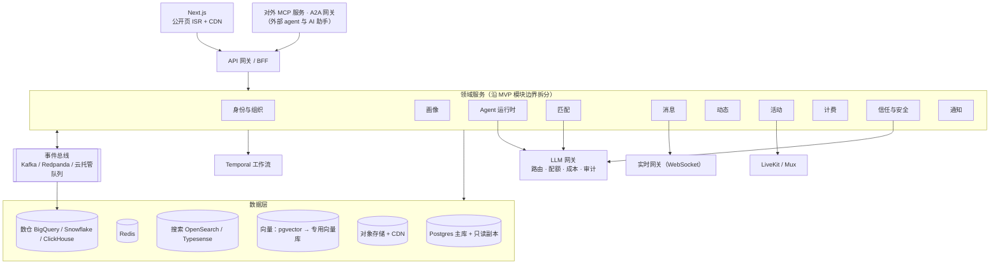

# 技术架构与后端方案

| 项 | 内容 |
|---|---|
| 版本 | v0.3（草案） |
| 日期 | 2026-10-19 |
| 关联 | [PRD](PRD.md) · [Agent 设计](agent-design.md) · [前端设计简报](design-brief.md) |

目标：**MVP 用 Vercel 快速上线，但从第一天起按"以后会变成大产品"的方式划分边界**，让规模化时是"拆分"而不是"重写"。

---

## 1. 架构原则

1. **快，但不欠结构性技术债。** 先做模块化单体：领域边界清晰，以后沿边界拆服务。
2. **标准优先、可移植。** 标准 Postgres、S3 兼容存储、OpenTelemetry；所有供应商特性都包在我们自己的接口后面。
3. **事件驱动的种子。** 从第一天就有 outbox 表，关键领域事件都写进去，由后台任务消费；以后接消息总线时只换消费端。
4. **隐私即架构。** 匿名数据物理隔离，敏感字段加密，权限在服务端，关键访问有审计。
5. **AI 可评测、可观测。** 每次模型调用都有记录；提示词和模型的改动必须过评测。

---

## 2. MVP 技术栈

| 层 | 选择 | 理由 | 规模化后 |
|---|---|---|---|
| Web 与 BFF | Next.js（App Router）+ TypeScript，部署在 Vercel | 一体化开发；每个 PR 自动预览；公开画像页用 ISR + CDN | 保留（Vercel 或自托管） |
| UI | React + Tailwind CSS（令牌用 CSS 变量，OKLCH）+ Radix 或 React Aria 无障碍原语 + Motion | 原语保证无障碍，视觉完全自定义（避免默认组件库的模板感） | 沉淀为 `packages/ui` 设计系统 |
| 大模型 | Anthropic API，官方 TypeScript SDK `@anthropic-ai/sdk`；默认 Claude Opus 5.5 | 工具调用、结构化输出、长上下文、提示词缓存、Batch API | 内部 LLM 网关服务 |
| 向量 | Voyage AI 多语言 embedding 模型（Anthropic 自己不提供 embedding） | 中英双语检索 | 接口可替换 |
| 数据库 | Supabase Postgres + pgvector + 全文检索（tsvector / pg_trgm） | 一个服务同时提供数据库、认证、存储、实时；支持 RLS | Aurora / AlloyDB 或 Supabase 企业版；读写分离 |
| ORM 与迁移 | Drizzle ORM + drizzle-kit | 类型安全、贴近 SQL、可移植 | 保留 |
| 认证 | Supabase Auth：Google、LinkedIn（OIDC）、GitHub、邮箱验证码 | 与 RLS 集成 | 另加 WorkOS 支持企业 SSO/SAML |
| 文件 | Supabase Storage（S3 兼容）+ 签名 URL | 简历、图片 | S3 / R2 + CDN |
| 实时 | Supabase Realtime | 消息、在线状态、多设备画像同步；免运维 | 独立 WebSocket 网关 |
| 后台任务 | Vercel Workflow（持久化步骤，可重试）+ Vercel Cron；备选 Inngest | 简历解析、链接抓取、向量化、匹配、通知 | Temporal 或托管队列 |
| 缓存与限流 | Upstash Redis + `@upstash/ratelimit` | 适合 serverless | Redis 集群 |
| 邮件 | Resend + React Email | 开发体验好 | 保留，或换 SES |
| 支付 | Stripe Billing + Checkout + Customer Portal | 订阅与额度 | 保留 |
| 会议 | MVP 用外部会议链接（Zoom、Google Meet）；可选用 Daily 等 API 自动生成房间 | 不自建音视频 | LiveKit / Mux 原生直播与视频 |
| 产品分析 | PostHog（事件、漏斗、特性开关、会话回放，回放默认遮罩所有输入和画像内容） | 一站式 | 另加数仓 |
| 错误与性能 | Sentry；Vercel Speed Insights | | Datadog 或 Grafana 栈 |
| LLM 观测 | `model_calls` 表 + OpenTelemetry（Anthropic SDK 支持）→ Langfuse 等追踪后端 | 成本、延迟、拒答、工具错误 | LLM 网关统一采集 |
| 内容审核 | Claude 分类 + 规则 + 人工队列 | | 独立的信任与安全服务 |
| 搜索 | Postgres 全文检索 + pgvector（HNSW 索引） | MVP 规模足够 | OpenSearch / Typesense + 专用向量库 |
| 防机器人 | Cloudflare Turnstile 或 Vercel BotID（保护未登录对话） | 未登录即可对话，必须防刷 | 保留 |
| 身份核验（P2） | 第三方服务（如 Stripe Identity） | 内推订阅防冒用身份 | 保留 |

---

## 3. 系统总览



---

## 4. 关键流程

### 4.1 一轮对话 → 右侧画像实时更新



### 4.2 简历摄取



### 4.3 匹配



### 4.4 连接请求与身份揭示



---

## 5. 代码仓库结构

pnpm workspaces + Turborepo 的单仓：

```text
.
├── apps/
│   └── web/                 # Next.js：公开页、求职者端、企业端、运营后台
│       └── app/
│           ├── (public)/    # /, /@[handle], /c/[slug], /e/[id], /p/[id], /pricing
│           ├── (talent)/    # /studio, /feed, /events, /inbox, /settings
│           ├── (company)/   # /hire, /company, ...
│           ├── admin/
│           └── api/         # agent/chat（SSE）、webhooks、uploads ...
├── packages/
│   ├── agent/               # 提示词、工具 schema（zod）、规划器、Page Spec schema、匿名化、重排
│   ├── core/                # 领域服务：portrait / company / matching / messaging / feed / events / billing / trust / growth / insider / referral / reviews
│   ├── db/                  # Drizzle schema、迁移、种子数据、RLS 策略
│   ├── ui/                  # 设计系统：令牌、组件（Claude Design /design-sync 的落点）
│   ├── emails/              # React Email 模板
│   └── config/              # tsconfig、eslint、tailwind 预设
├── evals/                   # 评测数据集与脚本
├── docs/                    # PRD、设计简报、架构
└── .impeccable/             # Impeccable 共享配置与评审记录
```

P2 起新增 `apps/mcp-server/`（对外 MCP 服务）和 A2A 网关，见 8.4。

**边界规则**（为以后拆服务做准备）：

- `apps/web` 只调用 `packages/core` 暴露的服务，不直接写 SQL。
- `core` 内各领域模块之间只通过函数接口和 outbox 事件交互，**不跨模块读表**。
- `packages/agent` 的工具通过 `core` 的接口读写数据，自己不持有数据库连接。

---

## 6. 数据模型

主键统一用 UUIDv7（按时间有序）；所有表带 `created_at`、`updated_at`；企业数据带 `company_id`；删除先软删除，再按策略硬删除。

### 6.1 身份与组织

| 表 | 关键字段 |
|---|---|
| `users` | id、auth_user_id、email、locale、timezone、deleted_at |
| `talent_profiles` | id、user_id、handle、display_name、pronouns、visibility_mode、index_opt_in、published_page_version |
| `aliases` | id、user_id、name（**随机生成**）、context_tags[] |
| `companies` | id、slug、name、domain、website、stage、size_band、verification_status、verified_at、page_spec、accent_hue |
| `company_members` | company_id、user_id、role（owner / admin / member） |

### 6.2 画像

| 表 | 关键字段 |
|---|---|
| `sources` | id、talent_id、type（chat / resume / link / github / post …）、uri、storage_path、status、text_snapshot、captured_at |
| `claims` | id、talent_id、layer、kind、statement、data（jsonb）、basis、confidence、status（draft / confirmed / verified / disputed / rejected）、visibility、sensitive、pinned、created_by、supersedes |
| `evidence` | id、claim_id、source_id、locator（jsonb）、quote、captured_at |
| `artifacts` | id、talent_id、kind、url、title、media（jsonb）、claim_id |
| `preferences` | talent_id、roles[]、domains[]、stages[]、locations[]、remote、start_date、employment_types[]、sponsorship（加密）、comp_min（加密）、deal_breakers[] |
| `skills` | id、name_en、name_zh、aliases[]、category、parent_id（技能词表） |
| `page_versions` | id、talent_id、version、spec（jsonb）、status（draft / published）、created_by |
| `anonymous_portraits` | talent_id、version、content（jsonb）、risk_report（jsonb）、generated_at —— **企业端读取匿名候选人的唯一数据源** |
| `evidence_units` | id、talent_id、unit_type、unit_id、text、lang、embedding（vector）、visibility —— 不含 `sensitive` 条目 |

### 6.3 Agent

| 表 | 关键字段 |
|---|---|
| `conversations` | id、owner_type（user / company）、owner_id、purpose（companion / onboarding / brief / insider …）、status、planner_state（jsonb）—— 用户看到的连续对话 |
| `conversation_segments` | id、conversation_id、model、seed_summary、started_at、ended_at —— API 层面的会话段（见 agent-design 11.3） |
| `conversation_messages` | id、segment_id、role、content（jsonb，**保存完整的 API 内容块**）、page_context（jsonb）、created_at |
| `model_calls` | id、conversation_id、route、model、effort、input_tokens、output_tokens、cache_read_tokens、cache_write_tokens、cost_usd、latency_ms、stop_reason、error |

> 会话历史**只追加、不修改**，并原样保存模型返回的内容块（包括 thinking 块），下一轮原样回传。新一代模型的 thinking 块与所在会话绑定，改写历史会导致请求被拒绝，也会让缓存失效。每轮的画像快照用"对话中的 system 消息"追加，而不是改写旧消息。

### 6.4 企业与匹配

| 表 | 关键字段 |
|---|---|
| `briefs` | id、company_id、title、spec（jsonb）、status、visibility、created_by |
| `brief_embeddings` | brief_id、req_index、embedding |
| `matches` | id、brief_id、talent_id、stage_scores（jsonb）、llm_verdict（jsonb）、final_score、explanation（jsonb）、model_version、status、computed_at |
| `match_feedback` | id、match_id、user_id、action（circle / strike / contact …）、reason |
| `profile_views` | id、viewer_company_id、viewer_user_id、talent_id、context |

### 6.5 连接

| 表 | 关键字段 |
|---|---|
| `connection_requests` | id、company_id、sender_user_id、talent_id、brief_id、post_id、kind（chat / coffee_chat）、note、status、expires_at、credit_entry_id、responded_at |
| `threads` / `thread_participants` | thread_id、user_id、company_id、identity_revealed、last_read_at |
| `messages` | id、thread_id、sender_user_id、body、attachments（jsonb）、deleted_at —— 规模化时按月分区 |
| `availability_rules` / `office_hours` | 每周时段规则、时区、每周容量 |
| `coffee_chats` | id、thread_id、host_user_id、guest_user_id、company_id、proposed_slots（jsonb）、scheduled_start、duration_min、meeting_url、status、feedback（jsonb） |

### 6.6 动态与活动

| 表 | 关键字段 |
|---|---|
| `posts` | id、author_user_id、author_mode（real / alias / company）、alias_id、company_id、kind、body、media、link_preview、tags[]、moderation_status |
| `post_reactions` / `comments` / `follows` | 常规字段；评论同样支持 author_mode 和 alias_id |
| `events` / `event_series` | type、title、description、agenda、starts_at、ends_at、timezone、capacity、meeting_url、cover、tags[]、visibility、status；系列用 rrule |
| `event_rsvps` | event_id、user_id、status、share_portrait（默认 false） |
| `event_questions` | id、event_id、author_user_id、alias_id、body、votes |

> 化名与实名的关联只存在于 `aliases.user_id`，对外接口永远不返回该字段，只供审核使用。

### 6.7 计费与平台

| 表 | 关键字段 |
|---|---|
| `plans` | id、audience（talent / company / insider）、name、price_cents、interval、quotas（jsonb）、stripe_price_id |
| `subscriptions` | id、owner_type、owner_id、plan_id、stripe_customer_id、stripe_subscription_id、status、current_period_end |
| `credit_ledger` | id、owner_type、owner_id、delta、reason、ref_type、ref_id —— 只追加，余额 = 求和 |
| `notifications` | id、user_id、kind、payload、read_at |
| `consents` | user_id、kind、version、granted_at、revoked_at |
| `reports` / `blocks` | 举报与屏蔽 |
| `audit_logs` | actor_user_id、actor_company_id、action、target_type、target_id、metadata |
| `outbox` | id、topic、aggregate_id、payload、created_at、processed_at |

### 6.8 求职陪伴、在职者、内推与评价

| 表 | 关键字段 |
|---|---|
| `resumes` | id、talent_id、target_role、version、file_path、generated_from_page_version |
| `growth_plans` | id、talent_id、target_role、items（jsonb：类型、目标、完成标准、状态、截止时间）、updated_at |
| `market_insights` | role_family、signal、company_count、brief_count、share、window —— 聚合表；`company_count < 5` 的行不对外 |
| `insider_profiles` | user_id、company_id、title、team_area、topics[]、open_to_refer、monthly_chat_capacity、verified_via（work_email / document）、verified_at、expires_at |
| `employment_verifications` | id、user_id、method、evidence_path（加密）、status、reviewed_by、reviewed_at |
| `referral_profiles` | insider_user_id、roles、signals（jsonb）—— 在职者的"内推画像" |
| `vetting_cases` | id、talent_id、status（pending / needs_info / approved / rejected）、checks（jsonb：学籍、经历、技能、工作许可、身份）、reviewer_id、completed_at |
| `referral_packs` | id、talent_id、version、target_roles[]、resume_id、blurb、top_evidence[]、status |
| `referral_requests` | id、talent_id、insider_user_id、initiated_by、company_id、role、status（requested / accepted / chatted / referred / declined / expired）、referred_at、outcome |
| `reviews` | id、coffee_chat_id、reviewer_user_id、reviewee_user_id、reviewer_role（insider / talent）、overall（1–5）、dimensions（jsonb）、comment、flagged_claim_ids[]、status（pending / published / hidden / appealed）、submitted_at、published_at |
| `review_appeals` | id、review_id、appellant_user_id、reason、status、resolved_by |
| `integrity_scores` | user_id、display_score、review_count、distribution（jsonb）、penalties（jsonb）、updated_at —— 由评价计算的物化视图 |

### 6.9 索引与权限

- `evidence_units.embedding`、`brief_embeddings.embedding`：HNSW 索引（余弦距离）。
- 条目陈述、动态正文：tsvector + GIN 全文索引。
- 部分索引：只包含"可被发现"的求职者，加速资格过滤。
- **权限**：浏览器端只用于读写本人数据，由 RLS 保护；跨租户读取（企业看画像、匹配）只走服务端，在 `core` 服务层显式授权并写审计日志；RLS 作为第二道防线。

---

## 7. 接口与实时协议

### 7.1 主要接口

| 接口 | 说明 |
|---|---|
| `POST /api/agent/chat` | 常驻对话（求职者、在职者、企业共用，按会话类型加载不同的提示词和工具；请求带上当前页面上下文）；SSE 流式返回 |
| `POST /api/uploads` | 申请签名上传 URL；上传后登记来源并触发摄取 |
| `GET /@[handle]` | 公开画像页（RSC + ISR，发布时按需重新验证） |
| `POST /api/portrait/publish` | 发布（需用户确认） |
| `POST /api/briefs`、`GET /api/briefs/:id/matches` | Brief 与匹配结果（匹配进度通过 Realtime 推送） |
| `POST /api/matches/:id/feedback` | 圈选、划掉、原因 |
| `POST /api/connections`、`PATCH /api/connections/:id` | 发起、接受、婉拒连接请求 |
| `GET / POST /api/threads/:id/messages` | 消息 |
| `POST /api/coffee-chats`、`PATCH /api/coffee-chats/:id` | 提议、确认、改期、取消、反馈 |
| `GET / POST /api/posts` 及互动接口 | 动态 |
| `GET / POST /api/events`、`POST /api/events/:id/rsvp` | 活动 |
| `POST /api/billing/checkout`、`POST /api/webhooks/stripe` | 支付 |
| `POST /api/reports` | 举报 |
| `POST /api/resume` | 由画像生成简历 PDF（可指定岗位） |
| `GET / PATCH /api/grow/plan` | 成长计划 |
| `POST /api/insider/verify` | 在职者验证（公司邮箱或证明文件） |
| `GET /api/insider/recommendations` | 在职者推荐（付费） |
| `POST /api/referrals/subscribe`、`GET /api/referrals/vetting` | 内推订阅、核验进度 |
| `POST /api/referral-requests`、`PATCH /api/referral-requests/:id` | 内推相关的 coffee chat 请求、"已内推"标记 |
| `POST /api/reviews`、`POST /api/reviews/:id/appeal` | 评价与申诉 |

表单类修改优先用 Server Actions；流式和 webhook 用 Route Handlers。所有输入用 zod 校验，schema 前后端共享。

### 7.2 对话的 SSE 事件

| 事件 | 载荷 | 前端行为 |
|---|---|---|
| `message.delta` | `{ text }` | 追加到当前回复 |
| `message.done` | `{ messageId }` | 结束流式状态 |
| `status` | `{ label, progress? }` | 更新等宽状态行（"Reading résumé · page 2 of 2"） |
| `portrait.patch` | `{ ops: JSONPatch[], claimIds, note }` | 应用到画布、红笔高亮、写页边批注 |
| `page.patch` | `{ ops: JSONPatch[] }` | 更新 Page Spec |
| `ui.ask` | `{ questionId, kind, options }` | 渲染选项卡片，回答作为下一条用户消息 |
| `ui.upload` | `{ accept, purpose }` | 渲染上传控件 |
| `ui.options` | `{ field, candidates[] }` | 渲染备选（如三个标题） |
| `ui.warning` | `{ target, risk, message }` | 页边红笔提示 |
| `ui.confirm` | `{ action, summary }` | 确认对话框（如发布） |
| `plan.patch` | `{ ops: JSONPatch[] }` | 更新成长计划 |
| `ui.file` | `{ kind, url }` | 展示生成的文件（如简历 PDF） |
| `error` | `{ code, retryable, message }` | 错误提示，保留用户输入 |

- 每个事件带递增序号；断线后带 `Last-Event-ID` 重连。进行中的回合状态保存在服务端，刷新页面后可以续上或拿到最终结果。
- 在 Vercel 上为 `/api/agent/chat` 配置足够的 `maxDuration`（以当前套餐上限为准）；简历解析、匹配这类长任务一律放进 Workflow，不占用对话请求。

---

## 8. 规模化演进路线

### 8.1 三个阶段

| 阶段 | 规模（参考） | 触发信号 | 主要变化 |
|---|---|---|---|
| A：MVP | 0 → 约 5 千月活 | — | 第 2 节的全部；模块化单体 + Workflow |
| B：PMF | 约 5 千 → 10 万月活 | 对话 p95 延迟上升；后台任务积压；数据库 CPU 持续高于 60%；工程师超过 5 人；企业客户要求 SSO | Agent 运行时、摄取、匹配迁到容器服务（Cloud Run、ECS 或 Fly.io），长连接和长任务不受 serverless 限制；引入 Temporal 或托管队列；Postgres 读副本 + 连接池；独立搜索索引（通过 CDC 同步）；数仓 + dbt；实验平台；WorkOS 企业 SSO；SOC 2 Type I |
| C：规模化 | 10 万 → 百万级月活 | 单库写入瓶颈；团队按领域分组；多区域需求 | 按模块边界拆成领域服务 + 事件总线；消息表分区（必要时迁到宽表存储）；独立实时网关；原生直播与视频；学习排序模型 + 特征平台；LLM 网关；多区域只读；SOC 2 Type II、GDPR 工具、数据驻留；容灾目标 RPO ≤ 5 分钟、RTO ≤ 1 小时 |

### 8.2 目标架构（阶段 C）



### 8.3 第一天就要做对的决定（让规模化变便宜）

1. **模块化单体**：`packages/core` 按领域划分，模块间只走接口和 outbox 事件，不跨模块读表。
2. **Outbox 表**：画像更新、连接请求、发帖、报名等关键事件都写 outbox，由 Workflow 消费；以后换 Kafka 只换消费端。
3. **标准 Postgres + Drizzle 迁移**：业务逻辑不依赖 Supabase 专有 API；认证、存储、实时都包一层接口。
4. **认证抽象**：我们自己的 `users` 表以认证提供方的 user id 为外键；换提供方时只迁移映射。
5. **S3 兼容存储接口**。
6. **LLM 调用集中封装**在 `packages/agent`：统一记录成本、重试、fallback、评测钩子；以后演进为 LLM 网关服务。
7. **向量检索封装在接口后面**：pgvector 起步，以后可换专用向量库。
8. **UUIDv7 主键**、软删除、审计字段。
9. **企业数据都带 `company_id`**，多租户边界从第一天就清楚。
10. **后台任务幂等**：每个任务有幂等键，可安全重放。
11. **公开画像页走 ISR + 按需重新验证**：读多写少，天然适合 CDN，规模化成本很低。
12. **特性开关**从第一天就有（PostHog）。

### 8.4 开放生态的架构预留（MCP、技能、Agent 协作）

PRD 7.17 是 P2，但 MVP 阶段就把扩展点留好：

| 现在就做 | 为什么 |
|---|---|
| 统一的工具注册表 + 权限与确认模型（只读 / 写入 / 对外发送 / 付费），内部工具也走这套 | 以后接 MCP 工具、技能时不用改 agent 主循环 |
| 确认由独立的策略层执行：按动作的风险等级和用户的预先授权，决定自动执行、拦截或请求确认 | 不让模型自己决定要不要问用户；低风险动作免确认，避免用户习惯性点"同意" |
| `core` 的领域服务接口清晰、带权限检查 | 以后可以几乎原样包装成对外的 MCP 工具 |
| 审计日志覆盖所有工具调用 | 外部 agent 接入后，每一步都可追溯、对本人可见 |
| 第三方凭据统一放进加密保管（Vault / KMS） | 连接器的 OAuth 令牌有地方安全存放、可以撤销 |

P2 新增的组件：

| 组件 | 说明 |
|---|---|
| `apps/mcp-server` | 对外 MCP 服务（远程、OAuth 授权），开放画像、成长计划、收件箱、人才搜索（企业权限）等工具 |
| MCP 客户端代理 | 后端代理外部 MCP 服务的调用，统一门控、确认、审计；只读低风险的服务也可以直接用 Claude API 的 MCP connector |
| A2A 网关 | 与外部 agent 对话协作：发布 agent 能力说明、管理协作任务的状态、执行用户的委托规则 |
| `packages/agent/skills/` | 技能目录，格式兼容 Agent Skills 规范（`SKILL.md`） |

P2 新增的数据表：

| 表 | 关键字段 |
|---|---|
| `connections` | id、user_id、provider、scopes[]、token_ref（指向加密保管）、status、created_at、revoked_at |
| `agent_skills` | id、name、version、source（first_party / third_party）、review_status、enabled_for |
| `external_agents` | id、owner_type、owner_id、name、agent_card_url、verified、scopes[]、status |
| `delegation_policies` | user_id、can_share（jsonb）、can_commit（jsonb）、must_ask（jsonb） |
| `agent_interactions` | id、conversation_id、external_agent_id、transcript_ref、outcome、created_at |

---

## 9. 成本模型

### 9.1 MVP 固定成本（量级参考，以各家官网为准）

| 项目 | 起步费用（约） |
|---|---|
| Vercel Pro | $20 / 成员 / 月 + 用量 |
| Supabase Pro | $25 / 月 + 计算与用量 |
| Upstash Redis | 按量计费，起步接近 $0 |
| Resend | 免费额度起步，之后约 $20 / 月 |
| PostHog、Sentry | 免费额度起步 |
| Stripe | 按交易抽成 |

### 9.2 大模型变动成本

当前价格（Anthropic 一方 API，2026 年 10 月）：

| 模型 | 输入（$/百万 token） | 输出（$/百万 token） | 备注 |
|---|---|---|---|
| Claude Opus 5.5 | 4.00 | 20.00 | 缓存读取 $0.20/百万 |
| Claude Sonnet 5.5 | 2.00 | 10.00 | |
| Claude Haiku 5.5 | 0.10 | 0.50 | 提示词 ≤ 10 万 token 时的价格 |

按默认的 Claude Opus 5.5 估算：

| 场景 | 估算 | 主要省钱手段 |
|---|---|---|
| 一次完整建档（约 20 轮对话 + 简历解析 + 画像合成 + 匿名化） | 约 $0.5–1.5 / 人 | 系统提示词和工具定义作为稳定前缀缓存；对话 effort 设为 medium 或更低 |
| 每周一次更新 | 约 $0.05–0.2 / 人 | 新会话从画像摘要起步，不带全部历史 |
| 一次匹配（50 人重排 + 解释） | 约 $0.5–1.2 / 次 | Brief 作为缓存前缀；夜间刷新走 Batch API（价格减半） |
| 一条动态审核 | < $0.01 | effort 设为 low |
| 一次成长建议（含联网搜索） | 约 $0.05–0.3 / 次 | 联网搜索另按次计费；常见岗位的聚合统计预先算好 |
| 一份内推包 | 约 $0.1–0.3 / 份 | 低频 |
| 每周在职者推荐 | 约 $0.1–0.3 / 位在职者 | 走 Batch API |

- 估算假设：每轮对话新增约 1–2K token 输入、约 0.8K token 输出（含思考）；匹配每位候选人约 2K token 未缓存输入、约 0.7K token 输出。
- 上线后以 `model_calls` 表的真实用量为准建看板：每份画像成本、每次匹配成本、缓存命中率。
- 是否把调用量大的路由（审核、重排）换成 Claude Sonnet 5.5 或 Claude Haiku 5.5，由团队根据评测结果决定；同一会话内不切换模型（缓存按模型隔离）。

---

## 10. 安全、隐私与合规实现

| 方面 | 做法 |
|---|---|
| 鉴权 | 服务端会话；每个接口在服务层校验"谁在访问哪个资源"；RLS 作为第二道防线 |
| Agent 工具 | 执行者身份由服务端决定，模型无法指定"别人"；企业端工具只能读到可发现的、匿名化或已授权的数据 |
| 匿名隔离 | `anonymous_portraits` 独立存储；企业端按候选人的可见性模式选择数据源；接口测试断言响应中不含身份字段 |
| 加密 | 传输 TLS；托管服务的静态加密；签证、薪资、联系方式等敏感字段做应用层信封加密，密钥放在 Supabase Vault（MVP）或 KMS |
| 文件 | 校验类型和大小；PDF 在隔离环境解析；图片重新编码并去除 EXIF（含定位）；P1 增加恶意文件扫描 |
| 反滥用 | 未登录对话防机器人；按 IP、用户、公司分别限流 |
| 审计 | 企业查看画像、身份揭示、数据导出、后台操作全部写入 `audit_logs` |
| 数据生命周期 | 导出（JSON + PDF）；删除在 30 天内完成，覆盖向量、匿名版和缓存，备份按轮转周期过期；聊天记录保留策略可配置 |
| 合规文件 | 隐私政策、服务条款、社区规范、AI 使用告知 |
| 合规审查 | 自动化招聘工具相关法规（如纽约市 Local Law 144）、隐私法规（如 CCPA）、公开职位的薪资透明法规、诚信分与 FCRA、各公司的内推政策；仅限 18 岁以上 |
| 内推与付款 | 求职者与在职者之间没有付款通道；消息中的付款请求会被识别并提醒；条款明确禁止 |
| 评价 | 只能在真实 coffee chat 之后提交；双盲公开；文字审核；申诉流程；评价者信誉加权 |
| 企业数据 | 成长建议只读聚合表 `market_insights`，低于样本门槛的行不对外 |
| 核验材料 | 证明文件单独加密存储，核验完成后按保留期删除，只保留核验结果 |
| 外部 agent 与连接器（P2） | 外部内容当作不可信数据；按授权范围最小化访问；令牌加密保存、可撤销；企业 agent 必须属于已验证公司；所有交互可审计、对本人可见 |
| 安全开发 | 依赖与密钥扫描；参照 OWASP ASVS L2 的检查表；P1 上线前做渗透测试 |

---

## 11. 可观测性、环境与 CI/CD

- **环境**：本地（Supabase CLI 本地栈）→ 预览（每个 PR 一个 Vercel 预览部署 + Supabase 分支数据库）→ 生产。
- **CI（GitHub Actions）**：类型检查、lint、单元测试（Vitest）、关键流程端到端测试（Playwright，覆盖 PRD 的流程 A–D）、`npx impeccable detect`（反模式扫描，发现主要问题时失败）、agent 评测（PR 跑冒烟集，每晚跑全量）、数据库迁移检查。
- **部署**：合并到主分支后自动部署；生产数据库迁移需要人工批准。
- **监控**：Sentry（错误）、Vercel Speed Insights（Web Vitals）、PostHog（产品分析与特性开关）。
- **LLM 观测**：`model_calls` 表 + OpenTelemetry 追踪；看板包括每份画像成本、缓存命中率、拒答率、延迟分位、工具调用错误率。
- **告警**：错误率、对话失败率、队列积压、成本日环比异常。
